|  |
| --- |
| **BỘ XÂY DỰNG**  **HỌC VIỆN HÀNG KHÔNG VIỆT NAM**  **KHOA CÔNG NGHỆ THÔNG TIN**  ****    **XÂY DỰNG ỨNG DỤNG**  **THƯƠNGMẠI ĐIỆN TỬ**  **Xây dựng ứng dụng thương mại điện tử Soopi**  **Giảng viên hướng dẫn: ThS. Huỳnh Thanh Sơn**  **Nhóm sinh viên thực hiện: Nhóm 06**  **Mã số sinh viên:**  **Lớp: 010100096703**  **TP.Hồ Chí Minh, tháng 11/2026** |
| **BỘ XÂY DỰNG**  **HỌC VIỆN HÀNG KHÔNG VIỆT NAM**  **KHOA CÔNG NGHỆ THÔNG TIN**  ****    **XÂY DỰNG ỨNG DỤNG**  **THƯƠNGMẠI ĐIỆN TỬ**  **Xây dựng ứng dụng thương mại điện tử Soopi**  **Giảng viên hướng dẫn: ThS. Huỳnh Thanh Sơn**  **Nhóm sinh viên thực hiện: Nhóm 06**  **Mã số sinh viên:**  **Lớp: 010100096703**  **Thành phố Hồ Chí Minh, tháng 11/2026** |

**Danh sách Nhóm:**

|  |  |  |  |  |
| --- | --- | --- | --- | --- |
| **STT** | **Họ và tên** | **MSSV** | **Lớp** | **Ghi chú** |
| 1 | Quách Khải Hậu | 2431540107 | 24ĐHTT02 | Nhóm Trưởng |
| 2 | Lê Hồ Hoàng Long | 2431540106 | 24ĐHTT02 |  |
| 3 | Trần Quang Long | 2431540097 | 24ĐHTT02 |  |
| 4 | Trịnh Huỳnh Nam Sơn | 2431540088 | 24ĐHTT02 |  |
| 5 | Trần Ngọc Trí | 2431540008 | 24ĐHTT01 |  |

|  |  |
| --- | --- |
| **Cán bộ chấm thi 1**  *(ký và ghi rõ họ tên)* | **Cán bộ chấm thi 2**  *(ký và ghi rõ họ tên)* |
| **Cán bộ chấm thi phúc khảo 1**  *(ký và ghi rõ họ tên)* | **Cán bộ chấm thi phúc khảo 2**  *(ký và ghi rõ họ tên)* |

**DANH MỤC CÁC KÝ HIỆU, CHỮ VIẾT TẮT**

|  |  |
| --- | --- |
| **Ký hiệu, chữ viết tắt** | **Chữ viết đầy đủ** |
|  |  |
|  |  |
|  |  |
|  |  |
|  |  |

**MỤC LỤC**

# *Trang*

# Danh mục các ký hiệu, chữ viết tắt

# Danh mục các bảng, hình vẽ, đồ thị

# **MỞ ĐẦU:**

## **CHƯƠNG 1:….**

# **1.1.**

## ***1.1.1.***

## ***1.1.2.***

# **1.2.**

## ***1.2.1..***

## ***1.2.2.***

# **1….**

## **CHƯƠNG 2:….**

# **2.1.**

# **….**

## **CHƯƠNG 3:….**

# **KẾT LUẬN**

# **DANH MỤC TÀI LIỆU THAM KHẢO**

# **PHỤ LỤC**

**MỞ ĐẦU**

Giới thiệu tổng quan về đề tài, viết ngắn ngọn, rõ nội dung.

**CHƯƠNG 1. GIỚI THIỆU**

* 1. **Lý do chọn đề tài**

Sự phát triển mạnh mẽ của Internet, thương mại điện tử và các hình thức thanh toán trực tuyến đã làm thay đổi đáng kể thói quen mua sắm của người tiêu dùng. Các phương thức mua bán truyền thống ngày càng bộc lộ nhiều hạn chế về thời gian, khả năng tiếp cận sản phẩm và sự thuận tiện trong quá trình thanh toán. Đặc biệt, khi số lượng người mua, người bán, sản phẩm và đơn hàng ngày càng tăng, việc quản lý dữ liệu và xử lý giao dịch cần được thực hiện trên một hệ thống tập trung, đồng thời hỗ trợ thanh toán điện tử để nâng cao tính tiện lợi cho người dùng.

Từ thực tiễn đó, nhóm chọn đề tài “Xây dựng ứng dụng thương mại điện tử Soopi” theo kiến trúc client-server: giao diện website ReactJS kết hợp máy chủ backend Node.js/Express và cơ sở dữ liệu MongoDB để xử lý nghiệp vụ và lưu trữ dữ liệu tập trung. Hệ thống mô phỏng quy trình mua bán trực tuyến với ba tác nhân chính gồm Người dùng, Người bán và Quản trị viên, hỗ trợ các chức năng như đăng ký, đăng nhập, xem và tìm kiếm sản phẩm, quản lý giỏ hàng, đặt hàng, theo dõi trạng thái đơn hàng, đánh giá sản phẩm và thanh toán trực tuyến qua VNPay; đồng thời cho phép người bán quản lý sản phẩm, xử lý đơn hàng và quản trị viên quản lý hoạt động chung của hệ thống. Qua đó, đề tài giúp nhóm củng cố kỹ năng xây dựng ứng dụng web, phát triển backend, quản lý cơ sở dữ liệu và tích hợp cổng thanh toán trực tuyến vào một hệ thống thương mại điện tử có tính thực tế.

* 1. **Mục tiêu đề tài**

Đề tài xây dựng hệ thống thương mại điện tử Soopi hoàn chỉnh gồm giao diện website và máy chủ backend, cho phép người dùng thực hiện toàn bộ quy trình mua sắm trực tuyến một cách thuận tiện, đồng thời hỗ trợ người bán quản lý hoạt động kinh doanh và cho phép quản trị viên quản lý dữ liệu của toàn hệ thống.

Kết quả cần đạt được:

Về hệ thống ứng dụng: Xây dựng hoàn chỉnh website thương mại điện tử với đầy đủ chức năng cho ba nhóm tác nhân chính. Đối với Người dùng, hệ thống hỗ trợ đăng ký/đăng nhập, quản lý thông tin cá nhân, xem và tìm kiếm sản phẩm, lọc sản phẩm theo danh mục, xem chi tiết sản phẩm, quản lý giỏ hàng, đặt hàng, thanh toán trực tuyến qua VNPay, theo dõi trạng thái đơn hàng và đánh giá sản phẩm. Đối với Người bán, hệ thống hỗ trợ quản lý cửa hàng, thêm/sửa/xóa sản phẩm, quản lý số lượng sản phẩm và xử lý các đơn hàng thuộc cửa hàng. Đối với Quản trị viên, hệ thống hỗ trợ quản lý người dùng, người bán, danh mục sản phẩm, sản phẩm và các dữ liệu liên quan của toàn hệ thống.

Về công nghệ: Nghiên cứu, thiết kế và triển khai thành công hệ thống theo kiến trúc client-server, trong đó giao diện website sử dụng ReactJS, phía backend sử dụng Node.js/Express để xử lý nghiệp vụ và cung cấp RESTful API, đồng thời sử dụng MongoDB để lưu trữ tập trung các dữ liệu như tài khoản, cửa hàng, sản phẩm, giỏ hàng, đơn hàng và đánh giá. Hệ thống đồng thời tích hợp cổng thanh toán VNPay để hỗ trợ thanh toán trực tuyến cho người dùng. Qua quá trình thực hiện, nhóm có thể vận dụng các kiến thức về phát triển giao diện web, xây dựng backend, thiết kế API, quản lý cơ sở dữ liệu và tích hợp thanh toán điện tử vào một sản phẩm thương mại điện tử có tính hoàn chỉnh cao.

**1.3. Phạm vi đề tài**

Phạm vi chức năng: Hệ thống tập trung vào các nghiệp vụ chính của một website thương mại điện tử đa người bán. Đối với Người dùng, hệ thống hỗ trợ đăng ký/đăng nhập, quản lý thông tin cá nhân, xem và tìm kiếm sản phẩm, lọc sản phẩm theo danh mục, xem chi tiết sản phẩm, quản lý giỏ hàng, đặt hàng, thanh toán qua VNPay, theo dõi trạng thái đơn hàng và đánh giá sản phẩm. Đối với Người bán, hệ thống hỗ trợ quản lý cửa hàng, thêm/sửa/xóa sản phẩm, quản lý số lượng sản phẩm và xử lý các đơn hàng thuộc cửa hàng. Đối với Quản trị viên, hệ thống hỗ trợ quản lý người dùng, người bán, danh mục sản phẩm, sản phẩm và các dữ liệu liên quan của toàn hệ thống. Đề tài không xây dựng chức năng giao hàng thực tế và không có tác nhân nhân viên giao hàng; quá trình xử lý đơn chỉ được quản lý thông qua các trạng thái đơn hàng. Hệ thống chỉ mô phỏng giá trị phí vận chuyển để tính tổng đơn hàng và áp dụng voucher Freeship, không tích hợp đơn vị vận chuyển hoặc quy trình giao nhận thực tế. Hệ thống chỉ mô phỏng việc gửi và xử lý yêu cầu đổi trả/khiếu nại giữa Người dùng và Người bán, chưa triển khai cơ chế hoàn tiền tự động.

Phạm vi dữ liệu: Dữ liệu chính của hệ thống gồm tài khoản người dùng, thông tin người bán và cửa hàng, danh mục sản phẩm, sản phẩm, giỏ hàng, đơn hàng, chi tiết đơn hàng, giao dịch thanh toán, chương trình khuyến mãi, voucher, đánh giá sản phẩm, yêu cầu đổi trả/khiếu nại, yêu cầu đăng ký Người bán và dữ liệu trao đổi hỗ trợ giữa Người dùng với Người bán. Dữ liệu được lưu trữ tập trung trên cơ sở dữ liệu MongoDB và được truy xuất thông qua backend. Chức năng thanh toán được tích hợp với VNPay trong môi trường thử nghiệm phục vụ quá trình xây dựng và kiểm thử hệ thống, chưa triển khai cho mục đích thương mại thực tế.

Phạm vi nền tảng: Hệ thống được phát triển dưới dạng website, sử dụng ReactJS để xây dựng giao diện phía người dùng, Node.js/Express để xây dựng backend và MongoDB để lưu trữ dữ liệu. Hệ thống được phát triển và kiểm thử trong môi trường phục vụ học tập, chưa triển khai trên hạ tầng sản xuất có quy mô lớn.

Phạm vi thời gian: Đề tài được thực hiện trong khuôn khổ học kỳ, tập trung vào quá trình phân tích yêu cầu, thiết kế hệ thống, xây dựng các chức năng chính, tích hợp thanh toán VNPay, kiểm thử và hoàn thiện tài liệu báo cáo.

**1.4 Đối tượng nghiên cứu**

Nền tảng ReactJS và phát triển giao diện web: Nghiên cứu cách xây dựng giao diện theo mô hình component, tổ chức các trang chức năng, xử lý sự kiện người dùng, quản lý trạng thái và hiển thị dữ liệu trong quá trình tương tác với hệ thống.

Các thành phần giao diện website thương mại điện tử: Nghiên cứu cách xây dựng các giao diện như danh sách sản phẩm, chi tiết sản phẩm, giỏ hàng, đặt hàng, quản lý cửa hàng và trang quản trị; đồng thời tổ chức bố cục giao diện phù hợp với từng nhóm tác nhân Người dùng, Người bán và Quản trị viên.

Cơ sở dữ liệu MongoDB: Nghiên cứu mô hình dữ liệu dạng document, thiết kế các collection, thực hiện các thao tác CRUD và tổ chức dữ liệu cho các đối tượng chính như tài khoản, cửa hàng, danh mục, sản phẩm, giỏ hàng, đơn hàng và đánh giá.

Kiến trúc client-server và giao tiếp mạng: Xây dựng RESTful API bằng Node.js/Express, thực hiện giao tiếp giữa giao diện ReactJS và backend thông qua HTTP, đồng thời xử lý các nghiệp vụ và truy xuất dữ liệu tập trung tại phía máy chủ.

Cơ chế xác thực và phân quyền: Nghiên cứu cách xác thực tài khoản và phân chia quyền truy cập giữa ba nhóm tác nhân gồm Người dùng, Người bán và Quản trị viên, đảm bảo mỗi tác nhân chỉ có thể thực hiện các chức năng phù hợp với vai trò của mình.

Các dịch vụ tích hợp bên thứ ba: Tích hợp cổng thanh toán VNPay nhằm hỗ trợ người dùng thực hiện thanh toán trực tuyến trong quá trình đặt hàng.

Quy trình nghiệp vụ thương mại điện tử: Mô hình hóa luồng nghiệp vụ từ khi người bán đăng và quản lý sản phẩm, người dùng tìm kiếm và lựa chọn sản phẩm, thêm vào giỏ hàng, tạo đơn hàng, thanh toán qua VNPay, đến khi người bán tiếp nhận và cập nhật trạng thái xử lý đơn hàng.

**1.5. Phương pháp nghiên cứu**

Phương pháp thu thập thông tin: Nhóm thực hiện đọc và tổng hợp tài liệu liên quan đến thương mại điện tử, ReactJS, Node.js/Express, MongoDB và RESTful API; đồng thời tham khảo tài liệu chính thức của các công nghệ được sử dụng và một số nền tảng thương mại điện tử phổ biến như Shopee, Lazada và Tiki để làm cơ sở xây dựng giao diện, xác định chức năng và thiết kế luồng nghiệp vụ cho hệ thống Soopi.

Phương pháp xử lý thông tin:

Định tính: Phân tích yêu cầu chức năng của ba nhóm tác nhân gồm Người dùng, Người bán và Quản trị viên; thiết kế luồng người dùng (user flow), phân tích quy trình mua hàng, quản lý sản phẩm, xử lý đơn hàng và thanh toán; đồng thời đánh giá tính thuận tiện và khả năng sử dụng của các giao diện trong hệ thống.

Định lượng: Đánh giá thời gian phản hồi của các chức năng chính, khả năng truy xuất dữ liệu từ MongoDB và quá trình xử lý các yêu cầu giữa giao diện ReactJS với backend Node.js/Express.

Phương pháp thực nghiệm: Nhóm tiến hành xây dựng website bằng ReactJS, phát triển backend bằng Node.js/Express, sử dụng MongoDB để lưu trữ dữ liệu và tích hợp cổng thanh toán VNPay trong môi trường thử nghiệm. Hệ thống được chạy và kiểm thử trong môi trường phát triển trên máy tính, thực hiện thử nghiệm các luồng nghiệp vụ chính như đăng ký/đăng nhập, quản lý sản phẩm, giỏ hàng, đặt hàng, thanh toán, cập nhật trạng thái đơn hàng và phân quyền giữa các tác nhân nhằm đảm bảo tính ổn định và độ tin cậy của sản phẩm.

**1.6. Bố cục đề tài**

Phần còn lại của báo cáo được tổ chức như sau.

Chương 2

Chương 3 trình bày quá trình phân tích, thiết kế, cài đặt và kiểm thử hệ thống thương mại điện tử Soopi, bao gồm kiến trúc tổng thể của hệ thống, các tác nhân Người dùng, Người bán và Quản trị viên, biểu đồ Use Case, đặc tả chức năng, biểu đồ hoạt động, biểu đồ tuần tự và biểu đồ lớp. Chương cũng trình bày thiết kế cơ sở dữ liệu MongoDB với các collection chính như người dùng, cửa hàng, danh mục, sản phẩm, giỏ hàng, đơn hàng và đánh giá; đồng thời mô tả quá trình cài đặt các chức năng chính như quản lý tài khoản, sản phẩm, giỏ hàng, đặt hàng, xử lý đơn hàng và thanh toán trực tuyến qua VNPay.

**CHƯƠNG 2. CƠ SỞ LÝ THUYẾT**

(Tùy theo các dạng đề tài của MÔN HỌC mà phần chương 2 sẽ có cách trình bày khác nhau. Đây là mẫu dành cho các Đề tài dạng Xây dựng các hệ thống ứng dụng. Sinh viên cần tham khảo sự hướng dẫn của giảng viên hướng dẫn Đề tài)

Sinh viên cần phải viết lời dẫn lý do chọn cơ sở lý thuyết áp dụng cho đề tài. Sau đó mới trình bày từng cơ sở lý thuyết được chọn (phải nêu được lịch sử hình thành và phát triển, khái niệm (định nghĩa), hình ảnh minh họa (nếu có), điểm mạnh, điểm yếu, v.v…)

**2.1. Cơ sở lý thuyết A (ví dụ: 2.1. NodeJS)**

**2.2. Cơ sở lý thuyết B**

**2.3. Cơ sở lý thuyết C**

**CHƯƠNG 3. PHÂN TÍCH HỆ THỐNG VÀ XÂY DỰNG SẢN PHẨM**

**3.1. Phân tích hệ thống**

Dựa trên lý do chọn đề tài, nhóm nhận thấy việc xây dựng một hệ thống thương mại điện tử trực tuyến là cần thiết nhằm đáp ứng nhu cầu mua sắm nhanh chóng, thuận tiện và hỗ trợ người bán quản lý hoạt động kinh doanh hiệu quả hơn. Mục tiêu của đề tài không chỉ dừng lại ở một website mua hàng đơn lẻ mà là một hệ thống thương mại điện tử Soopi theo mô hình nhiều người bán, gồm giao diện website và server backend, cho phép Người dùng đăng ký/đăng nhập, tìm kiếm và xem sản phẩm, quản lý giỏ hàng, đặt hàng, thanh toán qua VNPay, theo dõi trạng thái đơn hàng và đánh giá sản phẩm; đồng thời hỗ trợ Người bán quản lý cửa hàng, sản phẩm, số lượng hàng và xử lý đơn hàng, cũng như hỗ trợ Quản trị viên quản lý dữ liệu và hoạt động chung của hệ thống.

Phân tích hệ thống giúp nhóm xác định rõ các yêu cầu chức năng và phi chức năng cần thực hiện. Từ các phân tích, nhóm xác định hướng xây dựng sản phẩm theo kiến trúc client-server: giao diện website sử dụng ReactJS đóng vai trò client, giao tiếp với backend Node.js/Express thông qua RESTful API để xử lý các nghiệp vụ, trong khi dữ liệu được lưu trữ tập trung trên MongoDB. Ngoài ra, hệ thống tích hợp cổng thanh toán VNPay nhằm hỗ trợ người dùng thực hiện thanh toán trực tuyến và hoàn thiện quy trình mua hàng trên hệ thống Soopi.

**3.1.1 Khảo sát yêu cầu hệ thống**

Yêu cầu chức năng đối với Người dùng

* Quản lý tài khoản: Đăng ký tài khoản mới; đăng nhập bằng email và mật khẩu; đăng xuất; quên mật khẩu và đặt lại mật khẩu; xem và cập nhật thông tin cá nhân, số điện thoại và địa chỉ nhận hàng.
* Xem và tìm kiếm sản phẩm: Xem danh sách sản phẩm đang được bán trên hệ thống; xem chi tiết sản phẩm gồm tên, hình ảnh, mô tả, giá bán, số lượng còn lại, thông tin cửa hàng và đánh giá; tìm kiếm sản phẩm theo tên hoặc từ khóa; lọc sản phẩm theo danh mục và các tiêu chí phù hợp.
* Theo dõi giá và chương trình khuyến mãi: Xem giá gốc và giá sau khuyến mãi của sản phẩm khi có chương trình giảm giá; xem các chương trình khuyến mãi, Flash Sale hoặc voucher đang được áp dụng; sử dụng và kết hợp các voucher hợp lệ theo từng loại gồm voucher Freeship, voucher toàn sàn và voucher cửa hàng khi đặt hàng.
* Quản lý giỏ hàng: Thêm sản phẩm vào giỏ hàng; thay đổi số lượng; xóa sản phẩm; lựa chọn sản phẩm cần mua; tự động tính lại tổng tiền khi số lượng hoặc giá sản phẩm thay đổi.
* Đặt hàng và thanh toán: Nhập hoặc lựa chọn địa chỉ nhận hàng; kiểm tra danh sách sản phẩm, số lượng, giá bán, giá khuyến mãi, các voucher phù hợp và tổng giá trị đơn hàng trước khi xác nhận. Trước khi tạo đơn, hệ thống kiểm tra lại số lượng tồn kho; nếu giỏ hàng có sản phẩm từ nhiều cửa hàng, hệ thống tách thành các đơn hàng riêng theo từng Người bán. Khi tạo đơn thành công, hệ thống lưu giá bán/giá khuyến mãi, số lượng và thành tiền tại thời điểm đặt hàng, đồng thời trừ số lượng tồn kho tương ứng để dữ liệu đơn không bị thay đổi khi Người bán cập nhật giá sau đó. Nếu thanh toán thất bại và các đơn hàng liên quan bị hủy, hệ thống hoàn lại số lượng tồn kho đã trừ. Hệ thống hỗ trợ thanh toán trực tuyến thông qua VNPay.
* Thanh toán qua VNPay: Khi lựa chọn VNPay, hệ thống tạo yêu cầu thanh toán dựa trên tổng giá trị của đơn hàng hoặc các đơn hàng vừa được tạo và chuyển Người dùng đến cổng VNPay. Sau khi giao dịch hoàn tất, hệ thống tiếp nhận kết quả trả về và cập nhật trạng thái thanh toán tương ứng cho các đơn hàng liên quan. Nếu thanh toán thất bại hoặc giao dịch không được hoàn tất trong vòng 24 giờ kể từ thời điểm tạo đơn, hệ thống xem giao dịch là hết hạn/không thành công, tự động hủy các đơn hàng liên quan và hoàn lại số lượng tồn kho đã trừ.
* Quản lý và theo dõi đơn hàng: Xem lịch sử đơn hàng; xem chi tiết từng đơn gồm sản phẩm, số lượng, giá, tổng tiền, phương thức thanh toán và trạng thái thanh toán; theo dõi quá trình xử lý đơn hàng thông qua các trạng thái như chờ xác nhận, đã xác nhận, đang xử lý, đang vận chuyển, hoàn thành hoặc đã hủy.
* Đổi trả và khiếu nại: Gửi yêu cầu đổi trả hoặc khiếu nại đối với đơn hàng đủ điều kiện; cung cấp lý do hoặc nội dung liên quan; theo dõi trạng thái xử lý và kết quả chấp nhận hoặc từ chối từ Người bán.
* Đánh giá sản phẩm: Xem đánh giá, bình luận của những Người dùng khác; thực hiện đánh giá và bình luận đối với sản phẩm đã mua sau khi đơn hàng hoàn thành.
* Tương tác với Người bán: Gửi câu hỏi hoặc tin nhắn cho Người bán để trao đổi về sản phẩm, đơn hàng hoặc các vấn đề liên quan; nhận phản hồi từ cửa hàng thông qua chức năng hỗ trợ khách hàng.
* Đăng ký trở thành Người bán: Người dùng đã đăng nhập có thể gửi yêu cầu đăng ký trở thành Người bán; hệ thống kiểm tra và ghi nhận yêu cầu ở trạng thái chờ xét duyệt; sau khi được Quản trị viên phê duyệt, tài khoản vẫn giữ đầy đủ chức năng Người dùng và được bổ sung quyền sử dụng các chức năng dành cho Người bán.

Yêu cầu chức năng đối với Người bán

* Quản lý tài khoản và cửa hàng: Truy cập khu vực quản lý cửa hàng bằng tài khoản đã đăng nhập và được cấp quyền Người bán; xem và cập nhật thông tin cửa hàng; đăng xuất khỏi hệ thống khi cần.
* Quản lý sản phẩm: Xem danh sách sản phẩm thuộc cửa hàng; thêm mới, chỉnh sửa và xóa sản phẩm; quản lý các thông tin như tên sản phẩm, hình ảnh, mô tả, danh mục, số lượng và trạng thái kinh doanh của sản phẩm; xem các đánh giá và bình luận của Người dùng đối với từng sản phẩm thuộc cửa hàng.
* Quản lý giá sản phẩm: Người bán quản lý riêng giá gốc và giá sau khuyến mãi của từng sản phẩm. Giá gốc là mức giá ban đầu của sản phẩm, trong khi giá sau khuyến mãi là mức giá thực tế được áp dụng trong thời gian diễn ra chương trình giảm giá. Hệ thống cần lưu trữ và hiển thị hai giá trị riêng biệt, không ghi đè giá gốc khi tạo khuyến mãi. Giá sau khuyến mãi phải nhỏ hơn hoặc bằng giá gốc và chỉ được áp dụng khi chương trình khuyến mãi còn hiệu lực.
* Quản lý chương trình khuyến mãi: Tạo và cập nhật chương trình giảm giá cho một hoặc nhiều sản phẩm thuộc cửa hàng; thiết lập mức giá sau khuyến mãi hoặc tỷ lệ giảm; xác định thời gian bắt đầu và kết thúc chương trình; theo dõi trạng thái đang hoạt động, chưa bắt đầu hoặc đã kết thúc của chương trình khuyến mãi. Người bán đồng thời có thể tạo và quản lý voucher của cửa hàng với giá trị giảm, điều kiện sử dụng, số lượng và thời gian hiệu lực.
* Quản lý tồn kho: Theo dõi số lượng sản phẩm hiện có; cập nhật số lượng tồn kho; kiểm soát số lượng hàng có thể bán và hạn chế trường hợp Người dùng đặt vượt quá số lượng sản phẩm còn lại. Khi đơn hàng được tạo thành công, hệ thống tự động trừ số lượng tồn kho tương ứng; nếu thanh toán thất bại và đơn hàng bị hủy, số lượng đã trừ được hoàn lại.
* Quản lý đơn hàng: Xem danh sách và chi tiết các đơn hàng thuộc cửa hàng, được hệ thống tách riêng theo từng Người bán khi Người dùng đặt hàng; đối với đơn hàng đã thanh toán thành công, Người bán xác nhận đơn hàng, chuẩn bị và đóng gói sản phẩm, cập nhật trạng thái xử lý và không được từ chối đơn hàng. Việc cập nhật trạng thái vận chuyển trong đề tài được quản lý dưới dạng trạng thái đơn hàng.
* Quản lý đổi trả sản phẩm: Tiếp nhận yêu cầu đổi trả hoặc khiếu nại của khách hàng; xem lý do và thông tin liên quan; chấp nhận hoặc từ chối yêu cầu theo điều kiện của hệ thống.
* Quản lý doanh thu và giao dịch: Xem tổng doanh số bán hàng; theo dõi lịch sử giao dịch và doanh thu theo từng khoảng thời gian; xem thông tin các đơn hàng đã hoàn thành và doanh thu phát sinh từ cửa hàng.
* Báo cáo và thống kê: Xem thống kê số lượng đơn hàng, doanh thu theo ngày/tháng hoặc khoảng thời gian; theo dõi sản phẩm bán chạy, số lượng sản phẩm đã bán và xu hướng mua hàng của khách hàng.
* Hỗ trợ khách hàng: Xem và trả lời câu hỏi của khách hàng; phản hồi các yêu cầu liên quan đến sản phẩm và đơn hàng; gửi và nhận tin nhắn trực tiếp với khách hàng.
* Phân quyền dữ liệu: Người bán chỉ được phép quản lý cửa hàng, sản phẩm, chương trình khuyến mãi, đơn hàng, doanh thu và các dữ liệu thuộc cửa hàng của mình; không được truy cập hoặc chỉnh sửa dữ liệu của Người bán khác.

Yêu cầu chức năng đối với Quản trị viên

* Quản lý tài khoản và hệ thống: Đăng nhập/đăng xuất bằng tài khoản Quản trị viên; xem danh sách và thông tin chi tiết các tài khoản; quản lý Người dùng và Người bán; khóa/mở khóa tài khoản khi cần thiết; hỗ trợ đặt lại mật khẩu cho tài khoản.
* Duyệt đăng ký Người bán: Xem danh sách các yêu cầu đăng ký trở thành Người bán; xem thông tin yêu cầu; phê duyệt hoặc từ chối yêu cầu; nếu được phê duyệt, hệ thống bổ sung quyền Người bán cho tài khoản nhưng vẫn giữ quyền Người dùng để tài khoản tiếp tục mua hàng bình thường.
* Quản lý danh mục và sản phẩm: Xem, thêm mới, chỉnh sửa và xóa danh mục sản phẩm; xem danh sách sản phẩm của toàn hệ thống; kiểm tra và xử lý các sản phẩm không phù hợp hoặc vi phạm quy định của hệ thống.
* Quản lý giao dịch thanh toán: Xem danh sách các giao dịch thanh toán phát sinh trên hệ thống; xem thông tin chi tiết từng giao dịch gồm mã giao dịch, đơn hàng hoặc các đơn hàng liên quan, số tiền, phương thức thanh toán và trạng thái thanh toán; theo dõi trạng thái thanh toán của giao dịch và đơn hàng hoặc các đơn hàng tương ứng.
* Quản lý quảng cáo và khuyến mãi: Quản lý các nội dung quảng cáo trên hệ thống như banner hoặc Flash Sale; cung cấp chức năng để Người bán tạo chương trình khuyến mãi; kiểm soát các chương trình khuyến mãi được hiển thị trên hệ thống.
* Quản lý mã giảm giá và voucher: Tạo, chỉnh sửa, kích hoạt hoặc vô hiệu hóa các voucher cấp hệ thống gồm voucher toàn sàn và voucher Freeship; thiết lập giá trị giảm, điều kiện sử dụng, số lượng và thời gian hiệu lực; theo dõi tình trạng sử dụng voucher trên hệ thống. Voucher cửa hàng do Người bán tạo và quản lý trong phạm vi cửa hàng của mình.
* Báo cáo và thống kê tổng quan: Thống kê doanh thu, số lượng đơn hàng, số lượng Người dùng, Người bán và sản phẩm; theo dõi doanh thu theo thời gian và tình trạng hoạt động chung của hệ thống.
* Phân tích hoạt động kinh doanh: Theo dõi sản phẩm bán chạy, danh mục được quan tâm, xu hướng mua hàng và các thông tin hành vi mua sắm cơ bản; thống kê hiệu suất hoạt động của từng Người bán dựa trên đơn hàng, doanh thu và sản phẩm đã bán.

Yêu cầu phi chức năng

Hệ thống cần đảm bảo tính bảo mật và phân quyền, trong đó Người dùng, Người bán và Quản trị viên chỉ được truy cập các chức năng phù hợp với vai trò của mình. Các API yêu cầu xác thực phải kiểm tra thông tin tài khoản và quyền truy cập trước khi xử lý.

Hệ thống cần đảm bảo tính toàn vẹn dữ liệu, đặc biệt đối với số lượng tồn kho, giá sản phẩm, giá khuyến mãi, tổng tiền đơn hàng và trạng thái thanh toán. Khi tạo đơn hàng, hệ thống phải lưu giá bán/giá khuyến mãi, số lượng và thành tiền tại thời điểm đặt hàng để việc Người bán thay đổi giá sản phẩm sau đó không làm thay đổi thông tin của các đơn hàng đã tạo.

Hệ thống cần có giao diện dễ sử dụng và dễ theo dõi, các chức năng mua hàng, quản lý sản phẩm, quản lý đơn hàng, khuyến mãi và báo cáo phải được bố trí rõ ràng theo từng vai trò.

Hệ thống cần đảm bảo hiệu năng và tính ổn định, có khả năng xử lý các thao tác phổ biến như tải sản phẩm, tìm kiếm, giỏ hàng, đặt hàng và truy xuất đơn hàng với thời gian phản hồi phù hợp, đồng thời xử lý được các trường hợp dữ liệu không hợp lệ hoặc lỗi kết nối.

Cuối cùng, hệ thống cần có khả năng bảo trì và mở rộng, trong đó giao diện sử dụng ReactJS, backend sử dụng Node.js/Express, dữ liệu lưu trữ trên MongoDB và các thành phần giao tiếp thông qua RESTful API.

**3.1.2 Tác nhân**

|  |  |
| --- | --- |
| **Tác nhân** | **Mô tả** |
| **Người dùng (User)** | Là khách hàng sử dụng và tương tác trực tiếp với website Soopi để thực hiện quá trình mua sắm trực tuyến. Người dùng có thể đăng ký tài khoản, đăng nhập, đăng xuất, quên và đặt lại mật khẩu; xem và cập nhật thông tin cá nhân, địa chỉ nhận hàng; duyệt danh sách sản phẩm, xem chi tiết sản phẩm, tìm kiếm và lọc sản phẩm theo danh mục. Người dùng có thể thêm sản phẩm vào giỏ hàng, thay đổi số lượng, sử dụng chương trình khuyến mãi hoặc voucher phù hợp, xem giá gốc và giá sau khuyến mãi, tạo đơn hàng và thực hiện thanh toán trực tuyến thông qua VNPay. Sau khi đặt hàng, Người dùng có thể xem lịch sử và chi tiết đơn hàng, theo dõi trạng thái xử lý đơn, gửi yêu cầu đổi trả hoặc khiếu nại, đánh giá và bình luận sản phẩm sau khi hoàn tất mua hàng, đồng thời trao đổi với Người bán khi cần hỗ trợ về sản phẩm hoặc đơn hàng. Ngoài ra, Người dùng có thể gửi yêu cầu đăng ký trở thành Người bán; sau khi được Quản trị viên phê duyệt, tài khoản vẫn sử dụng đầy đủ các chức năng mua hàng của Người dùng và đồng thời được bổ sung quyền truy cập các chức năng dành cho Người bán. |
| **Người bán (Seller)** | Là cá nhân hoặc cửa hàng tham gia kinh doanh sản phẩm trên hệ thống Soopi. Người bán là tài khoản Người dùng đã gửi yêu cầu đăng ký trở thành Người bán và được Quản trị viên phê duyệt. Sau khi được phê duyệt, tài khoản vẫn có thể sử dụng đầy đủ các chức năng mua hàng của Người dùng, đồng thời được bổ sung quyền truy cập khu vực quản lý dành cho Người bán, cập nhật thông tin cửa hàng và quản lý toàn bộ sản phẩm thuộc cửa hàng của mình. Các chức năng chính bao gồm thêm, sửa, xóa sản phẩm; quản lý hình ảnh, mô tả, danh mục và số lượng tồn kho; quản lý riêng giá gốc và giá sau khuyến mãi của sản phẩm; tạo và cập nhật chương trình khuyến mãi, thời gian áp dụng và mức giảm giá. Người bán đồng thời có thể xem, xác nhận và xử lý các đơn hàng được hệ thống tách riêng cho cửa hàng; cập nhật trạng thái đơn hàng; tiếp nhận yêu cầu đổi trả hoặc khiếu nại; theo dõi đánh giá của khách hàng; hỗ trợ và trao đổi với Người dùng. Ngoài ra, Người bán có thể theo dõi doanh thu, lịch sử giao dịch, số lượng đơn hàng và các sản phẩm bán chạy của cửa hàng. Người bán chỉ được phép quản lý dữ liệu thuộc cửa hàng của mình và không có quyền thay đổi dữ liệu của Người bán khác. |
| **Người quản trị (Admin)** | Là người chịu trách nhiệm quản lý và giám sát toàn bộ hoạt động của hệ thống Soopi. Quản trị viên sử dụng tài khoản có quyền quản trị để đăng nhập vào khu vực quản lý riêng, tách biệt với giao diện của Người dùng và Người bán. Quản trị viên có thể quản lý tài khoản và trạng thái vai trò Người dùng, Người bán và cửa hàng; tiếp nhận, xem xét và phê duyệt hoặc từ chối các yêu cầu đăng ký trở thành Người bán; quản lý danh mục sản phẩm và kiểm tra các sản phẩm được đăng bán trên hệ thống. Quản trị viên có thể xem danh sách, xem chi tiết và theo dõi trạng thái các giao dịch thanh toán trên hệ thống. Bên cạnh đó, Quản trị viên có thể quản lý các chương trình quảng cáo, khuyến mãi, Flash Sale, mã giảm giá và voucher; thống kê doanh thu, đơn hàng, sản phẩm bán chạy và hiệu suất hoạt động của Người bán nhằm hỗ trợ việc giám sát và vận hành toàn bộ hệ thống. |

**3.1.3 Use case**

Vẽ các use case trong hệ thống

## Biểu đồ Use Case tổng quát

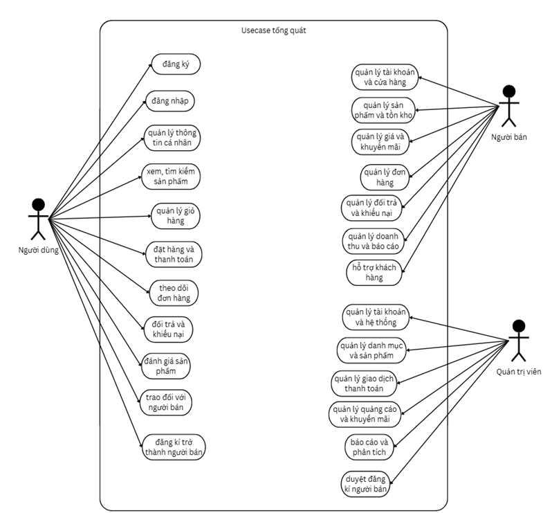

**Hình 3.1 - Mô hình Use Case tổng quát**

### Mô tả

- Actor: Người dùng
  - Đăng ký
  - Đăng nhập
  - Quản lý thông tin cá nhân
  - Xem, tìm kiếm sản phẩm
  - Quản lý giỏ hàng
  - Đặt hàng và thanh toán
  - Theo dõi đơn hàng
  - Đổi trả và khiếu nại
  - Đánh giá sản phẩm
  - Trao đổi với Người bán
  - Đăng ký trở thành Người bán

- Actor: Người bán
  - Quản lý tài khoản và cửa hàng
  - Quản lý sản phẩm và tồn kho
  - Quản lý giá và khuyến mãi
  - Quản lý đơn hàng
  - Quản lý đổi trả và khiếu nại
  - Quản lý doanh thu và báo cáo
  - Hỗ trợ khách hàng

- Actor: Quản trị viên
  - Quản lý tài khoản và hệ thống
  - Quản lý danh mục và sản phẩm
  - Quản lý giao dịch thanh toán
  - Quản lý quảng cáo và khuyến mãi
  - Báo cáo và phân tích
  - Duyệt đăng ký Người bán

Hình 3.1 - Mô hình Use Case tổng quát

Use case người dùng

**Usecase đăng nhập/đăng ký:**

## Use Case đăng nhập/đăng ký

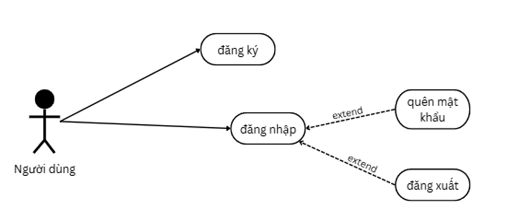

**Hình 3.2 - Mô hình Use Case đăng nhập/đăng ký**

### Mô tả

- Actor: Người dùng
  - Đăng ký
  - Đăng nhập
  - Quên mật khẩu
  - Đăng xuất

- Quan hệ:
  - Quên mật khẩu `<<extend>>` Đăng nhập
  - Đăng xuất `<<extend>>` Đăng nhập

Hình 3.2 - Mô hình Use Case đăng nhập/đăng ký

## Use Case quản lý thông tin cá nhân

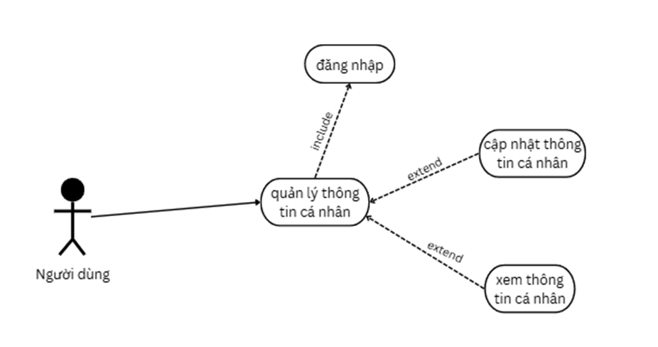

**Hình 3.3 - Mô hình Use Case quản lý thông tin cá nhân**

### Mô tả

- Actor: Người dùng
- Use case chính: Quản lý thông tin cá nhân
- Use case liên quan: Đăng nhập, Xem thông tin cá nhân, Cập nhật thông tin cá nhân
- Quan hệ:
  - Quản lý thông tin cá nhân `<<include>>` Đăng nhập
  - Xem thông tin cá nhân `<<extend>>` Quản lý thông tin cá nhân
  - Cập nhật thông tin cá nhân `<<extend>>` Quản lý thông tin cá nhân

## Use Case quản lý giỏ hàng

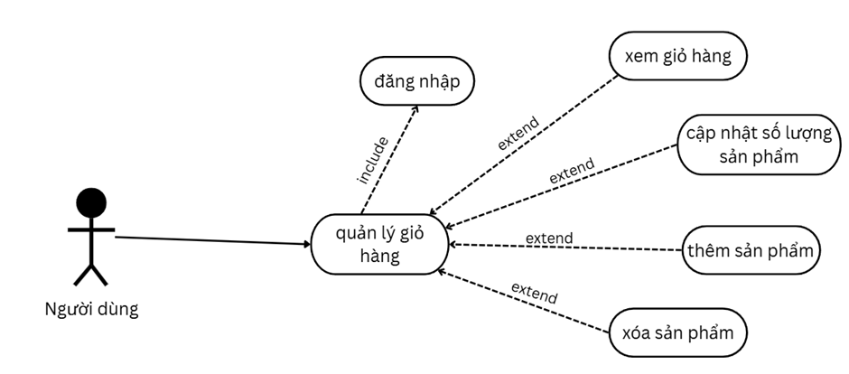

**Hình 3.4 - Mô hình Use Case quản lý giỏ hàng**

### Mô tả

- Actor: Người dùng
- Use case chính: Quản lý giỏ hàng
- Use case liên quan: Đăng nhập, Xem giỏ hàng, Cập nhật số lượng sản phẩm, Thêm sản phẩm, Xóa sản phẩm
- Quan hệ:
  - Quản lý giỏ hàng `<<include>>` Đăng nhập
  - Xem giỏ hàng `<<extend>>` Quản lý giỏ hàng
  - Cập nhật số lượng sản phẩm `<<extend>>` Quản lý giỏ hàng
  - Thêm sản phẩm `<<extend>>` Quản lý giỏ hàng
  - Xóa sản phẩm `<<extend>>` Quản lý giỏ hàng

## Use Case đặt hàng và thanh toán

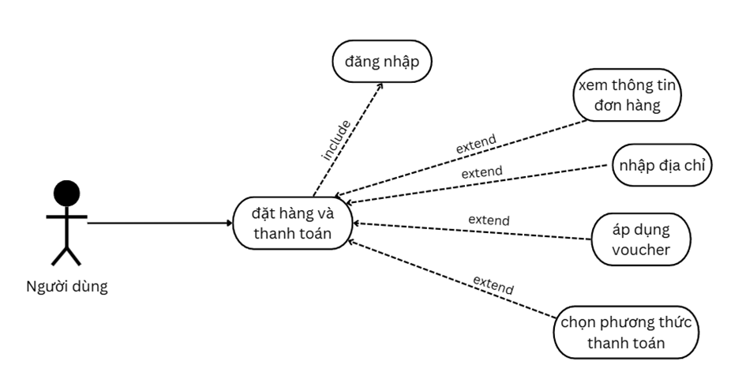

**Hình 3.5 - Mô hình Use Case đặt hàng và thanh toán**

### Mô tả

- Actor: Người dùng
- Use case chính: Đặt hàng và thanh toán
- Use case liên quan: Đăng nhập, Xem thông tin đơn hàng, Nhập địa chỉ, Áp dụng voucher, Chọn phương thức thanh toán
- Quan hệ:
  - Đặt hàng và thanh toán `<<include>>` Đăng nhập
  - Xem thông tin đơn hàng `<<extend>>` Đặt hàng và thanh toán
  - Nhập địa chỉ `<<extend>>` Đặt hàng và thanh toán
  - Áp dụng voucher `<<extend>>` Đặt hàng và thanh toán
  - Chọn phương thức thanh toán `<<extend>>` Đặt hàng và thanh toán

## Use Case quản lý và theo dõi đơn hàng

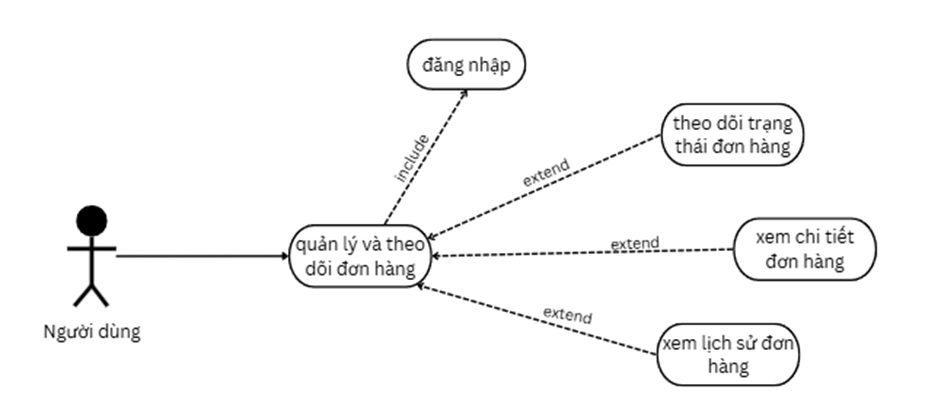

**Hình 3.6 - Mô hình Use Case quản lý và theo dõi đơn hàng**

### Mô tả

- Actor: Người dùng
- Use case chính: Quản lý và theo dõi đơn hàng
- Use case liên quan: Đăng nhập, Theo dõi trạng thái đơn hàng, Xem chi tiết đơn hàng, Xem lịch sử đơn hàng
- Quan hệ:
  - Quản lý và theo dõi đơn hàng `<<include>>` Đăng nhập
  - Theo dõi trạng thái đơn hàng `<<extend>>` Quản lý và theo dõi đơn hàng
  - Xem chi tiết đơn hàng `<<extend>>` Quản lý và theo dõi đơn hàng
  - Xem lịch sử đơn hàng `<<extend>>` Quản lý và theo dõi đơn hàng

## Use Case đổi trả và khiếu nại

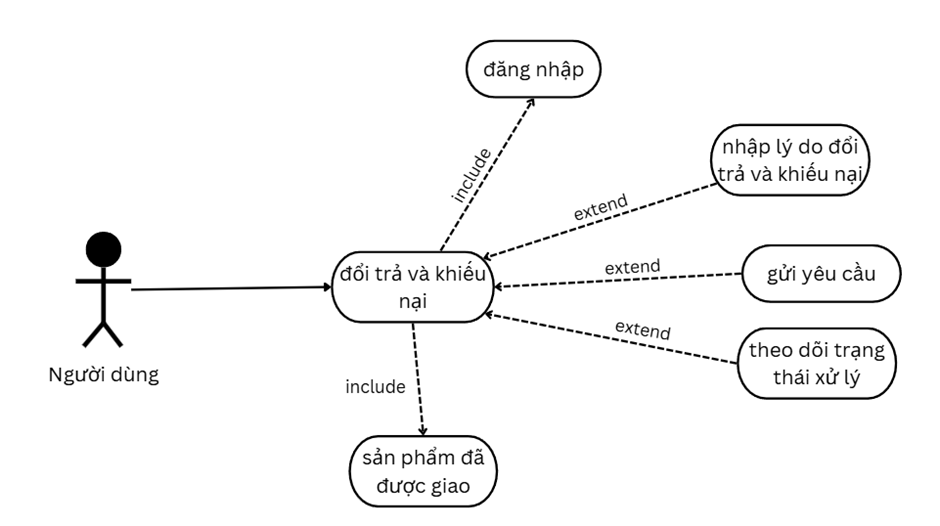

**Hình 3.7 - Mô hình Use Case đổi trả và khiếu nại**

### Mô tả

- Actor: Người dùng
- Use case chính: Đổi trả và khiếu nại
- Use case liên quan: Đăng nhập, Sản phẩm đã được giao, Nhập lý do đổi trả và khiếu nại, Gửi yêu cầu, Theo dõi trạng thái xử lý
- Quan hệ:
  - Đổi trả và khiếu nại `<<include>>` Đăng nhập
  - Đổi trả và khiếu nại `<<include>>` Sản phẩm đã được giao
  - Nhập lý do đổi trả và khiếu nại `<<extend>>` Đổi trả và khiếu nại
  - Gửi yêu cầu `<<extend>>` Đổi trả và khiếu nại
  - Theo dõi trạng thái xử lý `<<extend>>` Đổi trả và khiếu nại

## Use Case đánh giá sản phẩm

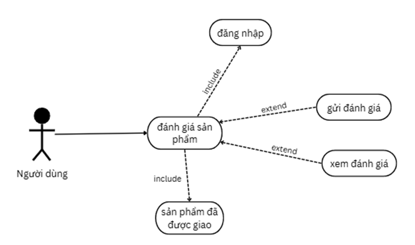

**Hình 3.8 - Mô hình Use Case đánh giá sản phẩm**

### Mô tả

- Actor: Người dùng
- Use case chính: Đánh giá sản phẩm
- Use case liên quan: Đăng nhập, Sản phẩm đã được giao, Gửi đánh giá, Xem đánh giá
- Quan hệ:
  - Đánh giá sản phẩm `<<include>>` Đăng nhập
  - Đánh giá sản phẩm `<<include>>` Sản phẩm đã được giao
  - Gửi đánh giá `<<extend>>` Đánh giá sản phẩm
  - Xem đánh giá `<<extend>>` Đánh giá sản phẩm

## Use Case trao đổi với Người bán

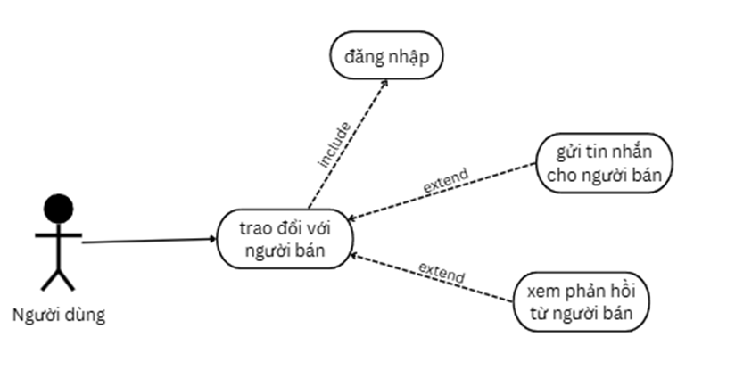

**Hình 3.9 - Mô hình Use Case trao đổi với Người bán**

### Mô tả

- Actor: Người dùng
- Use case chính: Trao đổi với Người bán
- Use case liên quan: Đăng nhập, Gửi tin nhắn cho Người bán, Xem phản hồi từ Người bán
- Quan hệ:
  - Trao đổi với Người bán `<<include>>` Đăng nhập
  - Gửi tin nhắn cho Người bán `<<extend>>` Trao đổi với Người bán
  - Xem phản hồi từ Người bán `<<extend>>` Trao đổi với Người bán

## Use Case đăng ký trở thành Người bán

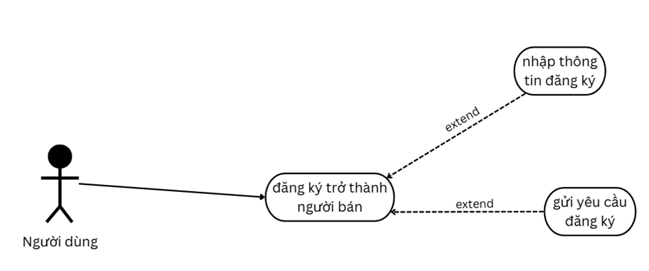

**Hình 3.10 - Mô hình Use Case đăng ký trở thành Người bán**

### Mô tả

- Actor: Người dùng
- Use case chính: Đăng ký trở thành Người bán
- Use case liên quan: Nhập thông tin đăng ký, Gửi yêu cầu đăng ký
- Quan hệ:
  - Nhập thông tin đăng ký `<<extend>>` Đăng ký trở thành Người bán
  - Gửi yêu cầu đăng ký `<<extend>>` Đăng ký trở thành Người bán

**Usecase người bán**

## Use Case quản lý tài khoản và cửa hàng

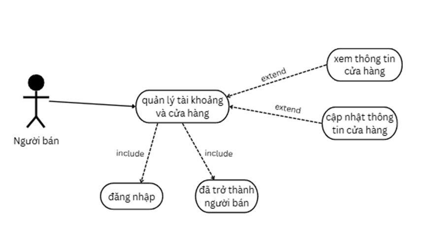

**Hình 3.11 - Mô hình Use Case quản lý tài khoản và cửa hàng**

### Mô tả

- Actor: Người bán
- Use case chính: Quản lý tài khoản và cửa hàng
- Use case liên quan: Đăng nhập, Đã trở thành Người bán, Xem thông tin cửa hàng, Cập nhật thông tin cửa hàng
- Quan hệ:
  - Quản lý tài khoản và cửa hàng `<<include>>` Đăng nhập
  - Quản lý tài khoản và cửa hàng `<<include>>` Đã trở thành Người bán
  - Xem thông tin cửa hàng `<<extend>>` Quản lý tài khoản và cửa hàng
  - Cập nhật thông tin cửa hàng `<<extend>>` Quản lý tài khoản và cửa hàng

## Use Case quản lý sản phẩm và tồn kho

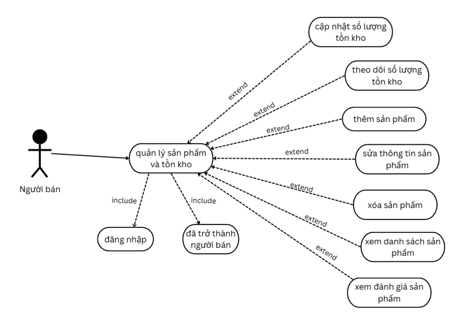

**Hình 3.12 - Mô hình Use Case quản lý sản phẩm và tồn kho**

### Mô tả

- Actor: Người bán
- Use case chính: Quản lý sản phẩm và tồn kho
- Use case liên quan: Đăng nhập, Đã trở thành Người bán, Cập nhật số lượng tồn kho, Theo dõi số lượng tồn kho, Thêm sản phẩm, Sửa thông tin sản phẩm, Xóa sản phẩm, Xem danh sách sản phẩm, Xem đánh giá sản phẩm
- Quan hệ:
  - Quản lý sản phẩm và tồn kho `<<include>>` Đăng nhập
  - Quản lý sản phẩm và tồn kho `<<include>>` Đã trở thành Người bán
  - Cập nhật số lượng tồn kho `<<extend>>` Quản lý sản phẩm và tồn kho
  - Theo dõi số lượng tồn kho `<<extend>>` Quản lý sản phẩm và tồn kho
  - Thêm sản phẩm `<<extend>>` Quản lý sản phẩm và tồn kho
  - Sửa thông tin sản phẩm `<<extend>>` Quản lý sản phẩm và tồn kho
  - Xóa sản phẩm `<<extend>>` Quản lý sản phẩm và tồn kho
  - Xem danh sách sản phẩm `<<extend>>` Quản lý sản phẩm và tồn kho
  - Xem đánh giá sản phẩm `<<extend>>` Quản lý sản phẩm và tồn kho

## Use Case quản lý giá và khuyến mãi

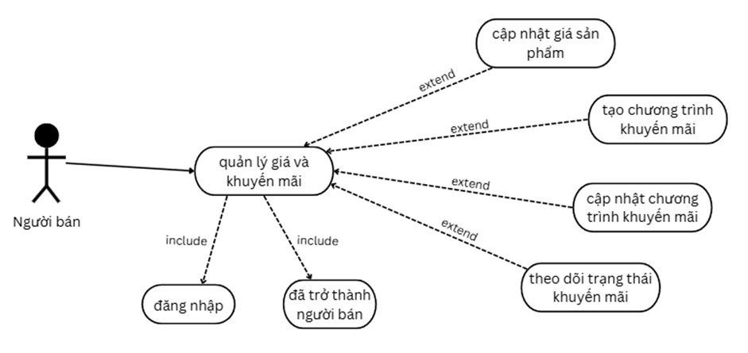

**Hình 3.13 - Mô hình Use Case quản lý giá và khuyến mãi**

### Mô tả

- Actor: Người bán
- Use case chính: Quản lý giá và khuyến mãi
- Use case liên quan: Đăng nhập, Đã trở thành Người bán, Cập nhật giá sản phẩm, Tạo chương trình khuyến mãi, Cập nhật chương trình khuyến mãi, Theo dõi trạng thái khuyến mãi
- Quan hệ:
  - Quản lý giá và khuyến mãi `<<include>>` Đăng nhập
  - Quản lý giá và khuyến mãi `<<include>>` Đã trở thành Người bán
  - Cập nhật giá sản phẩm `<<extend>>` Quản lý giá và khuyến mãi
  - Tạo chương trình khuyến mãi `<<extend>>` Quản lý giá và khuyến mãi
  - Cập nhật chương trình khuyến mãi `<<extend>>` Quản lý giá và khuyến mãi
  - Theo dõi trạng thái khuyến mãi `<<extend>>` Quản lý giá và khuyến mãi

## Use Case quản lý đơn hàng

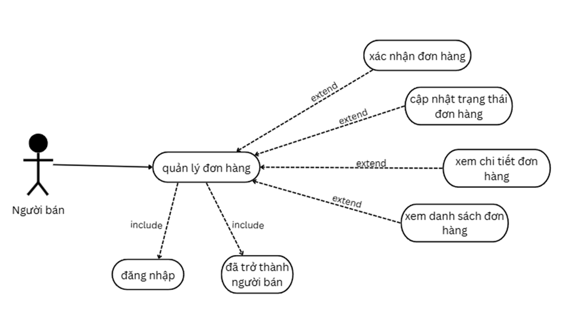

**Hình 3.14 - Mô hình Use Case quản lý đơn hàng**

### Mô tả

- Actor: Người bán
- Use case chính: Quản lý đơn hàng
- Use case liên quan: Đăng nhập, Đã trở thành Người bán, Xem danh sách đơn hàng, Xem chi tiết đơn hàng, Xác nhận đơn hàng, Cập nhật trạng thái đơn hàng
- Quan hệ:
  - Quản lý đơn hàng `<<include>>` Đăng nhập
  - Quản lý đơn hàng `<<include>>` Đã trở thành Người bán
  - Xem danh sách đơn hàng `<<extend>>` Quản lý đơn hàng
  - Xem chi tiết đơn hàng `<<extend>>` Quản lý đơn hàng
  - Xác nhận đơn hàng `<<extend>>` Quản lý đơn hàng
  - Cập nhật trạng thái đơn hàng `<<extend>>` Quản lý đơn hàng

## Use Case quản lý đổi trả sản phẩm

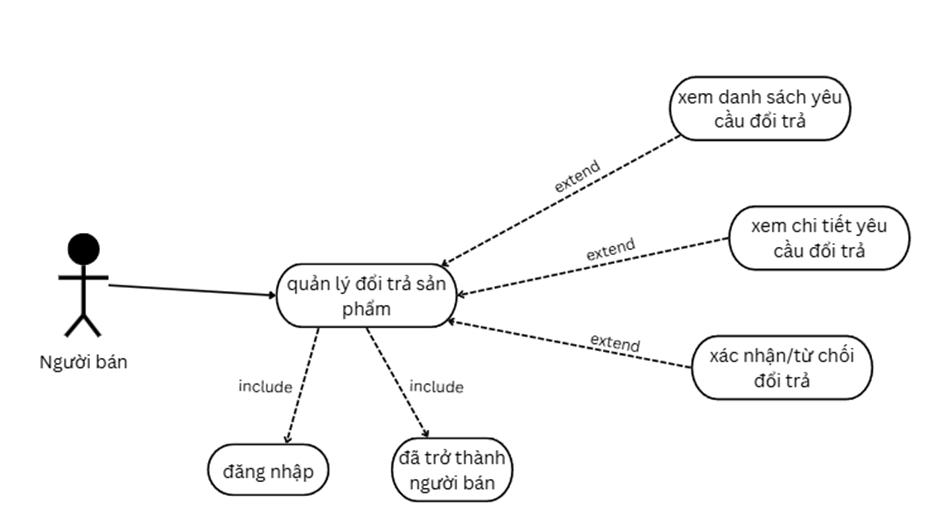

**Hình 3.15 - Mô hình Use Case quản lý đổi trả sản phẩm**

### Mô tả

- Actor: Người bán
- Use case chính: Quản lý đổi trả sản phẩm
- Use case liên quan: Đăng nhập, Đã trở thành Người bán, Xem danh sách yêu cầu đổi trả, Xem chi tiết yêu cầu đổi trả, Xác nhận/Từ chối đổi trả
- Quan hệ:
  - Quản lý đổi trả sản phẩm `<<include>>` Đăng nhập
  - Quản lý đổi trả sản phẩm `<<include>>` Đã trở thành Người bán
  - Xem danh sách yêu cầu đổi trả `<<extend>>` Quản lý đổi trả sản phẩm
  - Xem chi tiết yêu cầu đổi trả `<<extend>>` Quản lý đổi trả sản phẩm
  - Xác nhận/Từ chối đổi trả `<<extend>>` Quản lý đổi trả sản phẩm

## Use Case quản lý doanh thu và báo cáo

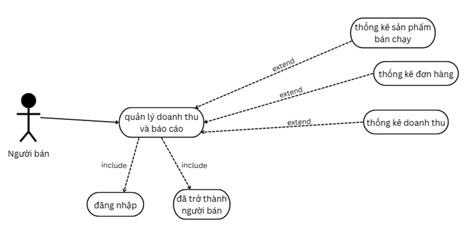

**Hình 3.16 - Mô hình Use Case quản lý doanh thu và báo cáo**

### Mô tả

- Actor: Người bán
- Use case chính: Quản lý doanh thu và báo cáo
- Use case liên quan: Đăng nhập, Đã trở thành Người bán, Thống kê doanh thu, Thống kê đơn hàng, Thống kê sản phẩm bán chạy
- Quan hệ:
  - Quản lý doanh thu và báo cáo `<<include>>` Đăng nhập
  - Quản lý doanh thu và báo cáo `<<include>>` Đã trở thành Người bán
  - Thống kê doanh thu `<<extend>>` Quản lý doanh thu và báo cáo
  - Thống kê đơn hàng `<<extend>>` Quản lý doanh thu và báo cáo
  - Thống kê sản phẩm bán chạy `<<extend>>` Quản lý doanh thu và báo cáo

## Use Case hỗ trợ khách hàng

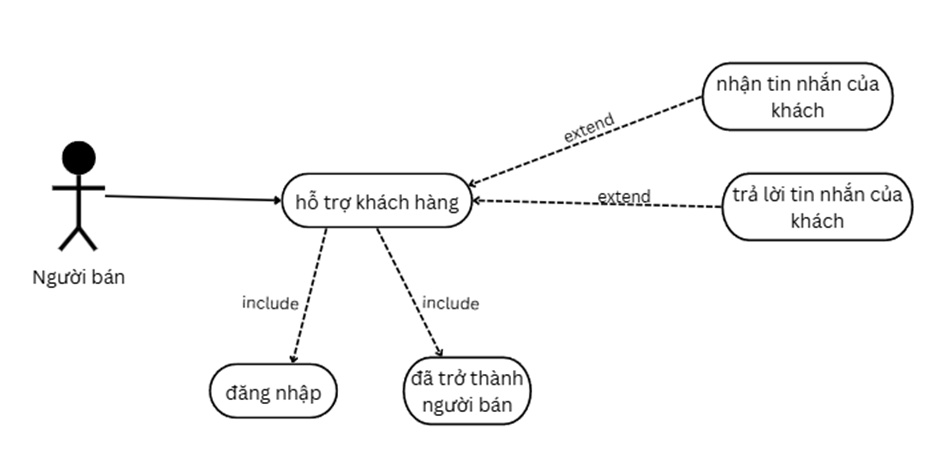

**Hình 3.17 - Mô hình Use Case hỗ trợ khách hàng**

### Mô tả

- Actor: Người bán
- Use case chính: Hỗ trợ khách hàng
- Use case liên quan: Đăng nhập, Đã trở thành Người bán, Nhận tin nhắn của khách, Trả lời tin nhắn của khách
- Quan hệ:
  - Hỗ trợ khách hàng `<<include>>` Đăng nhập
  - Hỗ trợ khách hàng `<<include>>` Đã trở thành Người bán
  - Nhận tin nhắn của khách `<<extend>>` Hỗ trợ khách hàng
  - Trả lời tin nhắn của khách `<<extend>>` Hỗ trợ khách hàng

**Use Case quản trị viên**

## Use Case quản lý tài khoản và hệ thống

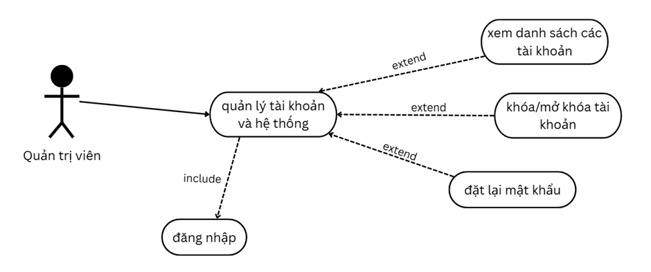

**Hình 3.18 - Mô hình Use Case quản lý tài khoản và hệ thống**

### Mô tả

- Actor: Quản trị viên
- Use case chính: Quản lý tài khoản và hệ thống
- Use case liên quan: Đăng nhập, Xem danh sách các tài khoản, Khóa/Mở khóa tài khoản, Đặt lại mật khẩu
- Quan hệ:
  - Quản lý tài khoản và hệ thống `<<include>>` Đăng nhập
  - Xem danh sách các tài khoản `<<extend>>` Quản lý tài khoản và hệ thống
  - Khóa/Mở khóa tài khoản `<<extend>>` Quản lý tài khoản và hệ thống
  - Đặt lại mật khẩu `<<extend>>` Quản lý tài khoản và hệ thống

## Use Case quản lý danh mục và sản phẩm

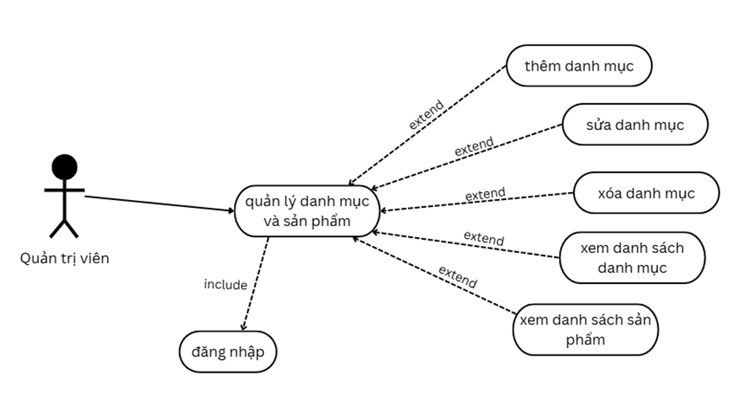

**Hình 3.19 - Mô hình Use Case quản lý danh mục và sản phẩm**

### Mô tả

- Actor: Quản trị viên
- Use case chính: Quản lý danh mục và sản phẩm
- Use case liên quan: Đăng nhập, Thêm danh mục, Sửa danh mục, Xóa danh mục, Xem danh sách danh mục, Xem danh sách sản phẩm
- Quan hệ:
  - Quản lý danh mục và sản phẩm `<<include>>` Đăng nhập
  - Thêm danh mục `<<extend>>` Quản lý danh mục và sản phẩm
  - Sửa danh mục `<<extend>>` Quản lý danh mục và sản phẩm
  - Xóa danh mục `<<extend>>` Quản lý danh mục và sản phẩm
  - Xem danh sách danh mục `<<extend>>` Quản lý danh mục và sản phẩm
  - Xem danh sách sản phẩm `<<extend>>` Quản lý danh mục và sản phẩm

## Use Case quản lý giao dịch và thanh toán

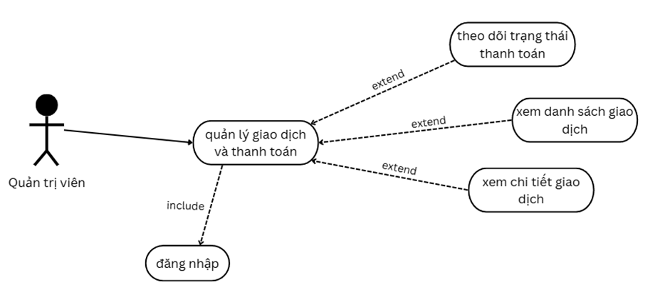

**Hình 3.20 - Mô hình Use Case quản lý giao dịch và thanh toán**

### Mô tả

- Actor: Quản trị viên
- Use case chính: Quản lý giao dịch và thanh toán
- Use case liên quan: Đăng nhập, Theo dõi trạng thái thanh toán, Xem danh sách giao dịch, Xem chi tiết giao dịch
- Quan hệ:
  - Quản lý giao dịch và thanh toán `<<include>>` Đăng nhập
  - Theo dõi trạng thái thanh toán `<<extend>>` Quản lý giao dịch và thanh toán
  - Xem danh sách giao dịch `<<extend>>` Quản lý giao dịch và thanh toán
  - Xem chi tiết giao dịch `<<extend>>` Quản lý giao dịch và thanh toán

## Use Case quản lý quảng cáo và khuyến mãi

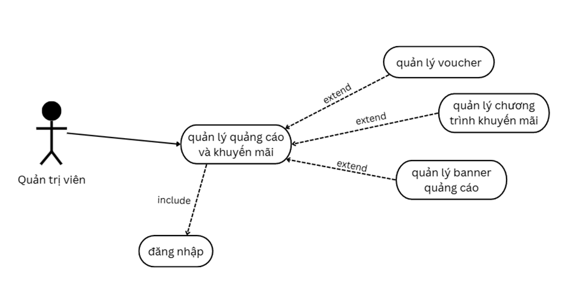

**Hình 3.21 - Mô hình Use Case quản lý quảng cáo và khuyến mãi**

### Mô tả

- Actor: Quản trị viên
- Use case chính: Quản lý quảng cáo và khuyến mãi
- Use case liên quan: Đăng nhập, Quản lý voucher, Quản lý chương trình khuyến mãi, Quản lý banner quảng cáo
- Quan hệ:
  - Quản lý quảng cáo và khuyến mãi `<<include>>` Đăng nhập
  - Quản lý voucher `<<extend>>` Quản lý quảng cáo và khuyến mãi
  - Quản lý chương trình khuyến mãi `<<extend>>` Quản lý quảng cáo và khuyến mãi
  - Quản lý banner quảng cáo `<<extend>>` Quản lý quảng cáo và khuyến mãi

## Use Case báo cáo và phân tích

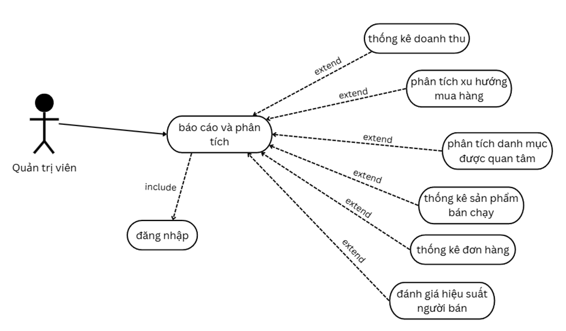

**Hình 3.22 - Mô hình Use Case báo cáo và phân tích**

### Mô tả

- Actor: Quản trị viên
- Use case chính: Báo cáo và phân tích
- Use case liên quan: Đăng nhập, Thống kê doanh thu, Phân tích xu hướng mua hàng, Phân tích danh mục được quan tâm, Thống kê sản phẩm bán chạy, Thống kê đơn hàng, Đánh giá hiệu suất Người bán
- Quan hệ:
  - Báo cáo và phân tích `<<include>>` Đăng nhập
  - Thống kê doanh thu `<<extend>>` Báo cáo và phân tích
  - Phân tích xu hướng mua hàng `<<extend>>` Báo cáo và phân tích
  - Phân tích danh mục được quan tâm `<<extend>>` Báo cáo và phân tích
  - Thống kê sản phẩm bán chạy `<<extend>>` Báo cáo và phân tích
  - Thống kê đơn hàng `<<extend>>` Báo cáo và phân tích
  - Đánh giá hiệu suất Người bán `<<extend>>` Báo cáo và phân tích

## Use Case duyệt đăng ký Người bán

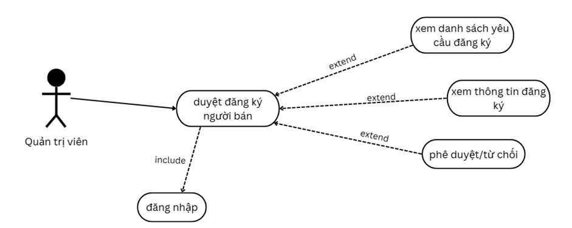

**Hình 3.23 - Mô hình Use Case duyệt đăng ký Người bán**

### Mô tả

- Actor: Quản trị viên
- Use case chính: Duyệt đăng ký Người bán
- Use case liên quan: Đăng nhập, Xem danh sách yêu cầu đăng ký, Xem thông tin đăng ký, Phê duyệt/Từ chối
- Quan hệ:
  - Duyệt đăng ký Người bán `<<include>>` Đăng nhập
  - Xem danh sách yêu cầu đăng ký `<<extend>>` Duyệt đăng ký Người bán
  - Xem thông tin đăng ký `<<extend>>` Duyệt đăng ký Người bán
  - Phê duyệt/Từ chối `<<extend>>` Duyệt đăng ký Người bán

**3.1.4. Đặc tả các chức năng theo use case**

**Tác nhân người dùng (User)**

**●Chức năng Đăng nhập**

**Bảng 3.1 - Use case Đăng nhập**

|  |  |
| --- | --- |
| **Use Case** | **Nội dung** |
| **Tên Use Case** | Đăng nhập |
| **Actor** | Người dùng (User), Người bán (Seller), Quản trị viên (Admin) |
| **Dòng sự kiện chính** | • Use case bắt đầu khi Người sử dụng truy cập vào hệ thống Soopi mà chưa đăng nhập. |
| • Hệ thống yêu cầu nhập email và mật khẩu. |
| • Người sử dụng nhập thông tin và yêu cầu đăng nhập. |
| • Hệ thống kiểm tra thông tin, nếu chính xác, Người sử dụng sẽ được đăng nhập vào hệ thống. |
| **Các dòng sự kiện khác hoặc ngoại lệ** | Nếu Người sử dụng nhập thiếu thông tin hoặc email/mật khẩu không chính xác, hệ thống sẽ hiển thị thông báo lỗi và yêu cầu Người sử dụng nhập lại. Nếu quên mật khẩu, Người sử dụng có thể lựa chọn chức năng Quên mật khẩu để đặt lại mật khẩu. Nếu email và mật khẩu chính xác nhưng tài khoản đang bị khóa, hệ thống từ chối đăng nhập và thông báo trạng thái tài khoản bị khóa. |
| **Tiền sự kiện** | Người sử dụng đã có tài khoản trên hệ thống Soopi. |
| **Hậu sự kiện** | Nếu Use case thành công, Người sử dụng sẽ được đăng nhập vào hệ thống. Ngược lại, trạng thái đăng nhập của hệ thống sẽ không thay đổi. |

**● Chức năng Đăng ký**

**Bảng 3.2 - Use case Đăng ký**

|  |  |
| --- | --- |
| **Use Case** | **Nội dung** |
| **Tên Use Case** | Đăng ký |
| **Actor** | Người dùng (User) |
| **Dòng sự kiện chính** | • Use case bắt đầu khi Người dùng chưa có tài khoản và lựa chọn chức năng đăng ký trên hệ thống Soopi. |
| • Hệ thống hiển thị giao diện đăng ký và yêu cầu Người dùng nhập các thông tin cần thiết. |
| • Người dùng nhập thông tin và yêu cầu đăng ký tài khoản. |
| • Hệ thống kiểm tra tính hợp lệ của thông tin đăng ký. |
| • Nếu thông tin hợp lệ, hệ thống tạo tài khoản mới và thông báo đăng ký thành công. |
| **Các dòng sự kiện khác hoặc ngoại lệ** | Nếu Người dùng nhập thiếu thông tin hoặc thông tin đăng ký không hợp lệ, hệ thống sẽ hiển thị thông báo lỗi và yêu cầu Người dùng kiểm tra, nhập lại thông tin. |
| **Tiền sự kiện** | Người dùng chưa có tài khoản trên hệ thống Soopi. |
| **Hậu sự kiện** | Nếu Use case thành công, tài khoản Người dùng mới được tạo trên hệ thống và Người dùng có thể sử dụng tài khoản để đăng nhập. Ngược lại, tài khoản mới sẽ không được tạo. |

**●Chức năng Quản lý thông tin cá nhân**

**Bảng 3.3 - Use case Quản lý thông tin cá nhân**

|  |  |
| --- | --- |
| **Use Case** | **Nội dung** |
| **Tên Use Case** | Quản lý thông tin cá nhân |
| **Actor** | Người dùng (User) |
| **Dòng sự kiện chính** | • Use case bắt đầu khi Người dùng đã đăng nhập và lựa chọn chức năng quản lý thông tin cá nhân. |
| • Hệ thống hiển thị thông tin cá nhân hiện tại của Người dùng. |
| • Người dùng xem và lựa chọn cập nhật thông tin khi có nhu cầu. |
| • Người dùng chỉnh sửa các thông tin gồm họ tên, ngày sinh, giới tính, số điện thoại và địa chỉ nhận hàng. |
| • Người dùng xác nhận cập nhật thông tin. |
| • Hệ thống kiểm tra tính hợp lệ của dữ liệu và lưu các thay đổi. |
| • Hệ thống thông báo cập nhật thông tin thành công. |
| **Các dòng sự kiện khác hoặc ngoại lệ** | Nếu Người dùng nhập thiếu thông tin bắt buộc hoặc dữ liệu không hợp lệ, hệ thống hiển thị thông báo lỗi và yêu cầu Người dùng kiểm tra lại. Nếu Người dùng hủy thao tác hoặc không xác nhận cập nhật, thông tin cũ sẽ được giữ nguyên. |
| **Tiền sự kiện** | Người dùng đã có tài khoản và đã đăng nhập vào hệ thống Soopi. |
| **Hậu sự kiện** | Nếu Use case thành công, thông tin cá nhân mới của Người dùng được cập nhật và lưu trên hệ thống. Ngược lại, thông tin cá nhân trước đó được giữ nguyên. |

**● Chức năng Xem, tìm kiếm sản phẩm**

**Bảng 3.4 - Use case Xem, tìm kiếm sản phẩm**

|  |  |
| --- | --- |
| **Use Case** | **Nội dung** |
| **Tên Use Case** | Xem, tìm kiếm sản phẩm |
| **Actor** | Người dùng (User) |
| **Dòng sự kiện chính** | • Use case bắt đầu khi Người dùng truy cập khu vực sản phẩm trên hệ thống Soopi. |
| • Hệ thống hiển thị danh sách các sản phẩm đang được bán cùng các thông tin cơ bản như tên sản phẩm, hình ảnh, giá bán và cửa hàng. |
| • Người dùng có thể nhập tên hoặc từ khóa để tìm kiếm sản phẩm, hoặc lựa chọn danh mục để lọc sản phẩm. |
| • Hệ thống xử lý điều kiện tìm kiếm/lọc và hiển thị danh sách sản phẩm phù hợp. |
| • Người dùng lựa chọn một sản phẩm để xem thông tin chi tiết. |
| • Hệ thống hiển thị thông tin chi tiết gồm tên sản phẩm, hình ảnh, mô tả, giá bán, số lượng còn lại, thông tin cửa hàng và đánh giá sản phẩm. |
| • Nếu sản phẩm đang có chương trình khuyến mãi, hệ thống hiển thị riêng **giá gốc** và **giá sau khuyến mãi**, đồng thời hiển thị các chương trình Flash Sale hoặc voucher đang được áp dụng. |
| **Các dòng sự kiện khác hoặc ngoại lệ** | • Nếu không có sản phẩm phù hợp với từ khóa hoặc danh mục đã chọn, hệ thống hiển thị thông báo không tìm thấy sản phẩm phù hợp. |
| • Nếu sản phẩm không có chương trình khuyến mãi đang áp dụng, hệ thống hiển thị giá bán hiện tại của sản phẩm và không hiển thị giá khuyến mãi. |
| **Tiền sự kiện** | Người dùng truy cập được vào website Soopi và hệ thống có dữ liệu sản phẩm để hiển thị. |
| **Hậu sự kiện** | Người dùng xem được danh sách hoặc thông tin chi tiết của sản phẩm phù hợp với nhu cầu tìm kiếm. Nếu sản phẩm có chương trình khuyến mãi, thông tin giá gốc, giá sau khuyến mãi và khuyến mãi liên quan được hiển thị để Người dùng tham khảo trước khi mua hàng. |

**● Chức năng Quản lý giỏ hàng**

**Bảng 3.5 - Use case Quản lý giỏ hàng**

|  |  |
| --- | --- |
| **Use Case** | **Nội dung** |
| **Tên Use Case** | Quản lý giỏ hàng |
| **Actor** | Người dùng (User) |
| **Dòng sự kiện chính** | • Use case bắt đầu khi Người dùng thêm sản phẩm vào giỏ hàng hoặc truy cập vào giỏ hàng trên hệ thống Soopi. |
| • Hệ thống hiển thị các sản phẩm hiện có trong giỏ hàng cùng thông tin số lượng và giá của từng sản phẩm. |
| • Người dùng có thể thay đổi số lượng sản phẩm trong giỏ hàng. |
| • Người dùng có thể xóa sản phẩm không còn nhu cầu mua khỏi giỏ hàng. |
| • Người dùng lựa chọn các sản phẩm muốn tiếp tục mua. |
| • Khi số lượng hoặc giá của sản phẩm thay đổi, hệ thống tự động tính lại tổng giá trị của các sản phẩm trong giỏ hàng. |
| • Hệ thống hiển thị lại thông tin giỏ hàng sau khi các thay đổi được cập nhật. |
| **Các dòng sự kiện khác hoặc ngoại lệ** | • Nếu Người dùng xóa một sản phẩm khỏi giỏ hàng, hệ thống loại bỏ sản phẩm đó và tính lại tổng giá trị giỏ hàng. |
| • Nếu số lượng sản phẩm trong giỏ hàng được thay đổi, hệ thống cập nhật số lượng mới và tự động tính lại tổng tiền. |
| • Nếu giá của sản phẩm thay đổi, hệ thống cập nhật lại giá và tổng giá trị tương ứng trong giỏ hàng. |
| **Tiền sự kiện** | Người dùng đã truy cập vào hệ thống Soopi và có thể thực hiện thao tác với các sản phẩm đang được bán trên hệ thống. |
| **Hậu sự kiện** | Giỏ hàng của Người dùng được cập nhật theo các thao tác đã thực hiện. Danh sách sản phẩm, số lượng và tổng giá trị giỏ hàng được lưu ở trạng thái mới nhất để phục vụ cho bước đặt hàng tiếp theo. |

**● Chức năng Đặt hàng và thanh toán**

**Bảng 3.6 - Use case Đặt hàng và thanh toán**

|  |  |
| --- | --- |
| **Use Case** | **Nội dung** |
| **Tên Use Case** | Đặt hàng và thanh toán |
| **Actor** | Người dùng (User) |
| **Dòng sự kiện chính** | • Use case bắt đầu khi Người dùng lựa chọn các sản phẩm cần mua từ giỏ hàng và thực hiện chức năng đặt hàng. |
| • Hệ thống hiển thị thông tin đơn hàng gồm danh sách sản phẩm, số lượng, giá bán, giá khuyến mãi nếu có và tổng giá trị đơn hàng. |
| • Người dùng nhập hoặc lựa chọn địa chỉ nhận hàng. |
| • Người dùng kiểm tra lại thông tin sản phẩm, số lượng, giá bán, giá khuyến mãi và tổng tiền của đơn hàng. |
| • Nếu có voucher phù hợp, Người dùng có thể lựa chọn và kết hợp các loại voucher gồm voucher Freeship, voucher toàn sàn và voucher cửa hàng theo điều kiện áp dụng. |
| • Hệ thống kiểm tra tính hợp lệ của các voucher và cập nhật lại tổng giá trị đơn hàng sau khi áp dụng. |
| • Người dùng lựa chọn phương thức thanh toán và xác nhận đặt hàng. |
| • Trước khi tạo đơn hàng, hệ thống kiểm tra lại số lượng tồn kho của từng sản phẩm. Nếu đủ số lượng, hệ thống tách các sản phẩm theo từng Người bán và tạo các đơn hàng riêng tương ứng; mỗi đơn lưu giá bán/giá khuyến mãi, số lượng và thành tiền tại thời điểm đặt hàng, đồng thời hệ thống trừ số lượng tồn kho tương ứng. |
| • Nếu Người dùng lựa chọn thanh toán trực tuyến qua **VNPay**, hệ thống tạo yêu cầu thanh toán dựa trên tổng giá trị của đơn hàng hoặc các đơn hàng vừa được tạo và chuyển Người dùng đến cổng thanh toán VNPay. |
| • Sau khi giao dịch kết thúc, hệ thống tiếp nhận kết quả trả về từ VNPay và cập nhật trạng thái thanh toán tương ứng cho các đơn hàng liên quan. |
| • Hệ thống hiển thị kết quả đặt hàng cho Người dùng. |
| **Các dòng sự kiện khác hoặc ngoại lệ** | • Nếu Người dùng chưa cung cấp đầy đủ thông tin nhận hàng, hệ thống yêu cầu bổ sung trước khi xác nhận đặt hàng. Nếu số lượng tồn kho của bất kỳ sản phẩm nào không đủ, hệ thống thông báo sản phẩm không đủ số lượng và yêu cầu Người dùng điều chỉnh giỏ hàng trước khi tiếp tục. |
| • Nếu một hoặc nhiều voucher được lựa chọn không hợp lệ hoặc không thể áp dụng cho đơn hàng, hệ thống thông báo cho Người dùng và không tính giá trị giảm của các voucher không hợp lệ. |
| • Nếu giao dịch qua VNPay không thành công, hệ thống tiếp nhận kết quả trả về, cập nhật trạng thái thanh toán, hủy các đơn hàng liên quan và hoàn lại số lượng tồn kho đã trừ. |
| • Nếu Người dùng không hoàn tất thanh toán VNPay trong vòng 24 giờ kể từ thời điểm tạo đơn, hệ thống tự động hủy các đơn hàng liên quan, cập nhật trạng thái thanh toán thành hết hạn/không thành công và hoàn lại số lượng tồn kho đã trừ. |
| **Tiền sự kiện** | Người dùng đã đăng nhập vào hệ thống Soopi, có sản phẩm cần mua trong giỏ hàng và đã lựa chọn sản phẩm để tiến hành đặt hàng. |
| **Hậu sự kiện** | Nếu Use case thành công, hệ thống tạo một hoặc nhiều đơn hàng được tách theo từng Người bán; mỗi đơn lưu thông tin sản phẩm, số lượng, giá bán/giá khuyến mãi và thành tiền tại thời điểm đặt hàng, địa chỉ nhận hàng và trạng thái thanh toán tương ứng; số lượng tồn kho được trừ khi đơn hàng được tạo. Nếu thanh toán VNPay thành công, các đơn hàng liên quan được ghi nhận đã thanh toán. Nếu giao dịch thất bại hoặc không được hoàn tất trong vòng 24 giờ kể từ thời điểm tạo đơn, các đơn hàng liên quan được hủy và số lượng tồn kho đã trừ được hoàn lại. |

**● Chức năng Quản lý và theo dõi đơn hàng**

**Bảng 3.7 - Use case Quản lý và theo dõi đơn hàng**

|  |  |
| --- | --- |
| **Use Case** | **Nội dung** |
| **Tên Use Case** | Quản lý và theo dõi đơn hàng |
| **Actor** | Người dùng (User) |
| **Dòng sự kiện chính** | • Use case bắt đầu khi Người dùng đã đăng nhập và truy cập chức năng quản lý đơn hàng trên hệ thống Soopi. |
| • Hệ thống hiển thị danh sách các đơn hàng mà Người dùng đã đặt. |
| • Người dùng lựa chọn một đơn hàng để xem thông tin chi tiết. |
| • Hệ thống hiển thị thông tin của đơn hàng gồm danh sách sản phẩm, số lượng, giá, tổng tiền, phương thức thanh toán và trạng thái thanh toán. |
| • Hệ thống hiển thị trạng thái xử lý hiện tại của đơn hàng. |
| • Người dùng theo dõi quá trình xử lý đơn hàng thông qua các trạng thái: **chờ xác nhận, đã xác nhận, đang xử lý, đang vận chuyển, hoàn thành hoặc đã hủy**. |
| **Các dòng sự kiện khác hoặc ngoại lệ** | • Nếu Người dùng chưa có đơn hàng nào, hệ thống hiển thị thông báo chưa có lịch sử đơn hàng. |
| • Nếu đơn hàng được chuyển sang trạng thái khác, hệ thống hiển thị trạng thái mới khi Người dùng xem lại thông tin đơn hàng. |
| • Nếu đơn hàng đã bị hủy, hệ thống hiển thị trạng thái **Đã hủy** để Người dùng biết đơn hàng không tiếp tục được xử lý. |
| **Tiền sự kiện** | Người dùng đã có tài khoản, đã đăng nhập vào hệ thống Soopi và đã từng tạo đơn hàng. |
| **Hậu sự kiện** | Người dùng xem được lịch sử, thông tin chi tiết và trạng thái xử lý hiện tại của đơn hàng. Use case này không làm thay đổi thông tin đơn hàng, chỉ hỗ trợ Người dùng tra cứu và theo dõi quá trình xử lý. |

**● Chức năng Đổi trả và khiếu nại**

**Bảng 3.8 - Use case Đổi trả và khiếu nại**

|  |  |
| --- | --- |
| **Use Case** | **Nội dung** |
| **Tên Use Case** | Đổi trả và khiếu nại |
| **Actor** | Người dùng (User) |
| **Dòng sự kiện chính** | • Use case bắt đầu khi Người dùng đã đăng nhập và lựa chọn một đơn hàng cần gửi yêu cầu đổi trả hoặc khiếu nại. |
| • Hệ thống hiển thị thông tin đơn hàng và chức năng gửi yêu cầu đổi trả/khiếu nại. |
| • Người dùng lựa chọn loại yêu cầu phù hợp. |
| • Người dùng nhập lý do đổi trả hoặc nội dung khiếu nại liên quan đến đơn hàng. |
| • Người dùng xác nhận gửi yêu cầu. |
| • Hệ thống kiểm tra thông tin và ghi nhận yêu cầu nếu hợp lệ. |
| • Hệ thống cập nhật yêu cầu sang trạng thái chờ xử lý. |
| • Người dùng có thể theo dõi trạng thái xử lý yêu cầu trên hệ thống. |
| • Sau khi Người bán xử lý, hệ thống hiển thị kết quả chấp nhận hoặc từ chối yêu cầu cho Người dùng. |
| **Các dòng sự kiện khác hoặc ngoại lệ** | • Nếu đơn hàng không đủ điều kiện để gửi yêu cầu đổi trả hoặc khiếu nại, hệ thống hiển thị thông báo và không cho phép tạo yêu cầu. |
| • Nếu Người dùng chưa nhập lý do hoặc nội dung yêu cầu chưa đầy đủ, hệ thống yêu cầu bổ sung thông tin trước khi gửi. |
| • Nếu yêu cầu không hợp lệ, hệ thống không ghi nhận yêu cầu. |
| • Nếu Người bán từ chối yêu cầu, hệ thống cập nhật trạng thái từ chối và hiển thị kết quả cho Người dùng. |
| **Tiền sự kiện** | Người dùng đã đăng nhập vào hệ thống Soopi và có đơn hàng đủ điều kiện để gửi yêu cầu đổi trả hoặc khiếu nại. |
| **Hậu sự kiện** | Nếu Use case thành công, yêu cầu đổi trả hoặc khiếu nại được lưu trên hệ thống và Người dùng có thể theo dõi trạng thái xử lý. Khi Người bán xử lý xong, kết quả chấp nhận hoặc từ chối được cập nhật cho Người dùng. Nếu yêu cầu không hợp lệ, hệ thống không tạo yêu cầu mới. |

**● Chức năng Đánh giá sản phẩm**

**Bảng 3.9 - Use case Đánh giá sản phẩm**

|  |  |
| --- | --- |
| **Use Case** | **Nội dung** |
| **Tên Use Case** | Đánh giá sản phẩm |
| **Actor** | Người dùng (User) |
| **Dòng sự kiện chính** | • Use case bắt đầu khi Người dùng truy cập vào sản phẩm trên hệ thống Soopi. |
| • Hệ thống hiển thị các đánh giá và bình luận đã có của sản phẩm. |
| • Nếu Người dùng đã mua sản phẩm và đơn hàng chứa sản phẩm đó đã hoàn thành, hệ thống cho phép Người dùng thực hiện đánh giá và bình luận. |
| • Người dùng nhập nội dung đánh giá và bình luận cho sản phẩm. |
| • Người dùng xác nhận gửi đánh giá. |
| • Hệ thống kiểm tra điều kiện hợp lệ và lưu đánh giá vào hệ thống. |
| • Hệ thống hiển thị đánh giá mới trong danh sách đánh giá của sản phẩm. |
| **Các dòng sự kiện khác hoặc ngoại lệ** | • Nếu Người dùng chưa mua sản phẩm hoặc đơn hàng chưa ở trạng thái hoàn thành, hệ thống không cho phép gửi đánh giá và bình luận. |
| • Nếu nội dung đánh giá không hợp lệ hoặc Người dùng chưa nhập nội dung cần thiết, hệ thống hiển thị thông báo và yêu cầu kiểm tra lại. |
| • Nếu quá trình lưu đánh giá không thành công, hệ thống thông báo lỗi và đánh giá không được ghi nhận. |
| **Tiền sự kiện** | Người dùng có thể xem các đánh giá và bình luận của sản phẩm mà không cần đăng nhập. Để gửi đánh giá và bình luận, Người dùng phải đăng nhập, đã mua sản phẩm và đơn hàng chứa sản phẩm đó đã hoàn thành. |
| **Hậu sự kiện** | Nếu Use case thành công, đánh giá và bình luận của Người dùng được lưu và hiển thị trên sản phẩm. Nếu không đáp ứng điều kiện hoặc xảy ra lỗi, hệ thống không tạo đánh giá mới. |

**● Chức năng Trao đổi với Người bán**

**Bảng 3.10 - Use case Trao đổi với Người bán**

|  |  |
| --- | --- |
| **Use Case** | **Nội dung** |
| **Tên Use Case** | Trao đổi với Người bán |
| **Actor** | Người dùng (User) |
| **Dòng sự kiện chính** | • Use case bắt đầu khi Người dùng có nhu cầu trao đổi với Người bán về sản phẩm, đơn hàng hoặc vấn đề liên quan. |
| • Người dùng lựa chọn chức năng trao đổi với Người bán trên hệ thống Soopi. |
| • Hệ thống hiển thị khu vực trao đổi giữa Người dùng và Người bán. |
| • Người dùng nhập câu hỏi hoặc nội dung cần hỗ trợ và gửi cho Người bán. |
| • Hệ thống ghi nhận và chuyển nội dung trao đổi đến Người bán tương ứng. |
| • Người bán xem nội dung do Người dùng gửi và thực hiện phản hồi. |
| • Hệ thống hiển thị phản hồi của Người bán để Người dùng xem và tiếp tục trao đổi khi cần. |
| **Các dòng sự kiện khác hoặc ngoại lệ** | • Nếu Người dùng chưa nhập nội dung, hệ thống không thực hiện gửi và yêu cầu Người dùng nhập nội dung cần trao đổi. |
| • Nếu nội dung gửi không thành công, hệ thống thông báo lỗi và tin nhắn không được ghi nhận. |
| • Nếu Người bán chưa phản hồi, Người dùng chỉ xem được nội dung đã gửi và chờ phản hồi từ Người bán. |
| **Tiền sự kiện** | Người dùng đã đăng nhập vào hệ thống Soopi và xác định được Người bán hoặc cửa hàng cần trao đổi. |
| **Hậu sự kiện** | Nếu Use case thành công, nội dung trao đổi của Người dùng được ghi nhận và Người bán có thể tiếp nhận, phản hồi. Khi Người bán phản hồi, Người dùng có thể xem nội dung phản hồi trên hệ thống. Nếu gửi không thành công, nội dung trao đổi mới không được ghi nhận. |

**● Chức năng Đăng ký trở thành Người bán**

**Bảng 3.11 - Use case Đăng ký trở thành Người bán**

|  |  |
| --- | --- |
| **Use Case** | **Nội dung** |
| **Tên Use Case** | Đăng ký trở thành Người bán |
| **Actor** | Người dùng (User) |
| **Dòng sự kiện chính** | • Use case bắt đầu khi Người dùng đã đăng nhập và lựa chọn chức năng đăng ký trở thành Người bán trên hệ thống Soopi. |
| • Hệ thống hiển thị giao diện đăng ký Người bán và yêu cầu Người dùng nhập các thông tin cần thiết. |
| • Người dùng nhập thông tin và gửi yêu cầu đăng ký trở thành Người bán. |
| • Hệ thống kiểm tra tính hợp lệ của thông tin đăng ký. |
| • Nếu thông tin hợp lệ, hệ thống ghi nhận yêu cầu ở trạng thái chờ Quản trị viên phê duyệt và thông báo gửi yêu cầu thành công. |
| **Các dòng sự kiện khác hoặc ngoại lệ** | Nếu Người dùng nhập thiếu thông tin hoặc thông tin đăng ký không hợp lệ, hệ thống hiển thị thông báo lỗi và yêu cầu Người dùng kiểm tra, nhập lại thông tin. Nếu Người dùng đã có yêu cầu đăng ký đang chờ xét duyệt hoặc tài khoản đã được cấp quyền Người bán, hệ thống không tạo thêm yêu cầu đăng ký mới và hiển thị thông báo phù hợp. |
| **Tiền sự kiện** | Người dùng đã có tài khoản và đã đăng nhập vào hệ thống Soopi. |
| **Hậu sự kiện** | Nếu Use case thành công, yêu cầu đăng ký Người bán được lưu ở trạng thái chờ phê duyệt. Sau khi được Quản trị viên phê duyệt, tài khoản vẫn giữ đầy đủ quyền Người dùng và được bổ sung quyền Người bán để sử dụng các chức năng dành cho Seller. |

**Tác nhân người bán (Seller)**

**● Chức năng Quản lý tài khoản và cửa hàng**

**Bảng 3.12 - Use case Quản lý tài khoản và cửa hàng**

|  |  |
| --- | --- |
| **Use Case** | **Nội dung** |
| **Tên Use Case** | Quản lý tài khoản và cửa hàng |
| **Actor** | Người bán (Seller) |
| **Dòng sự kiện chính** | • Use case bắt đầu khi Người bán đã đăng nhập vào hệ thống bằng tài khoản chung, đã được Quản trị viên phê duyệt/cấp quyền Người bán và lựa chọn truy cập khu vực quản lý cửa hàng. |
| • Hệ thống kiểm tra quyền Người bán và trạng thái hoạt động của tài khoản hiện tại. |
| • Nếu tài khoản có quyền Người bán hợp lệ và đang hoạt động, hệ thống cho phép truy cập khu vực quản lý cửa hàng. |
| • Người bán truy cập các chức năng quản lý cửa hàng bằng phiên đăng nhập hiện tại. |
| • Hệ thống hiển thị thông tin cửa hàng hiện tại của Người bán. |
| • Người bán xem thông tin và lựa chọn cập nhật khi có nhu cầu. |
| • Người bán chỉnh sửa thông tin cửa hàng và xác nhận cập nhật. |
| • Hệ thống kiểm tra thông tin, lưu các thay đổi hợp lệ và thông báo cập nhật thành công. |
| • Người bán có thể đăng xuất khỏi hệ thống sau khi hoàn tất các thao tác quản lý. |
| **Các dòng sự kiện khác hoặc ngoại lệ** | • Nếu tài khoản chưa được cấp quyền Người bán, hệ thống không cho phép truy cập khu vực quản lý cửa hàng và hiển thị thông báo phù hợp. |
| • Nếu tài khoản đang bị khóa hoặc không còn ở trạng thái hoạt động, hệ thống không cho phép truy cập khu vực quản lý cửa hàng. |
| • Nếu thông tin cập nhật cửa hàng không hợp lệ hoặc chưa đầy đủ, hệ thống hiển thị thông báo và không lưu thay đổi. |
| • Nếu quá trình cập nhật xảy ra lỗi, hệ thống giữ nguyên thông tin cửa hàng trước đó. |
| **Tiền sự kiện** | Người bán đã đăng nhập vào hệ thống Soopi bằng tài khoản chung, tài khoản đã được Quản trị viên phê duyệt/cấp quyền Người bán và đang ở trạng thái hoạt động. |
| **Hậu sự kiện** | Nếu Use case thành công, Người bán truy cập được khu vực quản lý và thông tin cửa hàng được cập nhật theo dữ liệu mới nhất. Nếu thao tác không thành công, thông tin cửa hàng trước đó được giữ nguyên. |

**● Chức năng Quản lý sản phẩm và tồn kho**

**Bảng 3.13 - Use case Quản lý sản phẩm và tồn kho**

|  |  |
| --- | --- |
| **Use Case** | **Nội dung** |
| **Tên Use Case** | Quản lý sản phẩm và tồn kho |
| **Actor** | Người bán (Seller) |
| **Dòng sự kiện chính** | • Use case bắt đầu khi Người bán đã đăng nhập và truy cập chức năng quản lý sản phẩm của cửa hàng. |
| • Hệ thống hiển thị danh sách các sản phẩm thuộc cửa hàng của Người bán. |
| • Người bán có thể lựa chọn thêm mới, chỉnh sửa hoặc xóa sản phẩm. |
| • Khi thêm mới hoặc chỉnh sửa, Người bán nhập/cập nhật các thông tin gồm tên sản phẩm, hình ảnh, mô tả, danh mục, số lượng và trạng thái kinh doanh. |
| • Người bán xác nhận thao tác. |
| • Hệ thống kiểm tra thông tin sản phẩm và lưu dữ liệu nếu hợp lệ. |
| • Người bán có thể xem số lượng tồn kho của từng sản phẩm. |
| • Khi có thay đổi về số lượng hàng, Người bán cập nhật tồn kho của sản phẩm. |
| • Hệ thống lưu số lượng tồn kho mới và hiển thị lại thông tin sản phẩm đã cập nhật. |
| • Người bán có thể lựa chọn một sản phẩm để xem các đánh giá và bình luận của Người dùng đối với sản phẩm đó. |
| • Hệ thống hiển thị mức đánh giá, nội dung bình luận và thông tin liên quan; Người bán chỉ được xem, không được chỉnh sửa hoặc xóa đánh giá của Người dùng. |
| **Các dòng sự kiện khác hoặc ngoại lệ** | • Nếu thông tin sản phẩm chưa đầy đủ hoặc không hợp lệ, hệ thống hiển thị thông báo và không lưu dữ liệu. |
| • Nếu số lượng tồn kho nhập không hợp lệ, hệ thống yêu cầu Người bán kiểm tra và nhập lại. |
| • Nếu Người bán thực hiện xóa sản phẩm, hệ thống chỉ thực hiện sau khi thao tác được xác nhận. |
| • Người bán không được phép xem hoặc chỉnh sửa sản phẩm thuộc cửa hàng của Người bán khác. |
| **Tiền sự kiện** | Người bán đã có tài khoản được phê duyệt, đã đăng nhập vào hệ thống Soopi và có quyền quản lý cửa hàng của mình. |
| **Hậu sự kiện** | Nếu Use case thành công, thông tin sản phẩm hoặc số lượng tồn kho được cập nhật và lưu trên hệ thống. Nếu thao tác không thành công, dữ liệu sản phẩm và tồn kho trước đó được giữ nguyên. |

**● Chức năng Quản lý giá và khuyến mãi**

**Bảng 3.14 - Use case Quản lý giá và khuyến mãi**

|  |  |
| --- | --- |
| **Use Case** | **Nội dung** |
| **Tên Use Case** | Quản lý giá và khuyến mãi |
| **Actor** | Người bán (Seller) |
| **Dòng sự kiện chính** | • Use case bắt đầu khi Người bán đã đăng nhập và truy cập chức năng quản lý giá và khuyến mãi của cửa hàng. |
| • Hệ thống hiển thị thông tin giá hiện tại của sản phẩm, bao gồm **giá gốc** và danh sách chương trình khuyến mãi, voucher cửa hàng nếu có. |
| • Người bán có thể cập nhật giá gốc của sản phẩm khi cần thiết. |
| • Khi muốn tạo hoặc cập nhật chương trình khuyến mãi, Người bán lựa chọn một hoặc nhiều sản phẩm thuộc cửa hàng và nhập **giá sau khuyến mãi** hoặc mức giảm giá phù hợp. |
| • Người bán thiết lập thời gian bắt đầu và thời gian kết thúc của chương trình khuyến mãi. |
| • Người bán có thể tạo hoặc cập nhật voucher cửa hàng, thiết lập giá trị giảm, điều kiện sử dụng, số lượng và thời gian hiệu lực; sau đó xác nhận thông tin đã nhập. |
| • Hệ thống kiểm tra tính hợp lệ của giá, thời gian áp dụng chương trình và thông tin voucher. |
| • Nếu thông tin hợp lệ, hệ thống lưu **giá gốc** và **giá sau khuyến mãi** thành hai giá trị riêng biệt, đồng thời lưu thông tin chương trình khuyến mãi và voucher cửa hàng. |
| • Hệ thống xác định trạng thái chương trình là chưa bắt đầu, đang hoạt động hoặc đã kết thúc dựa trên thời gian đã thiết lập. |
| • Khi chương trình đang hoạt động, hệ thống hiển thị giá gốc và giá sau khuyến mãi cho Người dùng; khi chương trình không còn hiệu lực, sản phẩm tiếp tục sử dụng giá gốc. |
| **Các dòng sự kiện khác hoặc ngoại lệ** | • Nếu giá gốc hoặc giá sau khuyến mãi không hợp lệ, hệ thống hiển thị thông báo và yêu cầu Người bán kiểm tra lại. |
| • Nếu giá sau khuyến mãi lớn hơn giá gốc, hệ thống không cho phép lưu chương trình khuyến mãi. |
| • Nếu thời gian bắt đầu và kết thúc chương trình không hợp lệ, hệ thống thông báo lỗi và không lưu thay đổi. |
| • Nếu Người bán không tạo chương trình khuyến mãi, hệ thống chỉ sử dụng giá gốc của sản phẩm. |
| • Người bán không được phép thay đổi giá, chương trình khuyến mãi hoặc voucher của cửa hàng khác. |
| **Tiền sự kiện** | Người bán đã có tài khoản được phê duyệt, đã đăng nhập vào hệ thống Soopi và có quyền quản lý giá, khuyến mãi và voucher của cửa hàng mình. |
| **Hậu sự kiện** | Nếu Use case thành công, thông tin giá, chương trình khuyến mãi và voucher cửa hàng được cập nhật trên hệ thống; **giá gốc và giá sau khuyến mãi được lưu riêng biệt và giá gốc không bị ghi đè**. Nếu thông tin không hợp lệ, dữ liệu giá, khuyến mãi và voucher trước đó được giữ nguyên. |

**● Chức năng Quản lý đơn hàng**

**Bảng 3.15 - Use case Quản lý đơn hàng**

|  |  |
| --- | --- |
| **Use Case** | **Nội dung** |
| **Tên Use Case** | Quản lý đơn hàng |
| **Actor** | Người bán (Seller) |
| **Dòng sự kiện chính** | • Use case bắt đầu khi Người bán đã đăng nhập và truy cập chức năng quản lý đơn hàng của cửa hàng. |
| • Hệ thống hiển thị danh sách các đơn hàng thuộc cửa hàng của Người bán; các đơn hàng này đã được hệ thống tách theo từng Người bán khi Người dùng đặt hàng. |
| • Người bán lựa chọn một đơn hàng để xem thông tin chi tiết. |
| • Hệ thống hiển thị các thông tin liên quan đến đơn hàng như sản phẩm, số lượng, thông tin người mua, tổng giá trị đơn hàng, trạng thái thanh toán và trạng thái xử lý. |
| • Người bán kiểm tra thông tin và trạng thái thanh toán của đơn hàng. Đối với đơn hàng đã thanh toán thành công, Người bán xác nhận đơn hàng để tiếp tục xử lý và không được từ chối đơn hàng. |
| • Sau khi xác nhận đơn hàng đã thanh toán thành công, Người bán tiến hành chuẩn bị và đóng gói sản phẩm. |
| • Trong quá trình xử lý, Người bán cập nhật trạng thái đơn hàng phù hợp với tiến trình thực tế. |
| • Hệ thống lưu trạng thái mới và cập nhật thông tin đơn hàng để Người dùng có thể theo dõi. |
| **Các dòng sự kiện khác hoặc ngoại lệ** | • Nếu đơn hàng không thuộc cửa hàng của Người bán, hệ thống không cho phép truy cập hoặc chỉnh sửa. |
| • Nếu đơn hàng chưa thanh toán thành công hoặc đã bị hủy, hệ thống không cho phép Người bán xác nhận và tiếp tục xử lý. Đối với đơn hàng đã thanh toán thành công, hệ thống không cho phép Người bán từ chối đơn hàng. |
| • Nếu trạng thái đơn hàng được cập nhật không hợp lệ hoặc không phù hợp với tiến trình hiện tại, hệ thống không lưu thay đổi và yêu cầu Người bán kiểm tra lại. |
| • Nếu quá trình cập nhật đơn hàng xảy ra lỗi, hệ thống giữ nguyên trạng thái trước đó. |
| **Tiền sự kiện** | Người bán đã có tài khoản được phê duyệt, đã đăng nhập vào hệ thống Soopi và có đơn hàng thuộc cửa hàng của mình. |
| **Hậu sự kiện** | Nếu Use case thành công, thông tin xử lý và trạng thái đơn hàng được cập nhật trên hệ thống. Người dùng có thể xem trạng thái mới nhất của đơn hàng. Nếu thao tác không thành công, trạng thái và dữ liệu đơn hàng trước đó được giữ nguyên. |

**● Chức năng Quản lý đổi trả sản phẩm**

**Bảng 3.16 - Use case Quản lý đổi trả sản phẩm**

|  |  |
| --- | --- |
| **Use Case** | **Nội dung** |
| **Tên Use Case** | Quản lý đổi trả sản phẩm |
| **Actor** | Người bán (Seller) |
| **Dòng sự kiện chính** | • Use case bắt đầu khi Người bán đã đăng nhập và truy cập chức năng quản lý yêu cầu đổi trả và khiếu nại. |
| • Hệ thống hiển thị danh sách các yêu cầu đổi trả hoặc khiếu nại liên quan đến sản phẩm thuộc cửa hàng của Người bán. |
| • Người bán lựa chọn một yêu cầu để xem thông tin chi tiết. |
| • Hệ thống hiển thị thông tin đơn hàng, sản phẩm liên quan, loại yêu cầu, lý do hoặc nội dung khiếu nại và trạng thái xử lý hiện tại. |
| • Người bán kiểm tra thông tin và lựa chọn chấp nhận hoặc từ chối yêu cầu. |
| • Người bán xác nhận kết quả xử lý. |
| • Hệ thống cập nhật trạng thái yêu cầu và lưu kết quả xử lý. |
| • Người dùng có thể xem kết quả xử lý yêu cầu đổi trả hoặc khiếu nại trên hệ thống. |
| **Các dòng sự kiện khác hoặc ngoại lệ** | • Nếu yêu cầu không liên quan đến sản phẩm thuộc cửa hàng, hệ thống không cho phép Người bán xử lý. |
| • Nếu thông tin yêu cầu chưa đầy đủ, Người bán có thể chưa thực hiện xử lý và giữ yêu cầu ở trạng thái chờ. |
| • Nếu Người bán từ chối yêu cầu, hệ thống cập nhật trạng thái từ chối và hiển thị kết quả cho Người dùng. |
| • Nếu quá trình cập nhật xảy ra lỗi, hệ thống giữ nguyên trạng thái trước đó của yêu cầu. |
| **Tiền sự kiện** | Người bán đã có tài khoản được phê duyệt, đã đăng nhập vào hệ thống Soopi và có yêu cầu đổi trả hoặc khiếu nại liên quan đến sản phẩm thuộc cửa hàng của mình. |
| **Hậu sự kiện** | Nếu Use case thành công, yêu cầu đổi trả hoặc khiếu nại được cập nhật với kết quả chấp nhận hoặc từ chối và Người dùng có thể xem kết quả xử lý. Nếu thao tác không thành công, trạng thái yêu cầu trước đó được giữ nguyên. |

**● Chức năng Quản lý doanh thu và báo cáo**

**Bảng 3.17 - Use case Quản lý doanh thu và báo cáo**

|  |  |
| --- | --- |
| **Use Case** | **Nội dung** |
| **Tên Use Case** | Quản lý doanh thu và báo cáo |
| **Actor** | Người bán (Seller) |
| **Dòng sự kiện chính** | • Use case bắt đầu khi Người bán đã đăng nhập và truy cập chức năng quản lý doanh thu và báo cáo của cửa hàng. |
| • Hệ thống tổng hợp dữ liệu bán hàng thuộc cửa hàng của Người bán. |
| • Hệ thống hiển thị tổng doanh thu của cửa hàng dựa trên các đơn hàng đã hoàn thành, đồng thời hiển thị lịch sử các giao dịch liên quan. |
| • Người bán lựa chọn khoảng thời gian cần xem báo cáo như theo ngày, tháng hoặc một khoảng thời gian cụ thể. |
| • Hệ thống thống kê số lượng đơn hàng đã hoàn thành, doanh thu phát sinh và số lượng sản phẩm đã bán trong khoảng thời gian được chọn. |
| • Hệ thống hiển thị danh sách hoặc thống kê các sản phẩm bán chạy của cửa hàng. |
| • Người bán xem và theo dõi kết quả báo cáo để đánh giá tình hình kinh doanh của cửa hàng. |
| **Các dòng sự kiện khác hoặc ngoại lệ** | • Nếu khoảng thời gian được chọn không có dữ liệu bán hàng, hệ thống hiển thị kết quả rỗng hoặc thông báo chưa có dữ liệu. |
| • Nếu khoảng thời gian được nhập không hợp lệ, hệ thống yêu cầu Người bán lựa chọn lại. |
| • Nếu xảy ra lỗi trong quá trình truy xuất dữ liệu, hệ thống hiển thị thông báo lỗi và không hiển thị báo cáo chưa hoàn chỉnh. |
| • Người bán chỉ được xem doanh thu, giao dịch và báo cáo thuộc cửa hàng của mình. |
| **Tiền sự kiện** | Người bán đã có tài khoản được phê duyệt, đã đăng nhập vào hệ thống Soopi và cửa hàng đã có dữ liệu đơn hàng hoặc giao dịch để thống kê. |
| **Hậu sự kiện** | Người bán xem được thông tin doanh thu, giao dịch và các số liệu thống kê của cửa hàng trong khoảng thời gian đã chọn. Use case này chỉ hỗ trợ tra cứu và phân tích dữ liệu, không làm thay đổi thông tin đơn hàng hoặc giao dịch. |

**● Chức năng Hỗ trợ khách hàng**

**Bảng 3.18 - Use case Hỗ trợ khách hàng**

|  |  |
| --- | --- |
| **Use Case** | **Nội dung** |
| **Tên Use Case** | Hỗ trợ khách hàng |
| **Actor** | Người bán (Seller) |
| **Dòng sự kiện chính** | • Use case bắt đầu khi Người bán đã đăng nhập và truy cập chức năng hỗ trợ khách hàng. |
| • Hệ thống hiển thị danh sách các câu hỏi, tin nhắn hoặc yêu cầu hỗ trợ do Người dùng gửi đến cửa hàng. |
| • Người bán lựa chọn một nội dung trao đổi để xem chi tiết. |
| • Hệ thống hiển thị nội dung câu hỏi hoặc vấn đề mà Người dùng cần hỗ trợ liên quan đến sản phẩm hoặc đơn hàng. |
| • Người bán nhập nội dung phản hồi và gửi cho Người dùng. |
| • Hệ thống ghi nhận phản hồi và hiển thị nội dung trao đổi cho hai bên. |
| • Người dùng có thể xem phản hồi và tiếp tục gửi tin nhắn nếu cần trao đổi thêm. |
| **Các dòng sự kiện khác hoặc ngoại lệ** | • Nếu Người bán chưa nhập nội dung phản hồi, hệ thống không thực hiện gửi và yêu cầu nhập nội dung. |
| • Nếu quá trình gửi phản hồi xảy ra lỗi, hệ thống thông báo và nội dung mới không được ghi nhận. |
| • Nếu chưa có yêu cầu hỗ trợ nào từ Người dùng, hệ thống hiển thị danh sách trống hoặc thông báo chưa có nội dung cần xử lý. |
| • Người bán chỉ được xem và phản hồi các nội dung hỗ trợ liên quan đến cửa hàng của mình. |
| **Tiền sự kiện** | Người bán đã có tài khoản được phê duyệt, đã đăng nhập vào hệ thống Soopi và có nội dung trao đổi hoặc yêu cầu hỗ trợ từ Người dùng. |
| **Hậu sự kiện** | Nếu Use case thành công, phản hồi của Người bán được lưu trên hệ thống và Người dùng có thể xem nội dung phản hồi. Nếu gửi không thành công, nội dung trao đổi trước đó được giữ nguyên. |

**Tác nhân Quản trị viên (Admin)**

**● Chức năng Duyệt đăng ký Người bán**

**Bảng 3.19 - Use case Duyệt đăng ký Người bán**

|  |  |
| --- | --- |
| **Use Case** | **Nội dung** |
| **Tên Use Case** | Duyệt đăng ký Người bán |
| **Actor** | Quản trị viên (Admin) |
| **Dòng sự kiện chính** | • Use case bắt đầu khi Quản trị viên đã đăng nhập và truy cập chức năng duyệt đăng ký Người bán trên hệ thống Soopi. |
| • Hệ thống hiển thị danh sách các yêu cầu đăng ký trở thành Người bán đang chờ xét duyệt. |
| • Quản trị viên lựa chọn một yêu cầu để xem thông tin tài khoản Người dùng và thông tin đăng ký Người bán. |
| • Quản trị viên kiểm tra thông tin và lựa chọn phê duyệt hoặc từ chối yêu cầu đăng ký. |
| • Hệ thống ghi nhận kết quả xét duyệt; nếu được phê duyệt, tài khoản vẫn giữ quyền Người dùng và được bổ sung quyền Người bán; nếu bị từ chối, tài khoản tiếp tục chỉ sử dụng quyền Người dùng. |
| **Các dòng sự kiện khác hoặc ngoại lệ** | Nếu yêu cầu không tồn tại, đã được xử lý hoặc thông tin chưa phù hợp để xét duyệt, hệ thống không thay đổi quyền tài khoản và hiển thị thông báo phù hợp. Nếu quá trình cập nhật xảy ra lỗi, trạng thái yêu cầu trước đó được giữ nguyên. |
| **Tiền sự kiện** | Quản trị viên có tài khoản Admin hợp lệ, đã đăng nhập vào hệ thống Soopi và có yêu cầu đăng ký trở thành Người bán đang chờ xét duyệt. |
| **Hậu sự kiện** | Nếu Use case thành công, yêu cầu được cập nhật thành đã phê duyệt hoặc đã từ chối. Trường hợp được phê duyệt, tài khoản vẫn sử dụng bình thường các chức năng của Người dùng và được bổ sung quyền Người bán để truy cập các chức năng dành cho Seller; trường hợp bị từ chối, tài khoản tiếp tục chỉ sử dụng quyền Người dùng. |

**● Chức năng Quản lý tài khoản và hệ thống**

**Bảng 3.20 - Use case Quản lý tài khoản và hệ thống**

|  |  |
| --- | --- |
| **Use Case** | **Nội dung** |
| **Tên Use Case** | Quản lý tài khoản và hệ thống |
| **Actor** | Quản trị viên (Admin) |
| **Dòng sự kiện chính** | • Use case bắt đầu khi Quản trị viên đã đăng nhập và truy cập chức năng quản lý tài khoản trên hệ thống Soopi. |
| • Hệ thống hiển thị danh sách các tài khoản Người dùng và Người bán hiện có trên hệ thống. |
| • Quản trị viên lựa chọn một tài khoản để xem thông tin chi tiết và trạng thái hoạt động. |
| • Quản trị viên có thể **khóa hoặc mở khóa tài khoản** tùy theo trạng thái hoạt động của tài khoản. |
| • Quản trị viên có thể thực hiện chức năng **đặt lại mật khẩu** cho tài khoản khi cần hỗ trợ người sử dụng. |
| • Sau khi Quản trị viên xác nhận thao tác khóa/mở khóa hoặc đặt lại mật khẩu, hệ thống kiểm tra tính hợp lệ và cập nhật trạng thái hoặc thông tin xác thực của tài khoản. |
| • Hệ thống thông báo kết quả xử lý cho Quản trị viên. |
| **Các dòng sự kiện khác hoặc ngoại lệ** | • Nếu tài khoản cần quản lý không tồn tại, hệ thống hiển thị thông báo và không thực hiện thay đổi. |
| • Nếu tài khoản bị khóa, tài khoản đó không thể đăng nhập hoặc sử dụng các chức năng yêu cầu xác thực cho đến khi được mở khóa. |
| • Nếu quá trình cập nhật xảy ra lỗi, hệ thống giữ nguyên dữ liệu và trạng thái trước khi thực hiện thao tác. |
| **Tiền sự kiện** | Quản trị viên có tài khoản Admin hợp lệ và đã đăng nhập vào khu vực quản trị của hệ thống Soopi. |
| **Hậu sự kiện** | Nếu Use case thành công, Quản trị viên xem được thông tin tài khoản và các thay đổi về trạng thái hoạt động hoặc mật khẩu được cập nhật theo thao tác đã thực hiện; tài khoản bị khóa không thể tiếp tục đăng nhập cho đến khi được mở khóa. Nếu thao tác không thành công, dữ liệu tài khoản trước đó được giữ nguyên. |

**● Chức năng Quản lý danh mục và sản phẩm**

**Bảng 3.21 - Use case Quản lý danh mục và sản phẩm**

|  |  |
| --- | --- |
| **Use Case** | **Nội dung** |
| **Tên Use Case** | Quản lý danh mục và sản phẩm |
| **Actor** | Quản trị viên (Admin) |
| **Dòng sự kiện chính** | • Use case bắt đầu khi Quản trị viên đã đăng nhập và truy cập chức năng quản lý danh mục và sản phẩm trên hệ thống Soopi. |
| • Hệ thống hiển thị danh sách các danh mục sản phẩm hiện có. |
| • Quản trị viên có thể thêm mới, chỉnh sửa hoặc xóa danh mục sản phẩm. |
| • Khi thêm hoặc chỉnh sửa danh mục, Quản trị viên nhập các thông tin cần thiết và xác nhận thao tác. |
| • Hệ thống kiểm tra dữ liệu và lưu thay đổi nếu thông tin hợp lệ. |
| • Quản trị viên chuyển sang xem danh sách toàn bộ sản phẩm đang được đăng bán trên hệ thống. |
| • Hệ thống hiển thị thông tin sản phẩm cùng cửa hàng hoặc Người bán tương ứng. |
| • Quản trị viên lựa chọn sản phẩm cần kiểm tra và xem thông tin chi tiết. |
| • Nếu phát hiện sản phẩm không phù hợp hoặc vi phạm quy định của hệ thống, Quản trị viên thực hiện xử lý sản phẩm đó. |
| • Hệ thống cập nhật kết quả quản lý và hiển thị lại danh sách dữ liệu mới nhất. |
| **Các dòng sự kiện khác hoặc ngoại lệ** | • Nếu thông tin danh mục chưa đầy đủ hoặc không hợp lệ, hệ thống hiển thị thông báo và không lưu thay đổi. |
| • Nếu thao tác xóa hoặc cập nhật danh mục không thực hiện được, hệ thống giữ nguyên dữ liệu trước đó và thông báo lỗi. |
| • Nếu không tìm thấy sản phẩm cần kiểm tra, hệ thống hiển thị thông báo phù hợp. |
| • Nếu quá trình xử lý sản phẩm xảy ra lỗi, trạng thái sản phẩm trước đó được giữ nguyên. |
| **Tiền sự kiện** | Quản trị viên có tài khoản Admin hợp lệ và đã đăng nhập vào khu vực quản trị của hệ thống Soopi. |
| **Hậu sự kiện** | Nếu Use case thành công, thông tin danh mục được thêm, chỉnh sửa hoặc xóa theo thao tác của Quản trị viên; các sản phẩm không phù hợp hoặc vi phạm được xử lý và trạng thái dữ liệu trên hệ thống được cập nhật. Nếu thao tác không thành công, dữ liệu trước đó được giữ nguyên. |

**● Chức năng Quản lý giao dịch thanh toán**

**Bảng 3.22 - Use case Quản lý giao dịch thanh toán**

|  |  |
| --- | --- |
| **Use Case** | **Nội dung** |
| **Tên Use Case** | Quản lý giao dịch thanh toán |
| **Actor** | Quản trị viên (Admin) |
| **Dòng sự kiện chính** | • Use case bắt đầu khi Quản trị viên đã đăng nhập và truy cập chức năng quản lý giao dịch thanh toán trên hệ thống Soopi. |
| • Hệ thống hiển thị danh sách các giao dịch thanh toán phát sinh trên toàn hệ thống. |
| • Quản trị viên xem các thông tin cơ bản của từng giao dịch như mã giao dịch, đơn hàng hoặc các đơn hàng liên quan, số tiền thanh toán, phương thức thanh toán và trạng thái thanh toán. |
| • Quản trị viên lựa chọn một giao dịch để xem thông tin chi tiết. |
| • Hệ thống hiển thị thông tin chi tiết của giao dịch và trạng thái thanh toán hiện tại. |
| • Quản trị viên theo dõi trạng thái thanh toán của giao dịch và đơn hàng hoặc các đơn hàng liên quan. |
| **Các dòng sự kiện khác hoặc ngoại lệ** | • Nếu không có giao dịch nào phát sinh, hệ thống hiển thị danh sách trống hoặc thông báo chưa có dữ liệu giao dịch. |
| • Nếu không tìm thấy giao dịch được lựa chọn, hệ thống hiển thị thông báo phù hợp. |
| • Nếu quá trình truy xuất thông tin giao dịch xảy ra lỗi, hệ thống hiển thị thông báo và giữ nguyên dữ liệu hiện tại. |
| **Tiền sự kiện** | Quản trị viên có tài khoản Admin hợp lệ, đã đăng nhập vào hệ thống Soopi và có quyền truy cập chức năng quản lý giao dịch thanh toán. |
| **Hậu sự kiện** | Quản trị viên xem được danh sách giao dịch, thông tin chi tiết và trạng thái thanh toán của các giao dịch trên hệ thống. Use case này phục vụ việc tra cứu và theo dõi giao dịch thanh toán, không làm thay đổi quá trình xử lý đơn hàng của Người bán. |

**● Chức năng Quản lý quảng cáo và khuyến mãi**

**Bảng 3.23 - Use case Quản lý quảng cáo và khuyến mãi**

|  |  |
| --- | --- |
| **Use Case** | **Nội dung** |
| **Tên Use Case** | Quản lý quảng cáo và khuyến mãi |
| **Actor** | Quản trị viên (Admin) |
| **Dòng sự kiện chính** | • Use case bắt đầu khi Quản trị viên đã đăng nhập và truy cập chức năng quản lý quảng cáo và khuyến mãi trên hệ thống Soopi. |
| • Hệ thống hiển thị danh sách các banner quảng cáo, chương trình Flash Sale, chương trình khuyến mãi và voucher đang có trên hệ thống. |
| • Quản trị viên có thể lựa chọn thêm mới, chỉnh sửa, kích hoạt hoặc vô hiệu hóa các nội dung quảng cáo và khuyến mãi phù hợp. |
| • Đối với banner quảng cáo, Quản trị viên cập nhật nội dung hiển thị và trạng thái hoạt động. |
| • Đối với Flash Sale hoặc chương trình khuyến mãi, Quản trị viên thiết lập thông tin chương trình và thời gian áp dụng. |
| • Đối với voucher hoặc mã giảm giá, Quản trị viên thiết lập giá trị giảm, điều kiện sử dụng, số lượng và thời gian hiệu lực. |
| • Quản trị viên xác nhận thao tác. |
| • Hệ thống kiểm tra thông tin và lưu dữ liệu nếu hợp lệ. |
| • Hệ thống cập nhật trạng thái hiển thị của quảng cáo, khuyến mãi hoặc voucher theo thông tin mới nhất. |
| **Các dòng sự kiện khác hoặc ngoại lệ** | • Nếu thông tin quảng cáo hoặc chương trình khuyến mãi chưa đầy đủ, hệ thống hiển thị thông báo và không lưu dữ liệu. |
| • Nếu thời gian bắt đầu và kết thúc chương trình không hợp lệ, hệ thống yêu cầu Quản trị viên kiểm tra lại. |
| • Nếu giá trị hoặc điều kiện của voucher không hợp lệ, hệ thống không kích hoạt voucher. |
| • Nếu Quản trị viên vô hiệu hóa một chương trình hoặc voucher, hệ thống ngừng cho phép áp dụng nội dung đó. |
| • Nếu quá trình cập nhật xảy ra lỗi, hệ thống giữ nguyên dữ liệu trước đó. |
| **Tiền sự kiện** | Quản trị viên có tài khoản Admin hợp lệ và đã đăng nhập vào khu vực quản trị của hệ thống Soopi. |
| **Hậu sự kiện** | Nếu Use case thành công, thông tin quảng cáo, chương trình khuyến mãi hoặc voucher được cập nhật và hiển thị theo trạng thái mới nhất trên hệ thống. Nếu thao tác không thành công, dữ liệu trước đó được giữ nguyên. |

**● Chức năng Báo cáo và phân tích**

**Bảng 3.24 - Use case Báo cáo và phân tích**

|  |  |
| --- | --- |
| **Use Case** | **Nội dung** |
| **Tên Use Case** | Báo cáo và phân tích |
| **Actor** | Quản trị viên (Admin) |
| **Dòng sự kiện chính** | • Use case bắt đầu khi Quản trị viên đã đăng nhập và truy cập chức năng báo cáo và phân tích trên hệ thống Soopi. |
| • Hệ thống tổng hợp dữ liệu hoạt động của toàn hệ thống. |
| • Hệ thống hiển thị các số liệu tổng quan như doanh thu, số lượng đơn hàng, số lượng Người dùng, Người bán và sản phẩm. |
| • Quản trị viên lựa chọn khoảng thời gian cần xem báo cáo. |
| • Hệ thống thống kê doanh thu và số lượng đơn hàng theo khoảng thời gian đã chọn. |
| • Hệ thống hiển thị các sản phẩm bán chạy và các danh mục được Người dùng quan tâm nhiều. |
| • Hệ thống phân tích xu hướng mua hàng dựa trên dữ liệu phát sinh trên hệ thống. |
| • Hệ thống hiển thị hiệu suất hoạt động của từng Người bán dựa trên các dữ liệu như số lượng đơn hàng, doanh thu và số lượng sản phẩm đã bán. |
| • Quản trị viên xem các kết quả thống kê và phân tích để theo dõi tình hình hoạt động chung của hệ thống Soopi. |
| **Các dòng sự kiện khác hoặc ngoại lệ** | • Nếu khoảng thời gian được chọn không có dữ liệu, hệ thống hiển thị kết quả rỗng hoặc thông báo chưa có dữ liệu thống kê. |
| • Nếu khoảng thời gian được nhập không hợp lệ, hệ thống yêu cầu Quản trị viên lựa chọn lại. |
| • Nếu dữ liệu chưa đủ để thực hiện một nội dung phân tích, hệ thống chỉ hiển thị các thống kê hiện có. |
| • Nếu quá trình truy xuất hoặc tổng hợp dữ liệu xảy ra lỗi, hệ thống hiển thị thông báo và không hiển thị kết quả chưa hoàn chỉnh. |
| **Tiền sự kiện** | Quản trị viên có tài khoản Admin hợp lệ, đã đăng nhập vào hệ thống Soopi và hệ thống đã có dữ liệu hoạt động để thực hiện thống kê, phân tích. |
| **Hậu sự kiện** | Quản trị viên xem được các báo cáo và kết quả phân tích về doanh thu, đơn hàng, Người dùng, Người bán, sản phẩm bán chạy, danh mục được quan tâm và hiệu suất hoạt động của Người bán. Use case này chỉ phục vụ theo dõi và phân tích dữ liệu, không làm thay đổi dữ liệu nghiệp vụ của hệ thống. |

**3.1.5. Biểu đồ hoạt động các chức năng**

## Biểu đồ hoạt động người dùng

### Hoạt động chức năng đăng nhập

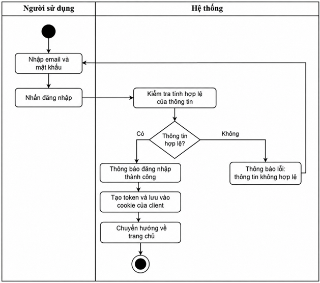

**Hình 3.24 - Mô hình hoạt động chức năng đăng nhập**

### Mô tả

- Người dùng nhập email và mật khẩu, sau đó nhấn đăng nhập.
- Hệ thống kiểm tra tính hợp lệ của thông tin.
- Nếu hợp lệ: thông báo đăng nhập thành công, tạo token, lưu cookie và chuyển về trang chủ.
- Nếu không hợp lệ: thông báo thông tin không hợp lệ và quay lại bước nhập email, mật khẩu.

### Hoạt động chức năng đăng ký

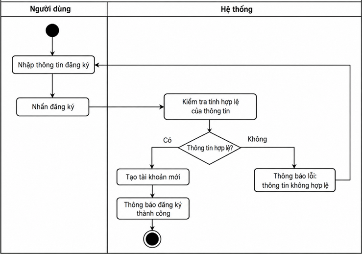

**Hình 3.25 - Mô hình hoạt động chức năng đăng ký**

### Mô tả

- Người dùng nhập thông tin đăng ký và nhấn đăng ký.
- Hệ thống kiểm tra tính hợp lệ của thông tin.
- Nếu hợp lệ: hệ thống tạo tài khoản mới và thông báo đăng ký thành công.
- Nếu không hợp lệ: hệ thống thông báo lỗi và quay lại bước nhập thông tin đăng ký.

### Hoạt động chức năng quản lý thông tin cá nhân

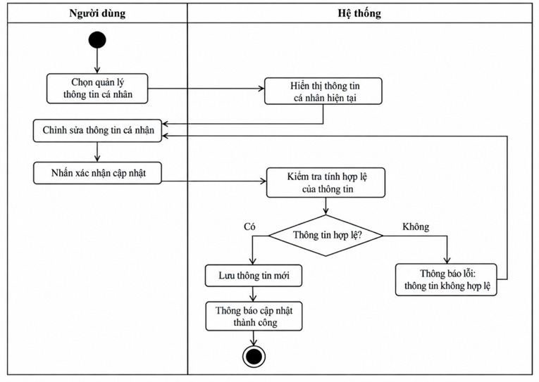

**Hình 3.26 - Mô hình hoạt động chức năng quản lý thông tin cá nhân**

### Mô tả

- Người dùng chọn quản lý thông tin cá nhân và hệ thống hiển thị thông tin hiện tại.
- Người dùng chỉnh sửa thông tin và nhấn xác nhận cập nhật.
- Hệ thống kiểm tra tính hợp lệ của thông tin.
- Nếu hợp lệ: lưu thông tin mới và thông báo cập nhật thành công.
- Nếu không hợp lệ: thông báo lỗi và quay lại bước chỉnh sửa.

### Hoạt động chức năng xem, tìm kiếm sản phẩm

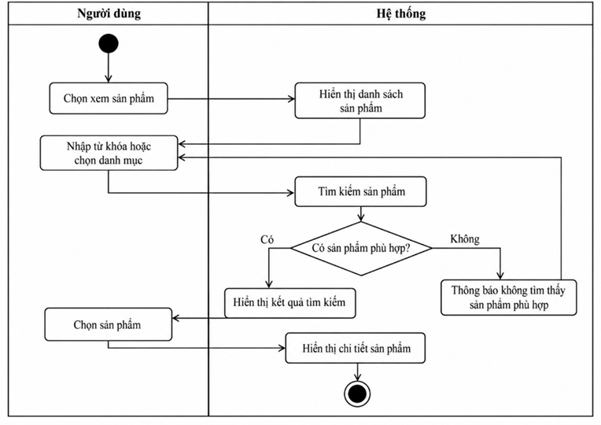

**Hình 3.27 - Mô hình hoạt động chức năng xem, tìm kiếm sản phẩm**

### Mô tả

- Người dùng chọn xem sản phẩm và hệ thống hiển thị danh sách sản phẩm.
- Người dùng nhập từ khóa hoặc chọn danh mục để tìm kiếm.
- Nếu có sản phẩm phù hợp: hệ thống hiển thị kết quả, người dùng chọn sản phẩm và xem chi tiết.
- Nếu không có sản phẩm phù hợp: hệ thống thông báo không tìm thấy sản phẩm.

### Hoạt động chức năng quản lý giỏ hàng

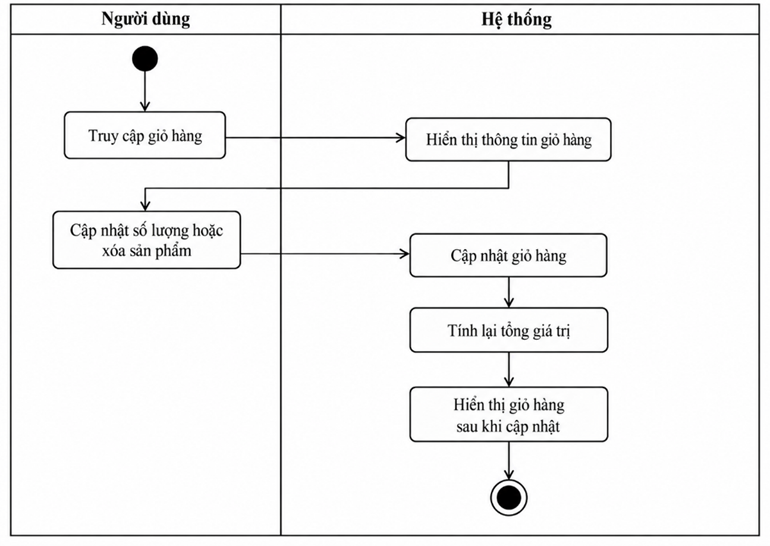

**Hình 3.28 - Mô hình hoạt động chức năng quản lý giỏ hàng**

### Mô tả

- Người dùng truy cập giỏ hàng và hệ thống hiển thị thông tin giỏ hàng.
- Người dùng cập nhật số lượng hoặc xóa sản phẩm.
- Hệ thống cập nhật giỏ hàng và tính lại tổng giá trị.
- Hệ thống hiển thị giỏ hàng sau khi cập nhật.

### Hoạt động chức năng đặt hàng và thanh toán

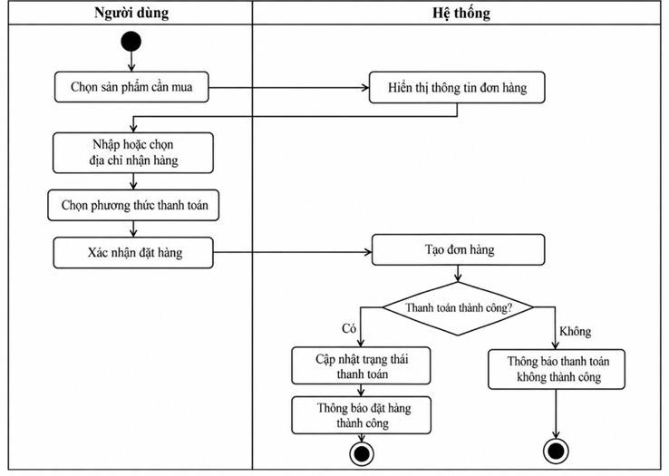

**Hình 3.29 - Mô hình hoạt động chức năng đặt hàng và thanh toán**

### Mô tả

- Người dùng chọn sản phẩm cần mua, nhập hoặc chọn địa chỉ nhận hàng và chọn phương thức thanh toán.
- Người dùng xác nhận đặt hàng, hệ thống tạo đơn hàng.
- Nếu thanh toán thành công: hệ thống cập nhật trạng thái thanh toán và thông báo đặt hàng thành công.
- Nếu thanh toán không thành công: hệ thống thông báo thanh toán không thành công.

### Hoạt động chức năng quản lý và theo dõi đơn hàng

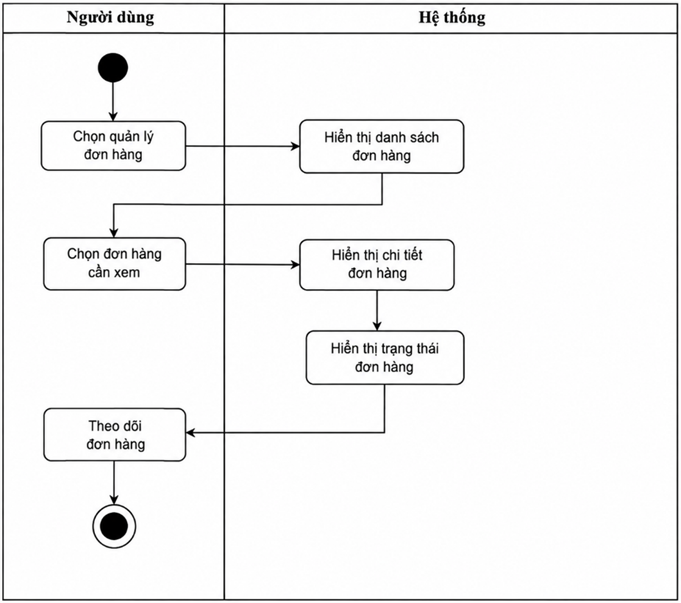

**Hình 3.30 - Mô hình hoạt động chức năng quản lý và theo dõi đơn hàng**

### Mô tả

- Người dùng chọn quản lý đơn hàng và hệ thống hiển thị danh sách đơn hàng.
- Người dùng chọn đơn hàng cần xem, hệ thống hiển thị chi tiết và trạng thái đơn hàng.
- Người dùng theo dõi trạng thái xử lý của đơn hàng.

### Hoạt động chức năng đổi trả và khiếu nại

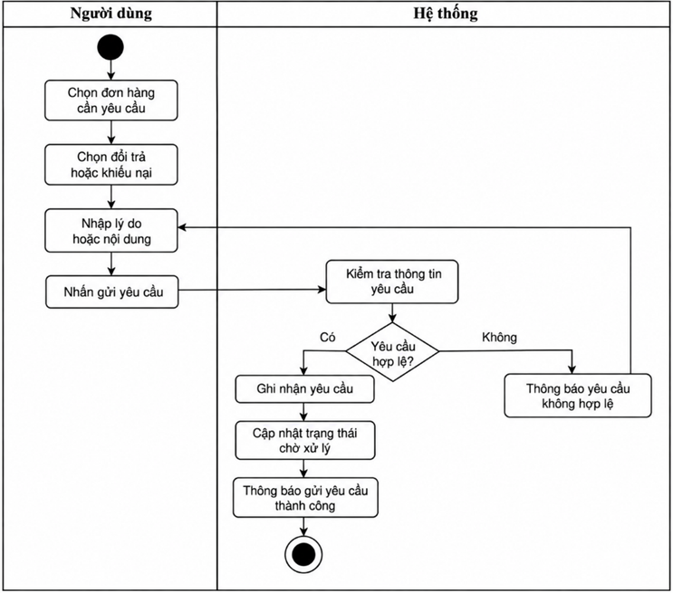

**Hình 3.31 - Mô hình hoạt động chức năng đổi trả và khiếu nại**

### Mô tả

- Người dùng chọn đơn hàng cần yêu cầu đổi trả hoặc khiếu nại.
- Người dùng nhập lý do hoặc nội dung và gửi yêu cầu.
- Hệ thống kiểm tra tính hợp lệ của yêu cầu.
- Nếu hợp lệ: hệ thống ghi nhận yêu cầu, cập nhật trạng thái chờ xử lý và thông báo gửi thành công.
- Nếu không hợp lệ: hệ thống thông báo lỗi và quay lại bước nhập nội dung.

### Hoạt động chức năng đánh giá sản phẩm

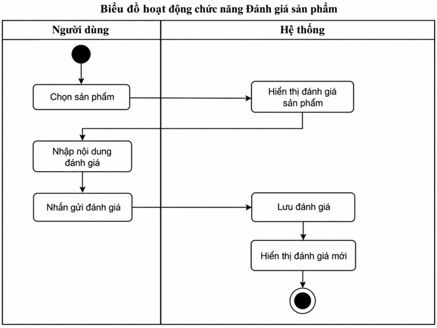

**Hình 3.32 - Mô hình hoạt động chức năng đánh giá sản phẩm**

### Mô tả

- Người dùng chọn sản phẩm và hệ thống hiển thị đánh giá của sản phẩm.
- Người dùng nhập nội dung đánh giá và nhấn gửi đánh giá.
- Hệ thống lưu đánh giá và hiển thị đánh giá mới.

### Hoạt động chức năng trao đổi với Người bán

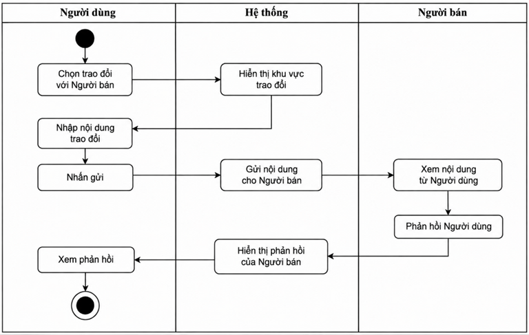

**Hình 3.33 - Mô hình hoạt động chức năng trao đổi với Người bán**

### Mô tả

- Người dùng chọn trao đổi với Người bán và hệ thống hiển thị khu vực trao đổi.
- Người dùng nhập nội dung và gửi tin nhắn cho Người bán.
- Người bán xem nội dung và phản hồi Người dùng.
- Hệ thống hiển thị phản hồi để Người dùng xem.

### Hoạt động chức năng đăng ký trở thành Người bán

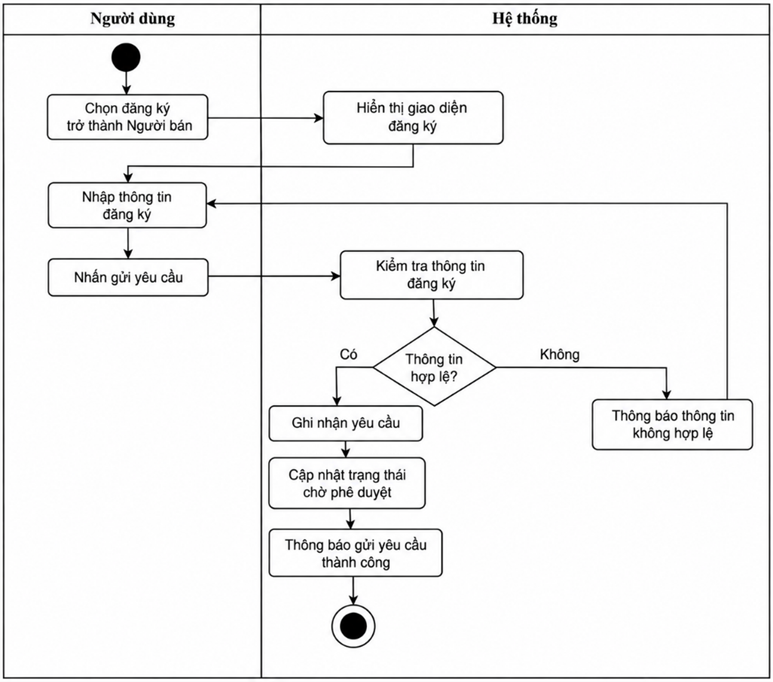

**Hình 3.34 - Mô hình hoạt động chức năng đăng ký trở thành Người bán**

### Mô tả

- Người dùng chọn đăng ký trở thành Người bán và hệ thống hiển thị giao diện đăng ký.
- Người dùng nhập thông tin đăng ký và gửi yêu cầu.
- Hệ thống kiểm tra tính hợp lệ của thông tin.
- Nếu hợp lệ: hệ thống ghi nhận yêu cầu, cập nhật trạng thái chờ phê duyệt và thông báo gửi yêu cầu thành công.
- Nếu không hợp lệ: hệ thống thông báo lỗi và quay lại bước nhập thông tin đăng ký.

## Biểu đồ hoạt động Người bán

### Hoạt động chức năng quản lý tài khoản và cửa hàng

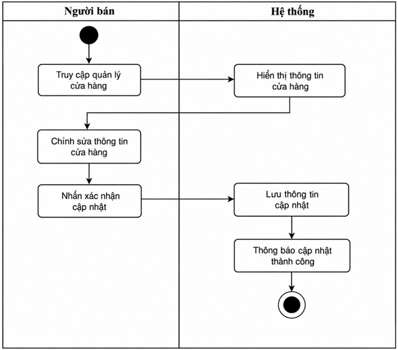

**Hình 3.35 - Mô hình hoạt động chức năng quản lý tài khoản và cửa hàng**

### Mô tả

- Người bán truy cập quản lý cửa hàng và hệ thống hiển thị thông tin cửa hàng.
- Người bán chỉnh sửa thông tin cửa hàng và nhấn xác nhận cập nhật.
- Hệ thống lưu thông tin cập nhật và thông báo cập nhật thành công.

### Hoạt động chức năng quản lý sản phẩm và tồn kho

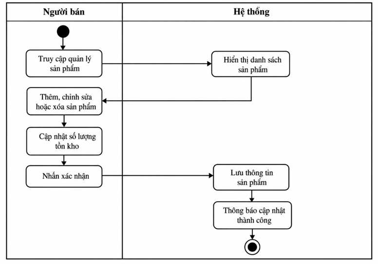

**Hình 3.36 - Mô hình hoạt động chức năng quản lý sản phẩm và tồn kho**

### Mô tả

- Người bán truy cập quản lý sản phẩm và hệ thống hiển thị danh sách sản phẩm.
- Người bán có thể thêm, chỉnh sửa hoặc xóa sản phẩm và cập nhật số lượng tồn kho.
- Người bán nhấn xác nhận, hệ thống lưu thông tin sản phẩm.
- Hệ thống thông báo cập nhật thành công.

### Hoạt động chức năng quản lý giá và khuyến mãi

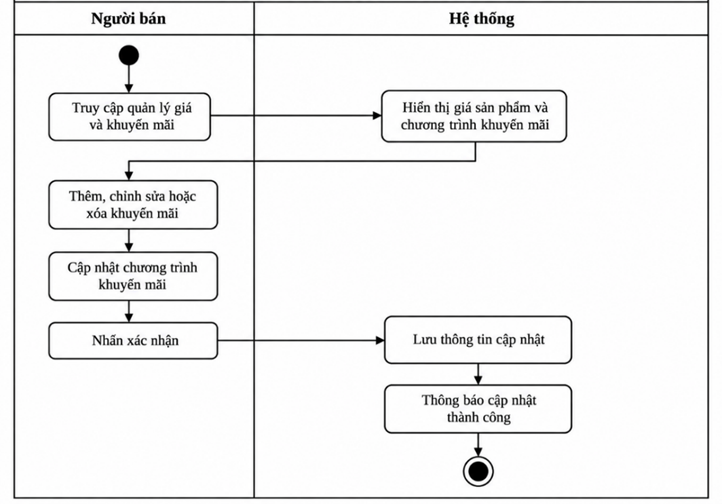

**Hình 3.37 - Mô hình hoạt động chức năng quản lý giá và khuyến mãi**

### Mô tả

- Người bán truy cập quản lý giá và khuyến mãi, hệ thống hiển thị giá sản phẩm và các chương trình khuyến mãi.
- Người bán có thể thêm, chỉnh sửa hoặc xóa khuyến mãi và cập nhật chương trình khuyến mãi.
- Người bán nhấn xác nhận, hệ thống lưu thông tin cập nhật.
- Hệ thống thông báo cập nhật thành công.

### Hoạt động chức năng quản lý đơn hàng

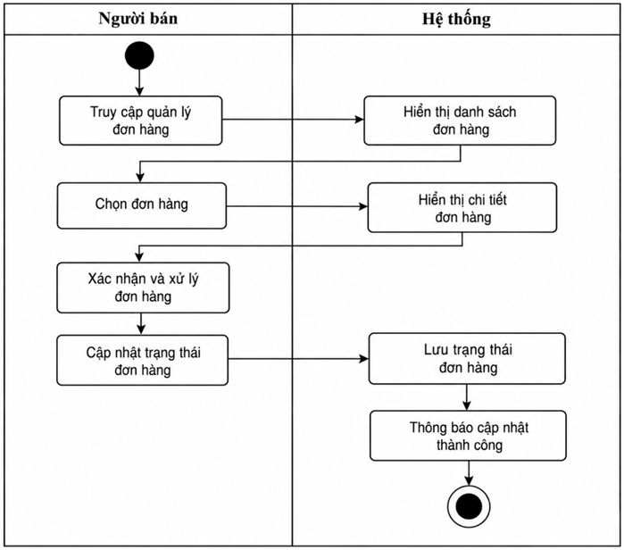

**Hình 3.38 - Mô hình hoạt động chức năng quản lý đơn hàng**

### Mô tả

- Người bán truy cập quản lý đơn hàng và hệ thống hiển thị danh sách đơn hàng.
- Người bán chọn đơn hàng để xem chi tiết, sau đó xác nhận và xử lý đơn hàng.
- Người bán cập nhật trạng thái đơn hàng.
- Hệ thống lưu trạng thái mới và thông báo cập nhật thành công.

### Hoạt động chức năng quản lý đổi trả sản phẩm

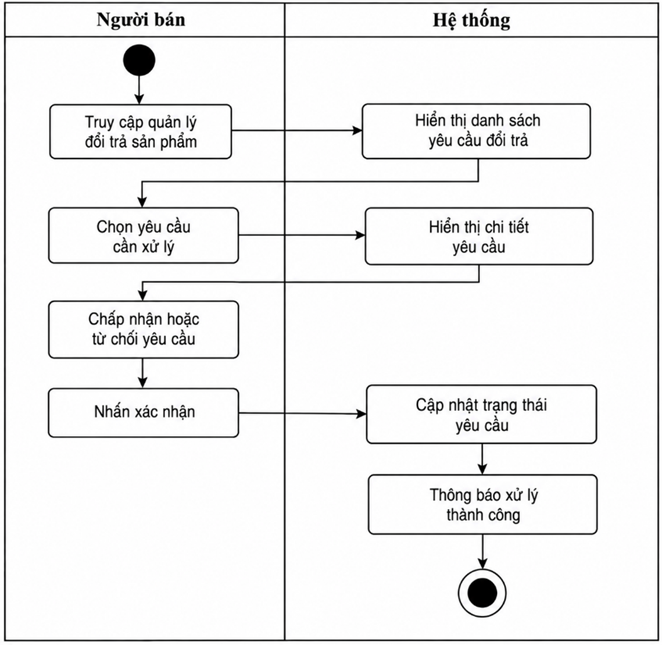

**Hình 3.39 - Mô hình hoạt động chức năng quản lý đổi trả sản phẩm**

### Mô tả

- Người bán truy cập quản lý đổi trả sản phẩm và hệ thống hiển thị danh sách yêu cầu đổi trả.
- Người bán chọn yêu cầu cần xử lý và hệ thống hiển thị chi tiết yêu cầu.
- Người bán chấp nhận hoặc từ chối yêu cầu, sau đó nhấn xác nhận.
- Hệ thống cập nhật trạng thái yêu cầu và thông báo xử lý thành công.

### Hoạt động chức năng quản lý doanh thu và báo cáo

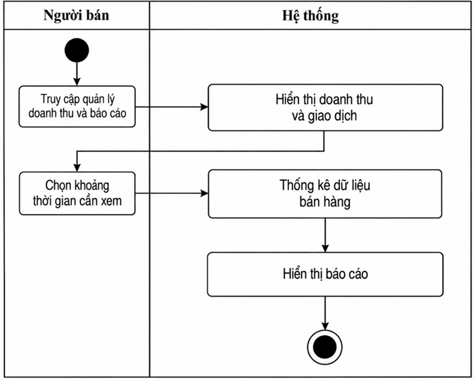

**Hình 3.40 - Mô hình hoạt động chức năng quản lý doanh thu và báo cáo**

### Mô tả

- Người bán truy cập quản lý doanh thu và báo cáo, hệ thống hiển thị doanh thu và giao dịch.
- Người bán chọn khoảng thời gian cần xem.
- Hệ thống thống kê dữ liệu bán hàng và hiển thị báo cáo.

### Hoạt động chức năng hỗ trợ khách hàng

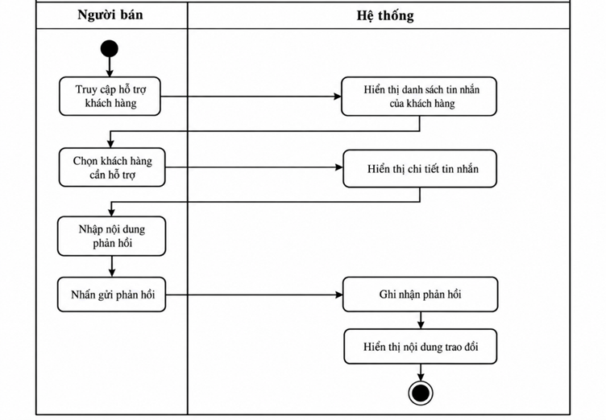

**Hình 3.41 - Mô hình hoạt động chức năng hỗ trợ khách hàng**

### Mô tả

- Người bán truy cập hỗ trợ khách hàng, hệ thống hiển thị danh sách tin nhắn.
- Người bán chọn khách hàng cần hỗ trợ và xem chi tiết tin nhắn.
- Người bán nhập nội dung phản hồi và gửi.
- Hệ thống ghi nhận phản hồi và hiển thị nội dung trao đổi.

## Biểu đồ hoạt động Quản trị viên

### Hoạt động chức năng duyệt đăng ký Người bán

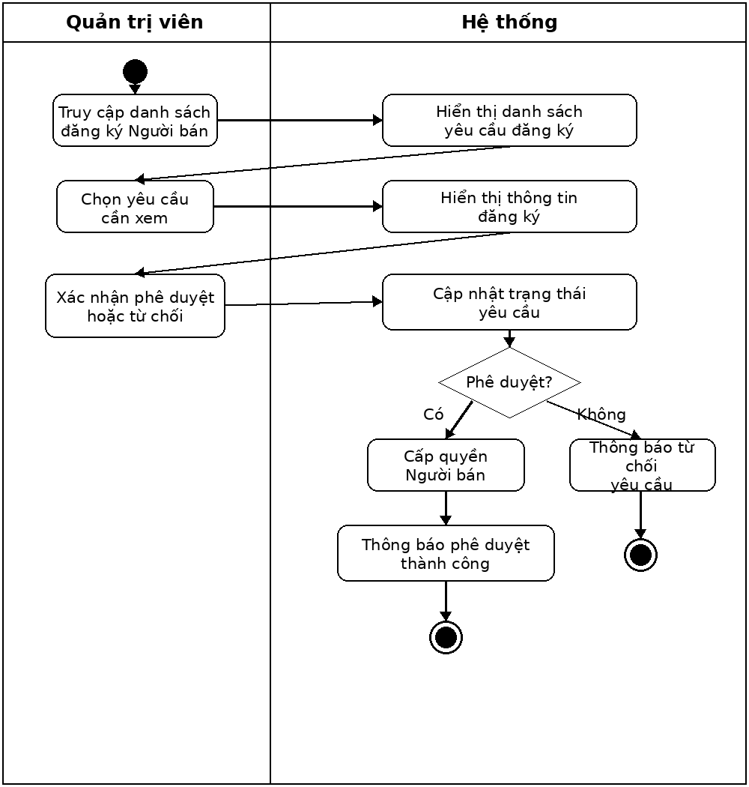

**Hình 3.42 - Mô hình hoạt động chức năng duyệt đăng ký Người bán**

### Mô tả

- Quản trị viên truy cập danh sách yêu cầu đăng ký Người bán và chọn yêu cầu cần xem.
- Hệ thống hiển thị thông tin đăng ký để Quản trị viên phê duyệt hoặc từ chối.
- Hệ thống cập nhật trạng thái yêu cầu.
- Nếu phê duyệt: hệ thống cấp quyền Người bán và thông báo thành công; nếu từ chối: hệ thống thông báo kết quả từ chối.

### Hoạt động chức năng quản lý tài khoản và hệ thống

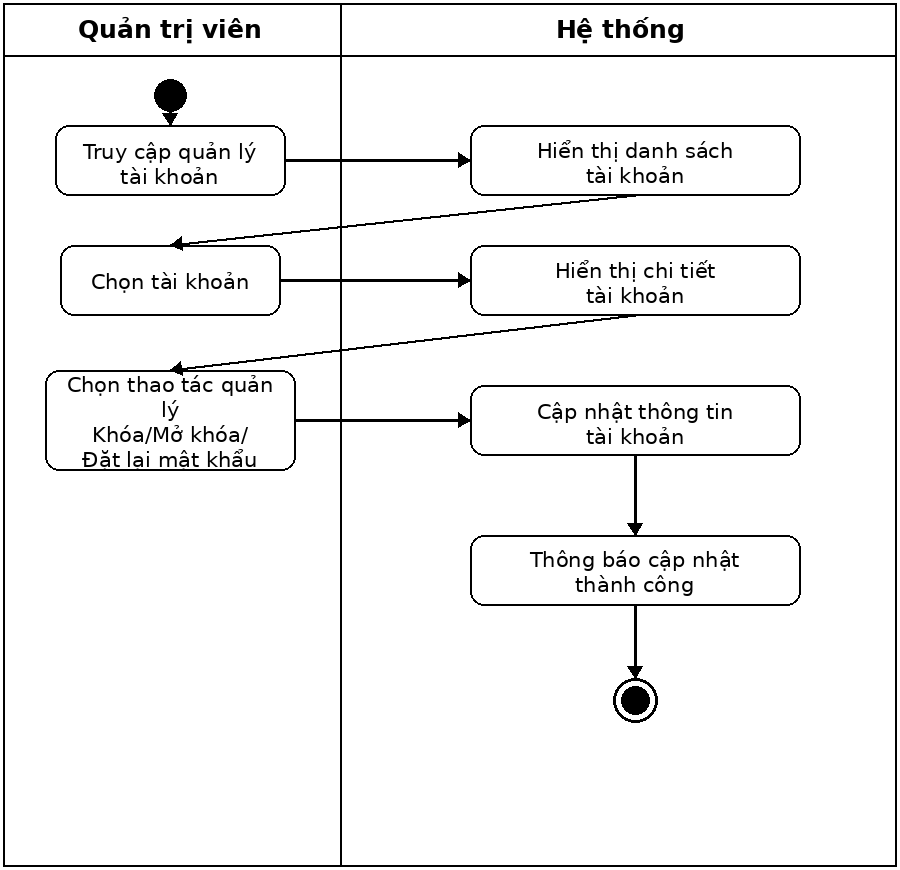

**Hình 3.43 - Mô hình hoạt động chức năng quản lý tài khoản và hệ thống**

### Mô tả

- Quản trị viên truy cập quản lý tài khoản, hệ thống hiển thị danh sách tài khoản.
- Quản trị viên chọn tài khoản và xem thông tin chi tiết.
- Quản trị viên chọn thao tác khóa/mở khóa hoặc đặt lại mật khẩu.
- Hệ thống cập nhật thông tin tài khoản và thông báo cập nhật thành công.

### Hoạt động chức năng quản lý danh mục và sản phẩm

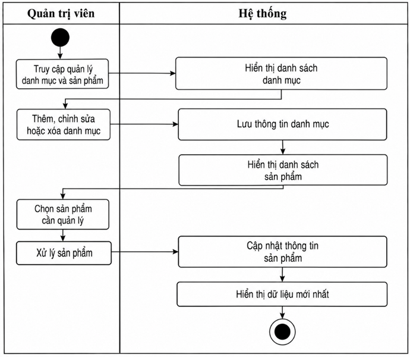

**Hình 3.44 - Mô hình hoạt động chức năng quản lý danh mục và sản phẩm**

### Mô tả

- Quản trị viên truy cập quản lý danh mục và sản phẩm, hệ thống hiển thị danh sách danh mục.
- Quản trị viên có thể thêm, chỉnh sửa hoặc xóa danh mục; hệ thống lưu thông tin danh mục.
- Hệ thống hiển thị danh sách sản phẩm để Quản trị viên chọn sản phẩm cần quản lý.
- Quản trị viên xử lý sản phẩm, hệ thống cập nhật thông tin và hiển thị dữ liệu mới nhất.

### Hoạt động chức năng quản lý giao dịch thanh toán

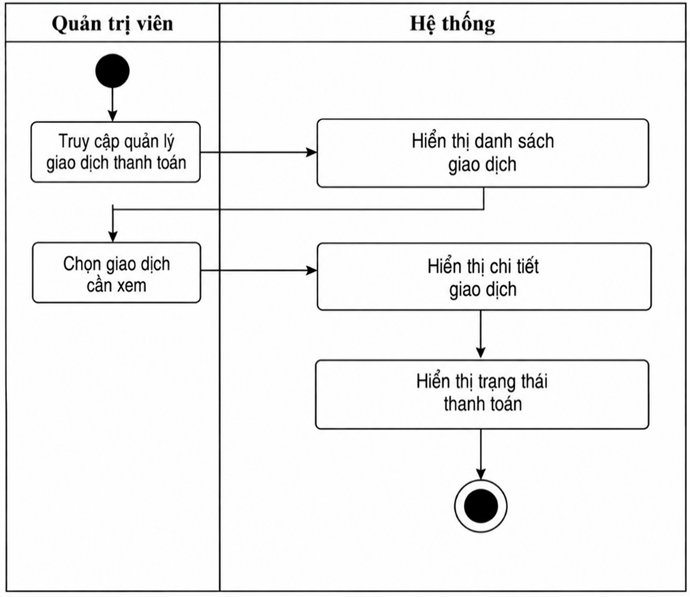

**Hình 3.45 - Mô hình hoạt động chức năng quản lý giao dịch thanh toán**

### Mô tả

- Quản trị viên truy cập quản lý giao dịch thanh toán, hệ thống hiển thị danh sách giao dịch.
- Quản trị viên chọn giao dịch cần xem.
- Hệ thống hiển thị chi tiết giao dịch và trạng thái thanh toán.

### Hoạt động chức năng quản lý quảng cáo và khuyến mãi

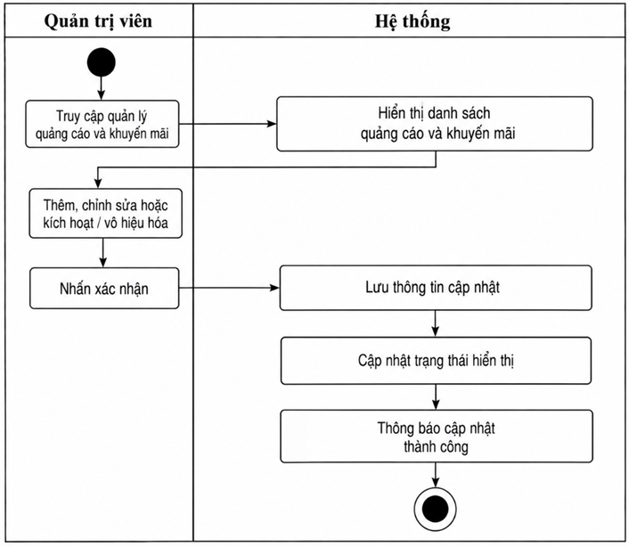

**Hình 3.46 - Mô hình hoạt động chức năng quản lý quảng cáo và khuyến mãi**

### Mô tả

- Quản trị viên truy cập quản lý quảng cáo và khuyến mãi, hệ thống hiển thị danh sách hiện có.
- Quản trị viên có thể thêm, chỉnh sửa hoặc kích hoạt/vô hiệu hóa nội dung.
- Quản trị viên nhấn xác nhận, hệ thống lưu thông tin cập nhật.
- Hệ thống cập nhật trạng thái hiển thị và thông báo thành công.

### Hoạt động chức năng báo cáo và phân tích

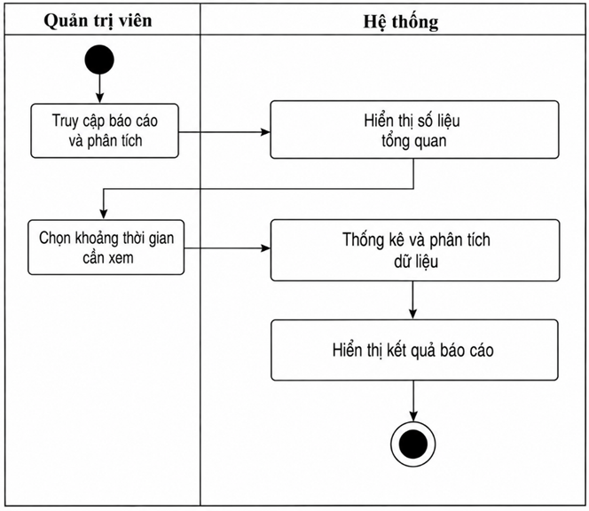

**Hình 3.47 - Mô hình hoạt động chức năng báo cáo và phân tích**

### Mô tả

- Quản trị viên truy cập báo cáo và phân tích, hệ thống hiển thị số liệu tổng quan.
- Quản trị viên chọn khoảng thời gian cần xem.
- Hệ thống thống kê và phân tích dữ liệu.
- Hệ thống hiển thị kết quả báo cáo.

**3.1.6 Biểu đồ tương tác tuần tự các chức năng**

### Biểu đồ tuần tự chức năng đăng nhập

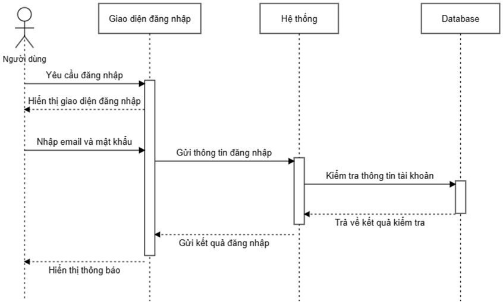

**Hình 3.48 - Mô hình tuần tự chức năng đăng nhập**

### Mô tả

- Người dùng gửi yêu cầu đăng nhập.
- Giao diện đăng nhập hiển thị màn hình đăng nhập để người dùng nhập email và mật khẩu.
- Giao diện gửi thông tin đăng nhập sang hệ thống.
- Hệ thống kiểm tra thông tin tài khoản trong cơ sở dữ liệu.
- Database trả kết quả kiểm tra về cho hệ thống.
- Hệ thống gửi kết quả đăng nhập về giao diện.
- Giao diện hiển thị thông báo cho người dùng.

### Biểu đồ tuần tự chức năng đăng ký

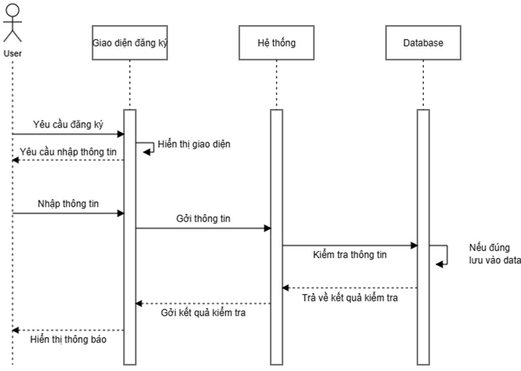

**Hình 3.49 - Mô hình tuần tự chức năng đăng ký**

### Mô tả

- Người dùng gửi yêu cầu đăng ký tài khoản.
- Giao diện đăng ký hiển thị biểu mẫu để người dùng nhập thông tin.
- Giao diện gửi thông tin đăng ký sang hệ thống.
- Hệ thống kiểm tra thông tin đăng ký trong cơ sở dữ liệu.
- Nếu thông tin hợp lệ, hệ thống lưu dữ liệu vào database.
- Database trả kết quả kiểm tra về cho hệ thống.
- Hệ thống gửi kết quả xử lý về giao diện.
- Giao diện hiển thị thông báo cho người dùng.

### Biểu đồ tuần tự chức năng quản lý thông tin cá nhân

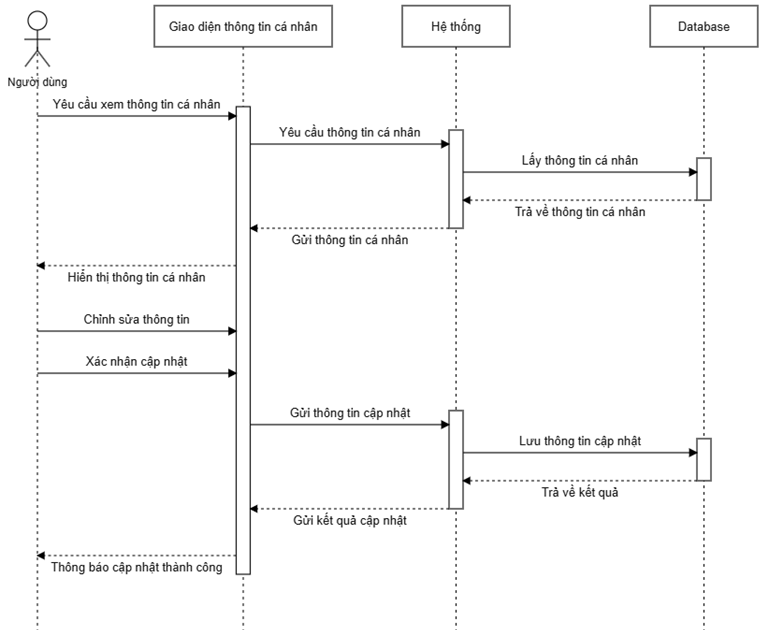

**Hình 3.50 - Mô hình tuần tự chức năng quản lý thông tin cá nhân**

### Mô tả

- Người dùng yêu cầu xem thông tin cá nhân.
- Giao diện thông tin cá nhân gửi yêu cầu lấy thông tin sang hệ thống.
- Hệ thống lấy thông tin cá nhân từ cơ sở dữ liệu.
- Database trả thông tin cá nhân về cho hệ thống.
- Hệ thống gửi thông tin cá nhân về giao diện để hiển thị cho người dùng.
- Người dùng chỉnh sửa thông tin và xác nhận cập nhật.
- Giao diện gửi thông tin cập nhật sang hệ thống.
- Hệ thống lưu thông tin cập nhật vào database.
- Database trả kết quả cập nhật về cho hệ thống.
- Hệ thống gửi kết quả cập nhật về giao diện.
- Giao diện thông báo cập nhật thành công cho người dùng.

### Biểu đồ tuần tự chức năng xem, tìm kiếm sản phẩm

**Hình 3.51 - Mô hình tuần tự chức năng xem, tìm kiếm sản phẩm**

### Mô tả

- Người dùng yêu cầu xem sản phẩm.
- Giao diện sản phẩm gửi yêu cầu lấy danh sách sản phẩm sang hệ thống.
- Hệ thống lấy danh sách sản phẩm từ cơ sở dữ liệu.
- Database trả danh sách sản phẩm về cho hệ thống.
- Hệ thống gửi danh sách sản phẩm về giao diện để hiển thị.
- Người dùng nhập từ khóa hoặc chọn danh mục để tìm kiếm.
- Giao diện gửi yêu cầu tìm kiếm sang hệ thống.
- Hệ thống tìm kiếm sản phẩm trong cơ sở dữ liệu.
- Database trả kết quả tìm kiếm về cho hệ thống.
- Hệ thống gửi kết quả tìm kiếm về giao diện để hiển thị.
- Người dùng chọn một sản phẩm cần xem.
- Giao diện gửi yêu cầu lấy chi tiết sản phẩm sang hệ thống.
- Hệ thống lấy thông tin sản phẩm từ cơ sở dữ liệu.
- Database trả thông tin sản phẩm về cho hệ thống.
- Hệ thống gửi chi tiết sản phẩm về giao diện để hiển thị cho người dùng.

### Biểu đồ tuần tự chức năng quản lý giỏ hàng

**Hình 3.52 - Mô hình tuần tự chức năng quản lý giỏ hàng**

### Mô tả

- Người dùng yêu cầu xem giỏ hàng.
- Giao diện giỏ hàng gửi yêu cầu lấy thông tin giỏ hàng sang hệ thống.
- Hệ thống lấy dữ liệu giỏ hàng từ cơ sở dữ liệu.
- Database trả dữ liệu giỏ hàng về cho hệ thống.
- Hệ thống gửi thông tin giỏ hàng về giao diện để hiển thị cho người dùng.
- Người dùng cập nhật số lượng hoặc xóa sản phẩm.
- Giao diện gửi thông tin cập nhật sang hệ thống.
- Hệ thống cập nhật giỏ hàng trong cơ sở dữ liệu.
- Database trả kết quả cập nhật về cho hệ thống.
- Hệ thống gửi giỏ hàng đã cập nhật về giao diện.
- Giao diện hiển thị giỏ hàng mới cho người dùng.

### Biểu đồ tuần tự chức năng đặt hàng và thanh toán

**Hình 3.53 - Mô hình tuần tự chức năng đặt hàng và thanh toán**

### Mô tả

- Người dùng gửi yêu cầu đặt hàng.
- Giao diện đặt hàng gửi yêu cầu lấy thông tin đơn hàng sang hệ thống.
- Hệ thống lấy thông tin sản phẩm và giỏ hàng từ cơ sở dữ liệu.
- Database trả thông tin đơn hàng về cho hệ thống.
- Hệ thống gửi thông tin đơn hàng về giao diện để hiển thị.
- Người dùng nhập địa chỉ, chọn phương thức thanh toán và xác nhận đặt hàng.
- Giao diện gửi yêu cầu đặt hàng sang hệ thống.
- Hệ thống tạo đơn hàng trong cơ sở dữ liệu.
- Database xác nhận tạo đơn hàng.
- Hệ thống gửi yêu cầu thanh toán đến VNPay và nhận kết quả thanh toán.
- Hệ thống cập nhật trạng thái thanh toán vào cơ sở dữ liệu.
- Database xác nhận cập nhật.
- Hệ thống gửi kết quả đặt hàng về giao diện để hiển thị cho người dùng.

### Biểu đồ tuần tự chức năng quản lý và theo dõi đơn hàng

**Hình 3.54 - Mô hình tuần tự chức năng quản lý và theo dõi đơn hàng**

### Mô tả

- Người dùng yêu cầu xem đơn hàng.
- Giao diện đơn hàng gửi yêu cầu lấy danh sách đơn hàng sang hệ thống.
- Hệ thống lấy danh sách đơn hàng từ cơ sở dữ liệu.
- Database trả danh sách đơn hàng về cho hệ thống.
- Hệ thống gửi danh sách đơn hàng về giao diện để hiển thị cho người dùng.
- Người dùng chọn đơn hàng cần xem.
- Giao diện gửi yêu cầu lấy chi tiết đơn hàng sang hệ thống.
- Hệ thống lấy thông tin và trạng thái đơn hàng từ cơ sở dữ liệu.
- Database trả thông tin đơn hàng về cho hệ thống.
- Hệ thống gửi chi tiết đơn hàng về giao diện để hiển thị cho người dùng.

### Biểu đồ tuần tự chức năng đổi trả và khiếu nại

**Hình 3.55 - Mô hình tuần tự chức năng đổi trả và khiếu nại**

### Mô tả

- Người dùng chọn đơn hàng cần yêu cầu đổi trả hoặc khiếu nại.
- Giao diện gửi yêu cầu lấy thông tin đơn hàng sang hệ thống.
- Hệ thống lấy thông tin đơn hàng từ cơ sở dữ liệu.
- Database trả thông tin đơn hàng về cho hệ thống.
- Hệ thống gửi thông tin đơn hàng về giao diện để hiển thị cho người dùng.
- Người dùng chọn loại yêu cầu, nhập lý do hoặc nội dung khiếu nại và xác nhận gửi.
- Giao diện gửi yêu cầu đổi trả/khiếu nại sang hệ thống.
- Hệ thống lưu yêu cầu vào cơ sở dữ liệu.
- Database xác nhận lưu yêu cầu.
- Hệ thống gửi kết quả xử lý về giao diện.
- Giao diện thông báo gửi yêu cầu thành công cho người dùng.

### Biểu đồ tuần tự chức năng đánh giá sản phẩm

**Hình 3.56 - Mô hình tuần tự chức năng đánh giá sản phẩm**

### Mô tả

- Người dùng chọn sản phẩm cần xem đánh giá.
- Giao diện sản phẩm gửi yêu cầu lấy danh sách đánh giá sang hệ thống.
- Hệ thống lấy danh sách đánh giá từ cơ sở dữ liệu.
- Database trả danh sách đánh giá về cho hệ thống.
- Hệ thống gửi danh sách đánh giá về giao diện để hiển thị cho người dùng.
- Người dùng nhập nội dung đánh giá và xác nhận gửi.
- Giao diện gửi đánh giá sang hệ thống.
- Hệ thống lưu đánh giá vào cơ sở dữ liệu.
- Database xác nhận lưu đánh giá.
- Hệ thống gửi kết quả về giao diện và hiển thị đánh giá mới cho người dùng.

### Biểu đồ tuần tự chức năng trao đổi với Người bán

**Hình 3.57 - Mô hình tuần tự chức năng trao đổi với Người bán**

### Mô tả

- Người dùng yêu cầu trao đổi với Người bán.
- Giao diện trao đổi hiển thị khu vực trao đổi.
- Người dùng nhập nội dung và nhấn gửi.
- Giao diện gửi nội dung trao đổi sang hệ thống.
- Hệ thống lưu nội dung trao đổi vào cơ sở dữ liệu.
- Database xác nhận lưu nội dung.
- Hệ thống gửi kết quả về giao diện.
- Giao diện thông báo gửi thành công cho người dùng.

### Biểu đồ tuần tự chức năng đăng ký trở thành Người bán

**Hình 3.58 - Mô hình tuần tự chức năng đăng ký trở thành Người bán**

### Mô tả

- Người dùng chọn đăng ký trở thành Người bán.
- Giao diện đăng ký Người bán hiển thị biểu mẫu đăng ký.
- Người dùng nhập thông tin và nhấn gửi yêu cầu.
- Giao diện gửi thông tin đăng ký sang hệ thống.
- Hệ thống lưu yêu cầu đăng ký vào cơ sở dữ liệu.
- Database xác nhận lưu yêu cầu.
- Hệ thống trả trạng thái chờ phê duyệt về giao diện.
- Giao diện thông báo gửi yêu cầu thành công cho người dùng.

## Biểu đồ tuần tự Người bán

### Biểu đồ tuần tự chức năng quản lý tài khoản và cửa hàng

**Hình 3.59 - Mô hình tuần tự chức năng quản lý tài khoản và cửa hàng**

### Mô tả

- Người bán gửi yêu cầu quản lý cửa hàng.
- Giao diện quản lý cửa hàng gửi yêu cầu lấy thông tin cửa hàng sang hệ thống.
- Hệ thống lấy thông tin cửa hàng từ cơ sở dữ liệu.
- Database trả thông tin cửa hàng về cho hệ thống.
- Hệ thống gửi thông tin cửa hàng về giao diện để hiển thị cho Người bán.
- Người bán chỉnh sửa thông tin cửa hàng và xác nhận cập nhật.
- Giao diện gửi thông tin cập nhật sang hệ thống.
- Hệ thống cập nhật thông tin cửa hàng trong cơ sở dữ liệu.
- Database xác nhận cập nhật.
- Hệ thống gửi kết quả cập nhật về giao diện.
- Giao diện thông báo cập nhật thành công cho Người bán.

### Biểu đồ tuần tự chức năng quản lý sản phẩm và tồn kho

**Hình 3.60 - Mô hình tuần tự chức năng quản lý sản phẩm và tồn kho**

### Mô tả

- Người bán yêu cầu quản lý sản phẩm.
- Giao diện quản lý sản phẩm gửi yêu cầu lấy danh sách sản phẩm sang hệ thống.
- Hệ thống lấy danh sách sản phẩm từ cơ sở dữ liệu.
- Database trả danh sách sản phẩm về cho hệ thống.
- Hệ thống gửi danh sách sản phẩm về giao diện để hiển thị cho Người bán.
- Người bán thực hiện thêm, sửa, xóa sản phẩm hoặc cập nhật tồn kho và xác nhận thao tác.
- Giao diện gửi thông tin cập nhật sang hệ thống.
- Hệ thống cập nhật dữ liệu sản phẩm trong cơ sở dữ liệu.
- Database xác nhận cập nhật.
- Hệ thống gửi kết quả xử lý về giao diện.
- Giao diện hiển thị danh sách sản phẩm mới cho Người bán.

### Biểu đồ tuần tự chức năng quản lý giá và khuyến mãi

**Hình 3.61 - Mô hình tuần tự chức năng quản lý giá và khuyến mãi**

### Mô tả

- Người bán chọn sản phẩm cần quản lý giá và khuyến mãi.
- Giao diện gửi yêu cầu lấy thông tin giá và khuyến mãi sang hệ thống.
- Hệ thống lấy thông tin giá và khuyến mãi từ cơ sở dữ liệu.
- Database trả thông tin về cho hệ thống.
- Hệ thống gửi thông tin giá và khuyến mãi về giao diện để hiển thị cho Người bán.
- Người bán cập nhật giá hoặc khuyến mãi và xác nhận cập nhật.
- Giao diện gửi thông tin cập nhật sang hệ thống.
- Hệ thống cập nhật giá và khuyến mãi trong cơ sở dữ liệu.
- Database xác nhận cập nhật.
- Hệ thống gửi kết quả về giao diện.
- Giao diện thông báo cập nhật thành công cho Người bán.

### Biểu đồ tuần tự chức năng quản lý đơn hàng

**Hình 3.62 - Mô hình tuần tự chức năng quản lý đơn hàng**

### Mô tả

- Người bán yêu cầu quản lý đơn hàng.
- Giao diện quản lý đơn hàng gửi yêu cầu lấy danh sách đơn hàng sang hệ thống.
- Hệ thống lấy danh sách đơn hàng từ cơ sở dữ liệu.
- Database trả danh sách đơn hàng về cho hệ thống.
- Hệ thống gửi danh sách đơn hàng về giao diện để hiển thị cho Người bán.
- Người bán chọn đơn hàng cần xem.
- Giao diện gửi yêu cầu lấy chi tiết đơn hàng sang hệ thống.
- Hệ thống lấy thông tin đơn hàng từ cơ sở dữ liệu.
- Database trả thông tin đơn hàng về cho hệ thống.
- Hệ thống gửi chi tiết đơn hàng về giao diện để hiển thị chi tiết và trạng thái đơn hàng.
- Người bán cập nhật trạng thái đơn hàng.
- Giao diện gửi trạng thái mới sang hệ thống.
- Hệ thống cập nhật trạng thái đơn hàng trong cơ sở dữ liệu.
- Database xác nhận cập nhật.
- Hệ thống gửi kết quả cập nhật về giao diện.
- Giao diện hiển thị trạng thái mới cho Người bán.

### Biểu đồ tuần tự chức năng quản lý đổi trả sản phẩm

**Hình 3.63 - Mô hình tuần tự chức năng quản lý đổi trả sản phẩm**

### Mô tả

- Người bán yêu cầu xem danh sách đổi trả.
- Giao diện quản lý đổi trả gửi yêu cầu lấy danh sách yêu cầu sang hệ thống.
- Hệ thống lấy danh sách yêu cầu từ cơ sở dữ liệu.
- Database trả danh sách yêu cầu về cho hệ thống.
- Hệ thống gửi danh sách yêu cầu về giao diện để hiển thị cho Người bán.
- Người bán chọn yêu cầu cần xử lý.
- Giao diện gửi yêu cầu lấy thông tin chi tiết sang hệ thống.
- Hệ thống lấy thông tin yêu cầu từ cơ sở dữ liệu.
- Database trả thông tin yêu cầu về cho hệ thống.
- Hệ thống gửi thông tin chi tiết về giao diện để hiển thị cho Người bán.
- Người bán chọn kết quả xử lý và xác nhận xử lý.
- Giao diện gửi kết quả xử lý sang hệ thống.
- Hệ thống cập nhật trạng thái yêu cầu trong cơ sở dữ liệu.
- Database xác nhận cập nhật.
- Hệ thống gửi kết quả xử lý về giao diện.
- Giao diện thông báo xử lý thành công cho Người bán.

### Biểu đồ tuần tự chức năng quản lý doanh thu và báo cáo

**Hình 3.64 - Mô hình tuần tự chức năng quản lý doanh thu và báo cáo**

### Mô tả

- Người bán yêu cầu xem doanh thu và báo cáo.
- Giao diện gửi yêu cầu lấy dữ liệu doanh thu sang hệ thống.
- Hệ thống lấy dữ liệu bán hàng từ cơ sở dữ liệu.
- Database trả dữ liệu bán hàng về cho hệ thống.
- Hệ thống gửi thông tin doanh thu về giao diện để hiển thị cho Người bán.
- Người bán chọn khoảng thời gian cần xem báo cáo.
- Giao diện gửi yêu cầu thống kê sang hệ thống.
- Hệ thống lấy dữ liệu theo khoảng thời gian từ cơ sở dữ liệu.
- Database trả dữ liệu thống kê về cho hệ thống.
- Hệ thống gửi kết quả báo cáo về giao diện.
- Giao diện hiển thị báo cáo và thống kê cho Người bán.

### Biểu đồ tuần tự chức năng hỗ trợ khách hàng

**Hình 3.65 - Mô hình tuần tự chức năng hỗ trợ khách hàng**

### Mô tả

- Người bán yêu cầu xem hỗ trợ khách hàng.
- Giao diện gửi yêu cầu lấy danh sách trao đổi sang hệ thống.
- Hệ thống lấy danh sách tin nhắn từ cơ sở dữ liệu.
- Database trả danh sách tin nhắn về cho hệ thống.
- Hệ thống gửi danh sách trao đổi về giao diện để hiển thị cho Người bán.
- Người bán chọn khách hàng cần hỗ trợ.
- Giao diện gửi yêu cầu lấy chi tiết trao đổi sang hệ thống.
- Hệ thống lấy nội dung trao đổi từ cơ sở dữ liệu.
- Database trả nội dung trao đổi về cho hệ thống.
- Hệ thống gửi nội dung chi tiết về giao diện để hiển thị.
- Người bán nhập nội dung phản hồi và nhấn gửi.
- Giao diện gửi nội dung phản hồi sang hệ thống.
- Hệ thống lưu phản hồi vào cơ sở dữ liệu.
- Database xác nhận lưu phản hồi.
- Hệ thống gửi kết quả về giao diện.
- Giao diện hiển thị nội dung phản hồi cho Người bán.

## Biểu đồ tuần tự Quản trị viên

### Biểu đồ tuần tự chức năng duyệt đăng ký Người bán

**Hình 3.66 - Mô hình tuần tự chức năng duyệt đăng ký Người bán**

### Mô tả

- Quản trị viên yêu cầu xem danh sách đăng ký Người bán.
- Giao diện duyệt đăng ký gửi yêu cầu lấy danh sách đăng ký sang hệ thống.
- Hệ thống lấy danh sách yêu cầu từ cơ sở dữ liệu.
- Database trả danh sách yêu cầu về cho hệ thống.
- Hệ thống gửi danh sách về giao diện để hiển thị cho Quản trị viên.
- Quản trị viên chọn yêu cầu cần duyệt.
- Giao diện gửi yêu cầu lấy thông tin đăng ký sang hệ thống.
- Hệ thống lấy thông tin đăng ký từ cơ sở dữ liệu.
- Database trả thông tin đăng ký về cho hệ thống.
- Hệ thống gửi thông tin chi tiết về giao diện để hiển thị.
- Quản trị viên chọn kết quả xét duyệt và xác nhận.
- Giao diện gửi kết quả xét duyệt sang hệ thống.
- Hệ thống cập nhật trạng thái và quyền tài khoản trong cơ sở dữ liệu.
- Database xác nhận cập nhật.
- Hệ thống gửi kết quả xử lý về giao diện.
- Giao diện thông báo xét duyệt thành công cho Quản trị viên.

### Biểu đồ tuần tự chức năng quản lý tài khoản và hệ thống

**Hình 3.67 - Mô hình tuần tự chức năng quản lý tài khoản và hệ thống**

### Mô tả

- Quản trị viên yêu cầu quản lý tài khoản.
- Giao diện quản lý tài khoản gửi yêu cầu lấy danh sách tài khoản sang hệ thống.
- Hệ thống lấy danh sách tài khoản từ cơ sở dữ liệu.
- Database trả danh sách tài khoản về cho hệ thống.
- Hệ thống gửi danh sách tài khoản về giao diện để hiển thị.
- Quản trị viên chọn tài khoản cần quản lý.
- Giao diện gửi yêu cầu lấy thông tin tài khoản sang hệ thống.
- Hệ thống lấy thông tin tài khoản từ cơ sở dữ liệu.
- Database trả thông tin tài khoản về cho hệ thống.
- Hệ thống gửi thông tin chi tiết về giao diện để hiển thị.
- Quản trị viên chọn thao tác quản lý và xác nhận.
- Giao diện gửi yêu cầu cập nhật sang hệ thống.
- Hệ thống cập nhật thông tin tài khoản trong cơ sở dữ liệu.
- Database xác nhận cập nhật.
- Hệ thống gửi kết quả xử lý về giao diện.
- Giao diện thông báo xử lý thành công cho Quản trị viên.

### Biểu đồ tuần tự chức năng quản lý danh mục và sản phẩm

**Hình 3.68 - Mô hình tuần tự chức năng quản lý danh mục và sản phẩm**

### Mô tả

- Quản trị viên yêu cầu quản lý danh mục và sản phẩm.
- Giao diện quản lý danh mục và sản phẩm gửi yêu cầu lấy dữ liệu sang hệ thống.
- Hệ thống lấy danh mục và sản phẩm từ cơ sở dữ liệu.
- Database trả dữ liệu về cho hệ thống.
- Hệ thống gửi dữ liệu về giao diện để hiển thị cho Quản trị viên.
- Quản trị viên chọn thao tác quản lý.
- Quản trị viên thực hiện thêm, sửa, xóa danh mục hoặc xử lý sản phẩm.
- Quản trị viên xác nhận thao tác.
- Giao diện gửi yêu cầu cập nhật sang hệ thống.
- Hệ thống cập nhật danh mục hoặc sản phẩm trong cơ sở dữ liệu.
- Database xác nhận cập nhật.
- Hệ thống gửi kết quả xử lý về giao diện.
- Giao diện hiển thị dữ liệu đã cập nhật cho Quản trị viên.

### Biểu đồ tuần tự chức năng quản lý giao dịch thanh toán

**Hình 3.69 - Mô hình tuần tự chức năng quản lý giao dịch thanh toán**

### Mô tả

- Quản trị viên yêu cầu xem giao dịch thanh toán.
- Giao diện giao dịch thanh toán gửi yêu cầu lấy danh sách giao dịch sang hệ thống.
- Hệ thống lấy danh sách giao dịch từ cơ sở dữ liệu.
- Database trả danh sách giao dịch về cho hệ thống.
- Hệ thống gửi danh sách giao dịch về giao diện để hiển thị cho Quản trị viên.
- Quản trị viên chọn giao dịch cần xem.
- Giao diện gửi yêu cầu lấy chi tiết giao dịch sang hệ thống.
- Hệ thống lấy thông tin giao dịch từ cơ sở dữ liệu.
- Database trả thông tin giao dịch về cho hệ thống.
- Hệ thống gửi chi tiết giao dịch về giao diện.
- Giao diện hiển thị chi tiết và trạng thái thanh toán cho Quản trị viên.

### Biểu đồ tuần tự chức năng quản lý quảng cáo và khuyến mãi

**Hình 3.70 - Mô hình tuần tự chức năng quản lý quảng cáo và khuyến mãi**

### Mô tả

- Quản trị viên yêu cầu quản lý quảng cáo và khuyến mãi.
- Giao diện quảng cáo và khuyến mãi gửi yêu cầu lấy danh sách quảng cáo và khuyến mãi sang hệ thống.
- Hệ thống lấy dữ liệu quảng cáo và khuyến mãi từ cơ sở dữ liệu.
- Database trả dữ liệu về cho hệ thống.
- Hệ thống gửi danh sách dữ liệu về giao diện.
- Giao diện hiển thị quảng cáo và khuyến mãi cho Quản trị viên.
- Quản trị viên chọn thao tác quản lý.
- Quản trị viên nhập hoặc cập nhật thông tin.
- Quản trị viên xác nhận thao tác.
- Giao diện gửi thông tin cập nhật sang hệ thống.
- Hệ thống cập nhật quảng cáo và khuyến mãi trong cơ sở dữ liệu.
- Database xác nhận cập nhật.
- Hệ thống gửi kết quả xử lý về giao diện.
- Giao diện hiển thị dữ liệu đã cập nhật cho Quản trị viên.

### Biểu đồ tuần tự chức năng báo cáo và phân tích

**Hình 3.71 - Mô hình tuần tự chức năng báo cáo và phân tích**

### Mô tả

- Quản trị viên yêu cầu xem báo cáo.
- Giao diện báo cáo và phân tích gửi yêu cầu lấy dữ liệu tổng quan sang hệ thống.
- Hệ thống lấy dữ liệu hệ thống từ cơ sở dữ liệu.
- Database trả dữ liệu hệ thống về cho hệ thống.
- Hệ thống gửi số liệu tổng quan về giao diện.
- Giao diện hiển thị số liệu tổng quan cho Quản trị viên.
- Quản trị viên chọn khoảng thời gian báo cáo.
- Giao diện gửi yêu cầu thống kê sang hệ thống.
- Hệ thống lấy dữ liệu theo thời gian từ cơ sở dữ liệu.
- Database trả dữ liệu thống kê về cho hệ thống.
- Hệ thống gửi kết quả phân tích về giao diện.
- Giao diện hiển thị báo cáo và phân tích cho Quản trị viên.

**3.1.7 Biểu đồ lớp**

**Hình 3.72 - Mô hình Class**

### Mô tả tổng quan

Biểu đồ lớp mô tả cấu trúc nghiệp vụ cốt lõi của hệ thống thương mại điện tử Soopi ở mức mô hình miền. Sơ đồ hiện có **19 lớp**, tập trung vào dữ liệu và hành vi nghiệp vụ; chưa đưa Controller, API, Repository hay cấu trúc MongoDB cụ thể vào vì các phần đó thuộc giai đoạn thiết kế và triển khai phía sau. Trong sơ đồ, dấu `-` biểu diễn thuộc tính của lớp, dấu `+` biểu diễn phương thức; các bội số `1`, `0..1`, `0..*`, `1..*` thể hiện số lượng đối tượng có thể tham gia quan hệ.

Cấu trúc lớp được chia thành bốn nhóm chính: tài khoản và Người bán; sản phẩm - danh mục - khuyến mãi; giỏ hàng - đơn hàng - thanh toán; và nhóm đánh giá - đổi trả - trao đổi. Cách chia này giúp tách rõ trách nhiệm của từng phần và thuận lợi khi thiết kế cơ sở dữ liệu, API và backend ở các bước sau.

### Nhóm tài khoản và Người bán

#### 1. Lớp `TaiKhoan`

- **Vai trò:** Lớp trung tâm quản lý thông tin tài khoản, hồ sơ cơ bản, vai trò và trạng thái tài khoản. Thuộc tính `vaiTro: Array` cho phép một tài khoản có đồng thời nhiều vai trò, phù hợp trường hợp tài khoản Người dùng được bổ sung quyền Người bán.

- **Thuộc tính:** `idTaiKhoan: String`; `email: String`; `matKhau: String`; `hoTen: String`; `ngaySinh: Date`; `gioiTinh: String`; `soDienThoai: String`; `diaChiNhanHang: String`; `vaiTro: Array`; `trangThaiTaiKhoan: String`.

- **Phương thức:** `dangKy()`; `dangNhap()`; `capNhatThongTin()`; `datLaiMatKhau()`; `khoaTaiKhoan()`; `moKhoaTaiKhoan()`; `themQuyenNguoiBan()`.

#### 2. Lớp `YeuCauDangKyNguoiBan`

- **Vai trò:** Lưu yêu cầu của Người dùng khi đăng ký trở thành Người bán, gồm thông tin cửa hàng dự kiến, ngày gửi và trạng thái xét duyệt.

- **Thuộc tính:** `idYeuCau: String`; `tenCuaHang: String`; `moTaCuaHang: String`; `diaChiCuaHang: String`; `ngayGui: Date`; `trangThai: String`.

- **Phương thức:** `guiYeuCau()`; `pheDuyet()`; `tuChoi()`.

#### 3. Lớp `CuaHang`

- **Vai trò:** Đại diện cửa hàng của Người bán, lưu thông tin nhận diện và trạng thái hoạt động của cửa hàng.

- **Thuộc tính:** `idCuaHang: String`; `tenCuaHang: String`; `moTa: String`; `diaChi: String`; `trangThaiHoatDong: String`.

- **Phương thức:** `xemThongTin()`; `capNhatThongTin()`.

### Nhóm sản phẩm, danh mục, khuyến mãi và quảng cáo

#### 4. Lớp `DanhMuc`

- **Vai trò:** Đại diện danh mục dùng để phân loại sản phẩm trên toàn hệ thống.

- **Thuộc tính:** `idDanhMuc: String`; `tenDanhMuc: String`.

- **Phương thức:** `themDanhMuc()`; `capNhatDanhMuc()`; `xoaDanhMuc()`.

#### 5. Lớp `SanPham`

- **Vai trò:** Đại diện sản phẩm được bán trên Soopi, lưu thông tin hiển thị, giá gốc, tồn kho và trạng thái kinh doanh.

- **Thuộc tính:** `idSanPham: String`; `tenSanPham: String`; `hinhAnh: Array`; `moTa: String`; `giaGoc: Number`; `soLuongTon: Number`; `trangThaiKinhDoanh: String`.

- **Phương thức:** `themSanPham()`; `capNhatSanPham()`; `xoaSanPham()`; `capNhatTonKho()`; `capNhatGia()`.

#### 6. Lớp `KhuyenMai`

- **Vai trò:** Đại diện một chương trình khuyến mãi, lưu loại, phạm vi, thời gian áp dụng và trạng thái chương trình.

- **Thuộc tính:** `idKhuyenMai: String`; `tenKhuyenMai: String`; `loaiKhuyenMai: String`; `phamVi: String`; `ngayBatDau: Date`; `ngayKetThuc: Date`; `trangThai: String`.

- **Phương thức:** `taoKhuyenMai()`; `capNhatKhuyenMai()`; `kiemTraHieuLuc()`; `capNhatTrangThai()`.

#### 7. Lớp `ChiTietKhuyenMai`

- **Vai trò:** Lớp liên kết giữa Khuyến mãi và Sản phẩm, dùng để lưu mức giảm cụ thể của từng sản phẩm trong một chương trình.

- **Thuộc tính:** `idChiTietKhuyenMai: String`; `tyLeGiam: Number`; `giaKhuyenMai: Number`.

- **Phương thức:** `tinhGiaKhuyenMai()`.

#### 8. Lớp `Voucher`

- **Vai trò:** Đại diện mã giảm giá, lưu loại voucher, cách giảm, giá trị giảm, mức giảm tối đa, điều kiện đơn tối thiểu, số lượng và thời gian hiệu lực.

- **Thuộc tính:** `idVoucher: String`; `maVoucher: String`; `tenVoucher: String`; `loaiVoucher: String`; `kieuGiam: String`; `giaTriGiam: Number`; `giamToiDa: Number`; `giaTriDonToiThieu: Number`; `soLuong: Number`; `ngayBatDau: Date`; `ngayKetThuc: Date`; `trangThai: String`.

- **Phương thức:** `taoVoucher()`; `capNhatVoucher()`; `kiemTraHopLe()`; `tinhGiaTriGiam()`; `kichHoat()`; `voHieuHoa()`.

#### 9. Lớp `ApDungVoucher`

- **Vai trò:** Lớp ghi nhận việc một voucher được áp dụng vào một đơn hàng và giá trị giảm thực tế tại thời điểm áp dụng.

- **Thuộc tính:** `idApDungVoucher: String`; `giaTriGiamThucTe: Number`; `thoiGianApDung: Date`.

- **Phương thức:** `tinhGiaTriGiamThucTe()`.

#### 10. Lớp `BannerQuangCao`

- **Vai trò:** Đại diện nội dung banner quảng cáo do hệ thống quản lý, gồm tiêu đề, hình ảnh, nội dung và trạng thái hiển thị.

- **Thuộc tính:** `idBanner: String`; `tieuDe: String`; `hinhAnh: String`; `noiDung: String`; `trangThai: String`.

- **Phương thức:** `themBanner()`; `capNhatBanner()`; `kichHoat()`; `voHieuHoa()`.

### Nhóm giỏ hàng, đơn hàng và thanh toán

#### 11. Lớp `GioHang`

- **Vai trò:** Đại diện giỏ hàng của tài khoản, lưu tổng giá trị và quản lý các thao tác thêm, xóa, cập nhật số lượng sản phẩm.

- **Thuộc tính:** `idGioHang: String`; `tongGiaTri: Number`.

- **Phương thức:** `themSanPham()`; `xoaSanPham()`; `capNhatSoLuong()`; `tinhTongTien()`.

#### 12. Lớp `ChiTietGioHang`

- **Vai trò:** Đại diện từng dòng sản phẩm trong giỏ hàng, lưu số lượng và trạng thái sản phẩm có được chọn để đặt hàng hay không.

- **Thuộc tính:** `idChiTietGioHang: String`; `soLuong: Number`; `duocChon: Boolean`.

- **Phương thức:** `capNhatSoLuong()`; `tinhThanhTien()`.

#### 13. Lớp `DonHang`

- **Vai trò:** Đại diện đơn hàng sau khi đặt, lưu địa chỉ nhận hàng, các thành phần tiền, phương thức thanh toán, trạng thái thanh toán và trạng thái xử lý.

- **Thuộc tính:** `idDonHang: String`; `diaChiNhanHang: String`; `tongTienHang: Number`; `tongGiamVoucher: Number`; `phiVanChuyen: Number`; `giamPhiVanChuyen: Number`; `tongThanhToan: Number`; `phuongThucThanhToan: String`; `trangThaiThanhToan: String`; `trangThaiXuLy: String`; `ngayTao: Date`.

- **Phương thức:** `taoDonHang()`; `tinhTongTien()`; `tinhTongGiamGia()`; `capNhatTrangThai()`; `huyDonHang()`.

#### 14. Lớp `ChiTietDonHang`

- **Vai trò:** Đại diện từng sản phẩm trong đơn hàng. Lớp này lưu lại giá gốc tại thời điểm đặt, giá bán thực tế và thành tiền để dữ liệu lịch sử đơn hàng không bị thay đổi khi giá sản phẩm thay đổi sau này.

- **Thuộc tính:** `idChiTietDonHang: String`; `soLuong: Number`; `giaGocTaiThoiDiemDat: Number`; `giaBanThucTe: Number`; `thanhTien: Number`.

- **Phương thức:** `tinhThanhTien()`.

#### 15. Lớp `GiaoDichThanhToan`

- **Vai trò:** Đại diện giao dịch thanh toán, lưu mã giao dịch, số tiền, phương thức, trạng thái và thời gian xử lý.

- **Thuộc tính:** `idGiaoDich: String`; `maGiaoDich: String`; `soTien: Number`; `phuongThucThanhToan: String`; `trangThaiThanhToan: String`; `thoiGianTao: Date`; `thoiGianHoanTat: Date`.

- **Phương thức:** `taoGiaoDich()`; `capNhatKetQua()`; `danhDauHetHan()`.

### Nhóm đánh giá, đổi trả và trao đổi

#### 16. Lớp `DanhGia`

- **Vai trò:** Đại diện đánh giá sản phẩm của Người dùng, gồm số sao, nội dung và ngày đánh giá.

- **Thuộc tính:** `idDanhGia: String`; `soSao: Number`; `noiDung: String`; `ngayDanhGia: Date`.

- **Phương thức:** `taoDanhGia()`; `kiemTraDieuKien()`.

#### 17. Lớp `YeuCauDoiTraKhieuNai`

- **Vai trò:** Đại diện yêu cầu đổi trả hoặc khiếu nại phát sinh từ một chi tiết đơn hàng, lưu loại yêu cầu, nội dung, trạng thái và kết quả xử lý.

- **Thuộc tính:** `idYeuCau: String`; `loaiYeuCau: String`; `noiDung: String`; `trangThaiXuLy: String`; `ketQuaXuLy: String`; `ngayTao: Date`.

- **Phương thức:** `guiYeuCau()`; `chapNhan()`; `tuChoi()`; `capNhatTrangThai()`.

#### 18. Lớp `CuocTroChuyen`

- **Vai trò:** Đại diện một phiên trao đổi giữa tài khoản Người dùng và cửa hàng, lưu thời gian bắt đầu và thời gian cập nhật.

- **Thuộc tính:** `idCuocTroChuyen: String`; `thoiGianBatDau: Date`; `thoiGianCapNhat: Date`.

- **Phương thức:** `taoCuocTroChuyen()`; `layDanhSachTinNhan()`.

#### 19. Lớp `TinNhan`

- **Vai trò:** Đại diện một tin nhắn trong cuộc trò chuyện, lưu nội dung và thời gian gửi.

- **Thuộc tính:** `idTinNhan: String`; `noiDung: String`; `thoiGianGui: Date`.

- **Phương thức:** `guiTinNhan()`.

### Quan hệ giữa các lớp

| Lớp A | Bội số A | Lớp B | Bội số B | Ý nghĩa |
| --- | ---: | --- | ---: | --- |

| `TaiKhoan` | 1 | `CuaHang` | 0..1 | Một tài khoản có tối đa một cửa hàng; mỗi cửa hàng thuộc một tài khoản. |

| `TaiKhoan` | 1 | `YeuCauDangKyNguoiBan` | 0..* | Một tài khoản có thể phát sinh nhiều yêu cầu đăng ký Người bán theo thời gian. |

| `CuaHang` | 1 | `SanPham` | 0..* | Một cửa hàng quản lý nhiều sản phẩm; mỗi sản phẩm thuộc một cửa hàng. |

| `DanhMuc` | 1 | `SanPham` | 0..* | Một danh mục có nhiều sản phẩm; mỗi sản phẩm thuộc một danh mục. |

| `CuaHang` | 0..1 | `KhuyenMai` | 0..* | Một chương trình khuyến mãi có thể thuộc một cửa hàng hoặc không gắn cửa hàng; một cửa hàng có thể có nhiều chương trình. |

| `KhuyenMai` | 1 | `ChiTietKhuyenMai` | 1..* | Mỗi chương trình có ít nhất một chi tiết áp dụng. |

| `SanPham` | 1 | `ChiTietKhuyenMai` | 0..* | Một sản phẩm có thể xuất hiện trong nhiều chi tiết khuyến mãi ở các chương trình khác nhau. |

| `CuaHang` | 0..1 | `Voucher` | 0..* | Voucher có thể là voucher cửa hàng hoặc không gắn cửa hàng; một cửa hàng có thể tạo nhiều voucher. |

| `Voucher` | 1 | `ApDungVoucher` | 0..* | Một voucher có thể được ghi nhận nhiều lần áp dụng. |

| `DonHang` | 1 | `ApDungVoucher` | 0..* | Một đơn hàng có thể áp dụng nhiều voucher; mỗi bản ghi áp dụng thuộc một đơn hàng. |

| `TaiKhoan` | 1 | `GioHang` | 0..1 | Một tài khoản có tối đa một giỏ hàng. |

| `GioHang` | 1 | `ChiTietGioHang` | 0..* | Quan hệ thành phần: giỏ hàng chứa nhiều chi tiết giỏ hàng. |

| `SanPham` | 1 | `ChiTietGioHang` | 0..* | Mỗi chi tiết giỏ hàng tham chiếu một sản phẩm; sản phẩm có thể xuất hiện trong nhiều giỏ. |

| `TaiKhoan` | 1 | `DonHang` | 0..* | Một tài khoản có thể tạo nhiều đơn hàng. |

| `CuaHang` | 1 | `DonHang` | 0..* | Một cửa hàng có thể nhận nhiều đơn hàng; mỗi đơn hàng thuộc một cửa hàng. |

| `DonHang` | 1 | `ChiTietDonHang` | 1..* | Quan hệ thành phần: một đơn hàng có ít nhất một chi tiết đơn hàng. |

| `SanPham` | 1 | `ChiTietDonHang` | 0..* | Mỗi chi tiết đơn hàng gắn với một sản phẩm; một sản phẩm có thể xuất hiện trong nhiều đơn hàng. |

| `GiaoDichThanhToan` | 1 | `DonHang` | 1..* | Theo mô hình hiện tại, một giao dịch thanh toán liên kết với một hoặc nhiều đơn hàng; mỗi đơn hàng gắn với một giao dịch. |

| `TaiKhoan` | 1 | `DanhGia` | 0..* | Một tài khoản có thể tạo nhiều đánh giá. |

| `SanPham` | 1 | `DanhGia` | 0..* | Một sản phẩm có thể nhận nhiều đánh giá. |

| `ChiTietDonHang` | 1 | `DanhGia` | 0..1 | Một chi tiết đơn hàng có tối đa một đánh giá, giúp ràng buộc đánh giá với lần mua cụ thể. |

| `ChiTietDonHang` | 1 | `YeuCauDoiTraKhieuNai` | 0..1 | Một chi tiết đơn hàng có tối đa một yêu cầu đổi trả/khiếu nại theo mô hình hiện tại. |

| `TaiKhoan` | 1 | `CuocTroChuyen` | 0..* | Một tài khoản có thể tham gia nhiều cuộc trò chuyện. |

| `CuaHang` | 1 | `CuocTroChuyen` | 0..* | Một cửa hàng có thể có nhiều cuộc trò chuyện với khách hàng. |

| `CuocTroChuyen` | 1 | `TinNhan` | 1..* | Quan hệ thành phần: một cuộc trò chuyện gồm một hoặc nhiều tin nhắn. |

| `TaiKhoan` | 1 | `TinNhan` | 0..* | Mỗi tin nhắn do một tài khoản gửi; một tài khoản có thể gửi nhiều tin nhắn. |

### Các điểm thiết kế quan trọng của mô hình

- **Tài khoản có thể đồng thời là Người dùng và Người bán:** `TaiKhoan` dùng `vaiTro: Array` và có phương thức `themQuyenNguoiBan()`. Vì vậy khi yêu cầu bán hàng được duyệt, hệ thống có thể bổ sung quyền Người bán mà không cần tạo tài khoản mới.

- **Mỗi tài khoản có tối đa một cửa hàng:** quan hệ `TaiKhoan 1 — 0..1 CuaHang` giữ mô hình đơn giản và phù hợp phạm vi hiện tại của Soopi. Lịch sử đăng ký được tách riêng qua `YeuCauDangKyNguoiBan`.

- **Khuyến mãi áp dụng nhiều sản phẩm:** quan hệ nhiều-nhiều giữa `KhuyenMai` và `SanPham` được tách bằng `ChiTietKhuyenMai`. Lớp trung gian lưu `tyLeGiam` hoặc `giaKhuyenMai`, nhờ đó một chương trình có thể áp dụng cho nhiều sản phẩm và một sản phẩm có thể tham gia nhiều chương trình ở các thời điểm khác nhau.

- **Voucher hỗ trợ nhiều loại và có thể kết hợp trên đơn hàng:** `Voucher` chứa `loaiVoucher`, còn quan hệ với `CuaHang` là `0..1`, nên mô hình có thể biểu diễn voucher cửa hàng và voucher không gắn cửa hàng. `ApDungVoucher` là lớp trung gian giữa `DonHang` và `Voucher`, cho phép một đơn hàng có nhiều bản ghi áp dụng voucher và lưu chính xác `giaTriGiamThucTe` của từng voucher.

- **Giá đơn hàng được chốt tại thời điểm đặt:** `ChiTietDonHang` lưu `giaGocTaiThoiDiemDat`, `giaBanThucTe` và `thanhTien`. Đây là điểm quan trọng để việc thay đổi giá sản phẩm hoặc khuyến mãi về sau không làm thay đổi dữ liệu lịch sử của đơn hàng đã tạo.

- **Một giao dịch có thể liên kết nhiều đơn hàng:** bội số `GiaoDichThanhToan 1 — 1..* DonHang` thể hiện đúng cấu trúc hiện tại của sơ đồ: một giao dịch thanh toán có thể bao phủ một hoặc nhiều đơn hàng, trong khi mỗi đơn hàng thuộc một giao dịch.

- **Đánh giá gắn với lần mua cụ thể:** ngoài quan hệ với `TaiKhoan` và `SanPham`, `DanhGia` còn gắn với `ChiTietDonHang` theo `1 — 0..1`. Nhờ đó hệ thống có thể kiểm tra điều kiện đã mua hàng và giới hạn tối đa một đánh giá cho mỗi chi tiết đơn hàng.

- **Đổi trả/khiếu nại gắn với chi tiết đơn hàng:** `YeuCauDoiTraKhieuNai` liên kết với `ChiTietDonHang` theo `1 — 0..1`, vì vậy yêu cầu được xác định theo sản phẩm cụ thể trong đơn thay vì chỉ gắn chung vào toàn bộ đơn hàng.

- **Giỏ hàng và cuộc trò chuyện dùng quan hệ thành phần:** `GioHang` chứa `ChiTietGioHang`, `DonHang` chứa `ChiTietDonHang`, và `CuocTroChuyen` chứa `TinNhan`. Điều này thể hiện các đối tượng chi tiết tồn tại trong ngữ cảnh của đối tượng cha và giúp quản lý dữ liệu nhất quán.

- **Banner quảng cáo đang là lớp độc lập:** sơ đồ hiện tại chưa nối `BannerQuangCao` với lớp tài khoản hay lớp khác. Điều này phù hợp nếu banner được xem là dữ liệu quản trị cấp hệ thống. Nếu sau này cần lưu người tạo, lịch sử duyệt hoặc phạm vi hiển thị chi tiết hơn thì mới bổ sung quan hệ; hiện tại không cần tự thêm vào sơ đồ.

### Ý nghĩa đối với bước thiết kế hệ thống tiếp theo

Biểu đồ lớp này có thể dùng làm cơ sở trực tiếp cho bước **3.2 Thiết kế cơ sở dữ liệu**. Tuy nhiên, sơ đồ hiện tại mới xác định lớp, thuộc tính, hành vi và quan hệ nghiệp vụ; nó **chưa quyết định cách nhúng hay tham chiếu document trong MongoDB**. Khi sang phần Collection, cần dựa trên các quan hệ ở trên để quyết định trường tham chiếu, document con, chỉ mục và ràng buộc dữ liệu. Không nên tự động chuyển mỗi quan hệ UML thành một collection riêng nếu chưa phân tích cách truy vấn thực tế.

Với phạm vi hiện tại, mô hình đã bao phủ đầy đủ các luồng chính đã mô tả ở Use Case, biểu đồ hoạt động và biểu đồ tuần tự: tài khoản và đăng ký Người bán, cửa hàng, sản phẩm và tồn kho, giỏ hàng, đặt hàng, thanh toán, voucher, khuyến mãi, đánh giá, đổi trả/khiếu nại, trao đổi Người dùng - Người bán và nội dung quảng cáo. Vì vậy Hình 3.72 có thể được dùng làm mô hình miền chính trước khi chuyển sang thiết kế Collection MongoDB.

**3.2. Thiết kế cơ sở dữ liệu**

**3.2.1. Thiết kế các** Collection

Dựa vào biểu đồ lớp phần trước thiết kế các Collection:

Ví dụ:

a. Thiết kế Collection Truyện

Bảng 3.12 - Collection Truyen

|  |  |  |
| --- | --- | --- |
| Tên Trường | Kiểu Dữ Liệu | Mô Tả |
| idTruyen | String | ID của truyện (PK) |
| tenTruyen | String | Tên truyện |
| moTaTruyen | String | Mô tả truyện |
| anhTruyen | String | Ảnh bìa của truyện |
| luotXemTruyen | Number | Số lượt xem của truyện |
| luotThichTruyen | Number | Số lượt thích của truyện |
| tinhTrangTruyen | String | Tình trạng của truyện (Hoàn thành, Đang tiến hành, Tạm dừng,...) |
| trangThaiTruyen | String | Trạng thái của truyện (Công khai, Riêng tư) |
| tacGiaIdTruyen | String | ID của tác giả (tham chiếu tới Nguoidung) |
| theLoaiIdTruyen | String | ID của thể loại (tham chiếu tới Theloai) |

**3.2.2. Cơ sở dữ liệu trong MongoDB**

Chụp kết quả các Collection đã xây dựng được trong MongoDB vào đây

**3.3. Xây dựng giao diện các chức năng sản phẩm**

**(Phần Xây dựng giao diện cho các chức năng trong hệ thống tùy theo mỗi đề tài sẽ mà phân ra từng mục nhỏ khác nhau theo tác nhân hệ thống)**

**Lưu ý cách trình bày trong phần trình bày thiết kế giao diện:**

**Phải có tên chức năng của giao diện**

**Chức năng giúp người dùng thực hiện công việc gì, giải thích chức năng giao diện**

**Đặt tên hình cho chức năng, để làm danh mục hình, đặt đúng cứu pháp theo quy định.**

**Ví dụ:**

**3.3.1 Chức năng đăng nhập**

Hình giao diện Chức năng đăng nhập

Hình 3.35 – Chức năng đăng nhập

Dựa vào phần phân tích chức năng tại mục 3.1 hãy trình bày flow cách xử lý tại mỗi bước để đạt được chức năng: Đầu tiên mô tả chức năng, tác nhân nào thực hiện chức năng, dạng truy vấn gì? Truy vấn vào Collection nào? Cột thông tin trong Collection cần dùng cho chức năng này. Request như thế nào? API nào được gọi? Reponse về như thế nào?

**….**

**3.3.2 ….**

**….**

**KẾT LUẬN**

**- Ý 1: Thể hiện Kết luận đề tài làm được gì**

Sinh viên so sánh kết quả nghiên cứu hoặc sản phẩm của mình với mục tiêu đã đề ra hoặc sản phẩm tương tự.

Sinh viên phân tích trong suốt quá trình thực hiện Thực tập tốt nghiệp, mình đã làm được gì, chưa làm được gì, các đóng góp nổi bật là gì, và tổng hợp những bài học kinh nghiệm rút ra nếu có.

* **Ý 2: Thể hiện Hướng phát triển**

Trong phần này, trên cơ sở những gì chưa làm được trong đề tài này hoặc làm được nhưng chưa tối ưu, sinh viên trình bày định hướng công việc trong tương lai để hoàn thiện hoặc nâng cấp cải tiến sản phẩm hoặc nghiên cứu của mình.

Trước tiên, sinh viên trình bày các công việc cần thiết để hoàn thiện các chức năng/nhiệm vụ đã làm. Sau đó sinh viên phân tích các hướng đi mới cho phép cải thiện và nâng cấp các chức năng/nhiệm vụ đã làm.

**DANH MỤC TÀI LIỆU THAM KHẢO**

(Tạo tài liệu tham khảo tự động, xem hướng dẫn)

Tài liệu tham khảo (bao gồm cả tên Website): sử dụng hình thức trích dẫn tài liệu tham khảo phổ biến sau đây:

- IEEE (Institute of Electrical and Electronics Engineers): thường áp dụng cho lĩnh vực kĩ thuật, khoa học máy tính, công nghệ thông tin.

**<u>Ví dụ:</u>**

[1] Ui-Jeong Lee, Sang-Jun Ahn , Dong-Young Choi, Sang-Min Chin and Dae-Sung Jang (2023) Airspace Designs and Operations for UAS Traffic Management at Low Altitude, Aerospace, 10(9):737. DOI: 10.3390/aerospace10090737

[2] Pedro Maristany de las Casas, Antonio Sedeño-Noda, Ralf Borndörfer (2021) An Improved Multiobjective Shortest Path Algorithm, Computers & Operations Research, Volume 135, pp. 424-449. DOI: 10.1016/j.cor.2021.105424

**PHỤ LỤC** (nếu có)

Link GitHub

Link Kế hoạch làm việc nhóm
